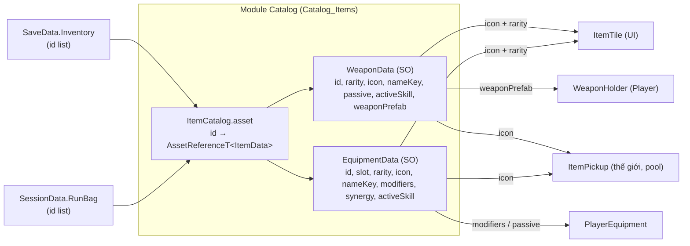
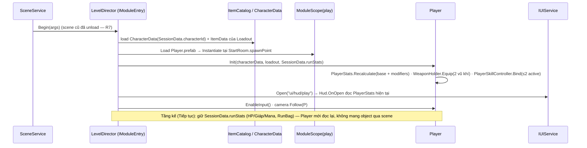
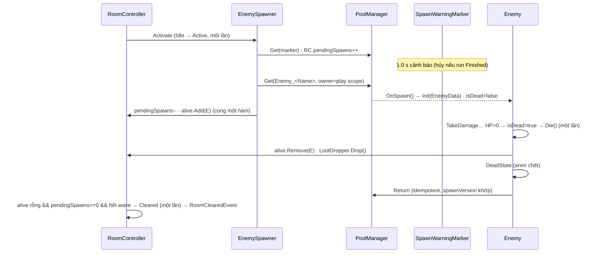

# Thực thể gameplay — Vật phẩm · Người chơi · Quái vật (dữ liệu, prefab, luồng sinh/hủy)

> Tài liệu bàn giao cho agent/session làm gameplay. Đọc trước khi dựng prefab vật phẩm, Player, quái hoặc boss.
> Cập nhật: 2026-11-04 · Unity 6.3 · URP 2D · Physics2D · Input System · DOTween.
> Liên quan: `docs/ARCHITECTURE.md` (tổng quan, dungeon, save, EventBus), `docs/WEAPONS_AND_VFX_SYSTEM.md` (vũ khí + VFX chi tiết), `docs/UI_SYSTEM.md` (ItemTile, HUD), `docs/MODULES_ADDRESSABLES_WEBGL.md` (module, Addressables, Pool §7.7, quy tắc R1–R14).
> Các mục có tiêu đề "(nguyên văn từ ARCHITECTURE §x)" được **chuyển nguyên văn** khỏi `ARCHITECTURE.md` (giữ số mục cũ để tra cứu các tham chiếu "§5.5", "§6"…).

---

## 0. TL;DR cho agent

- **Dữ liệu = ScriptableObject** (module Catalog: `CharacterData`, `WeaponData`, `EquipmentData`, `ActiveSkillSO`; module Enemies/Bosses: `EnemyData`, `EnemyAttackSO`). Prefab chỉ là "vỏ" nhận dữ liệu lúc spawn — **không** tạo prefab riêng cho từng món đồ.
- **Id ngắn là khóa chung**: `sword-ice`, `rune-book`, `knight`, `skeleton-spear`… dùng trong save, `SessionData`, `ItemCatalog`, address (`data/weapon/sword-ice`), key i18n (`sword.ice`, `item.rune_book`).
- **Mọi thứ sinh nhiều lần đi qua `PoolManager`** (MODULES §7.7): quái, đạn, VFX, loot, pickup, số sát thương. Prefab được load **một lần** từ `ModuleScope`, pool theo `owner` scope.
- **Một điểm chết duy nhất** cho mọi `IDamageable` (`Die()` chạy đúng 1 lần — R12), **một chủ sở hữu** cho mọi sự kiện "kết thúc" (`RoomController`, `LevelDirector`).
- Thứ tự spawn Player và quái ở §2.3 / §3.3 là hợp đồng: gameplay chỉ bắt đầu trong `IModuleEntry.Begin` (R7).

---

## 1. Vật phẩm (Items)

### 1.1. Tổng quan dữ liệu → hiển thị



- `ItemData` (abstract SO, base của `WeaponData`/`EquipmentData`): `string id`, `Rarity rarity`, `Sprite icon` (ô 16×16 hoặc kiếm 32×32), `string nameKey`, `string descKey` (key trong `DG_Multilanguage`), `ActiveSkillSO activeSkill` (tùy chọn), `int shopPrice`.
- `ItemCatalog` (SO, `data/catalog`): bảng `id → AssetReferenceT<ItemData>` + `GetAsync(id)` qua `ModuleScope`. Màn Lobby/Play gọi `catalog.LoadAll(ids)` một lần khi mở, không load từng món rải rác.
- Icon item gom vào **SpriteAtlas `Items`** (group `Catalog_Items`) — UI và pickup dùng chung atlas, không đánh address từng sprite.

### 1.2. Prefab vật phẩm

| Prefab | Module / group | Cấu trúc | Pool | Ghi chú |
|---|---|---|---|---|
| `ItemTile` / `ItemTileSmall` | Shared / `Shared_UI` | xem `UI_SYSTEM.md` §6.1 | pool UI theo màn | Chỉ hiển thị. |
| `ItemPickup.prefab` | Play / `Mod_Play` | `ItemPickup` (root: `CircleCollider2D` trigger r=0.5, layer `Pickup`, `IPoolable`) → `Icon` (SpriteRenderer, sorting `Items`) → `RarityGlow` (SpriteRenderer vòng màu theo rarity, nhấp nháy 2 frame) → `Shadow` | ✔ | 1 prefab cho mọi vũ khí/trang bị; `Init(ItemData)` gán icon + màu. Chạm → `RunBag.Add(id)` **một lần** (cờ `collected`, R11) → `ItemPickedUpEvent` → Toast tên món. |
| `Chest.prefab` | Play | `Chest` (`IInteractable`, cờ `opened`) → `Visual` (closed/open sprite) | ✘ (đặt sẵn trong room) | Mở → `LootSpawner.Spawn(table)`. |
| `ShopStand.prefab` | Play | `ShopStand` (`IInteractable`) → 3 `StandSlot` (icon + giá world-space) | ✘ | Interact → `IUIService.Open("ui/screen/shop", ShopContext.Run)`. |
| `Loot_Coin_Gold`, `Loot_Coin_Blue` (đã có), `Loot_ManaOrb`, `Loot_HealthPotion` | Play | `LootDrop` (trigger, `IPoolable`, DOTween nảy) → `Visual` (Animator) | ✔ | Hút về Player (magnet) — xem §1.4 nguyên văn. |

### 1.3. Luồng vòng đời một món đồ

```mermaid
sequenceDiagram
    participant Enemy as Quái / Rương
    participant LS as LootSpawner
    participant Pool as PoolManager
    participant P as ItemPickup
    participant Bag as SessionData.RunBag
    participant End as Victory/Defeat
    participant Inv as SaveData.Inventory
    Enemy->>LS: Die() / Open() → lootTable
    LS->>Pool: Get(ItemPickup, owner=play scope)
    Pool-->>P: OnSpawn() → Init(ItemData)
    P->>Bag: chạm Player → Add(id) (collected=true trước)
    P->>Pool: Return (idempotent)
    End->>Inv: "Về sảnh": settled=true → RunBag → Inventory → Save
    Note over Inv: Lobby: Loadout chọn từ Inventory (giới hạn 2 kỹ năng kích hoạt — §5.5)
```

{{A5_ITEMS}}

{{A8}}

---

## 2. Người chơi (Player)

### 2.1. Prefab

```
Player.prefab  (module Play, group Mod_Play, address "char/player-shell")
│  Rigidbody2D (Dynamic, gravity 0, Interpolate, freeze rotation), CapsuleCollider2D (layer Player)
│  PlayerInput · PlayerMovement · PlayerStats (IDamageable) · PlayerEquipment
│  PlayerSkillController · WeaponHolder · PlayerInteractor · PlayerAnimator
├─ Visual          SpriteRenderer + Animator (controller gốc; AnimatorOverrideController từ CharacterData) · SortingGroup "Characters"
├─ Shadow          SpriteRenderer (sorting "Shadows")
├─ WeaponPivot     xoay theo hướng ngắm (Auto-Aim) · flipY khi ngắm sang trái
│   └─ WeaponSocket   nơi WeaponHolder Instantiate prefab vũ khí đang cầm (WeaponData.weaponPrefab)
├─ Hurtbox         Collider2D trigger, layer PlayerHurtbox (đạn/bẫy quái chạm vào đây)
├─ InteractRange   CircleCollider2D trigger r=1.2 (PlayerInteractor)
└─ FxSockets       Feet (bụi chạy), Body (hit/heal)
```

- **Một prefab `Player` cho mọi nhân vật** (ARCHITECTURE cũ: "dùng chung 1 Prefab Player"). Khác biệt nhân vật = `CharacterData` (chỉ số, role, kỹ năng) + `AnimatorOverrideController` (hình).
- **Lobby không dùng `Player.prefab`.** Sảnh dùng `CharLobby_<id>.prefab` (module Characters, group `Characters`, address `char/<id>`): `Visual` (idle) + `Shadow` + `CharacterSpot` (collider bấm, mũi tên/giá khóa world-space). Nhẹ, không có physics/combat.

### 2.2. Lớp nhân vật & component

{{A4}}

### 2.3. Luồng spawn Player trong Play



- Chết: `PlayerStats.Die()` (một lần) → tắt input → `LevelDirector.Finish(victory:false)` (chốt một lần — R10).
- Player **không** vào pool (1 cái mỗi run); hủy cùng scene Play.

---

## 3. Quái vật (Enemies & Boss)

### 3.1. Prefab

```
Enemy_Base.prefab  (module Enemies, group Enemies_<set>)
│  Rigidbody2D (Dynamic, gravity 0, Interpolate), CircleCollider2D body (layer Enemy)
│  EnemyHealth (IDamageable, IPoolable) · EnemyBrain (FSM) · EnemyMotor (RoomPathfinder / bay thẳng)
│  EnemyAttackRunner (chạy EnemyAttackSO) · LootDropper (lootTable của EnemyData)
├─ Visual          SpriteRenderer + Animator · SortingGroup "Characters"
├─ Shadow
├─ Hurtbox         trigger, layer EnemyHurtbox (đòn của Player)
├─ AttackOrigin    điểm bắn đạn / tâm đòn cận chiến
└─ StatusFx        socket cho làm chậm/độc/đóng băng (VFX loop)
Enemy_<Name>.prefab = Prefab Variant của Enemy_Base: Visual (animator riêng) + EnemyData gán sẵn
Boss_<Id>.prefab   = Variant + BossPhaseController + thanh máu qua BossHealthChangedEvent (group Boss_<Id>)
SpawnWarningMarker.prefab (pool) · DamagePopup.prefab (world-space TMP, pool)
```

- Prefab quái hiện có: `Prefabs/Enemies/Enemy_Skeleton_Spear`, `Enemy_Skeleton_Warrior`, `Enemy_Vampire`, `Enemy_Zombie` → chuyển sang `Modules/Enemies/Dungeon/Prefabs/` thành Variant của `Enemy_Base` (MODULES §9.2).
- Layer va chạm (Physics2D matrix): `Player`↔`Enemy` (đẩy), `PlayerHurtbox`↔`EnemyProjectile`/`Trap`, `EnemyHurtbox`↔`PlayerAttack`/`PlayerProjectile`, `Pickup`↔`Player`. `Enemy`↔`Enemy` bật (tránh chồng), `EnemyProjectile`↔`Wall` bật.

### 3.2. Dữ liệu, FSM, sát thương, sinh quái, boss

{{A6}}

### 3.3. Luồng sinh → chết → trả pool



- **Prewarm**: `LevelDirector.Begin` tạo trước pool theo `DungeonConfig` (vd 8 Skeleton, 6 Zombie, 30 đạn, 20 coin) để không giật khi phòng đầu tiên mở.
- Boss: prefab `Boss_<Id>` tải nền (label `boss-<id>`, MODULES §7.6); phòng boss chờ có timeout. Boss không qua pool (1 lần/tầng).

---

## 4. Checklist dựng prefab

1. Root đúng module/thư mục (MODULES §9.1), component theo cây §1.2/§2.1/§3.1, layer + sorting đúng §3.1.
2. Dữ liệu từ SO, không hard-code chỉ số trong prefab. Tên hiển thị = key i18n.
3. Có `IPoolable` nếu sinh nhiều lần: `OnSpawn` reset (`isDead`, `collected`, `isLive`, timer, `spawnVersion++`), `OnDespawn` dọn (`DOTween.Kill`, `StopAllCoroutines`, velocity 0).
4. Mọi đường gây sát thương/chết/nhặt đồ có cờ chống lặp (R11–R13).
5. Đánh address + label (MODULES §6.2), chạy Analyze không trùng.
6. Test PlayMode: spawn 50 lần trả pool 50 lần không rò; giết bằng 2 nguồn cùng frame chỉ rơi loot 1 lần.
