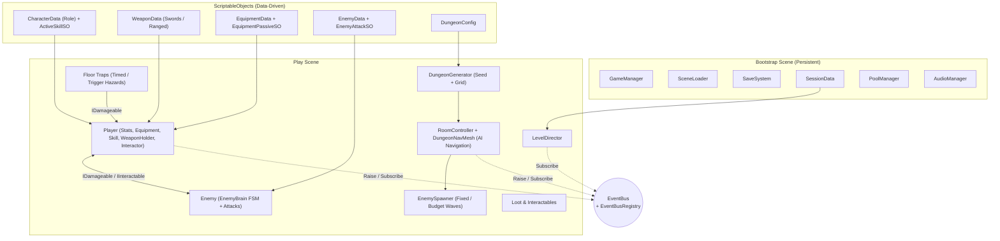

# Dungeon Gathering – Thiết kế hệ thống

> Unity 6.3 · URP 2D · Tilemap + Tilemap Extras · Cinemachine 3 · Input System · DOTween

**Bản đồ tài liệu** (file này là tổng quan; chi tiết nằm ở các file chuyên đề — mục lục đầy đủ: `docs/README.md`):

| Chủ đề | File |
|---|---|
| Tổng quan, scene, dungeon & pathfinding, bẫy, save, EventBus, thư mục, lộ trình | **file này** |
| UI: scene ↔ canvas, `UIRoot`, co giãn 1280×720 + pixel snap, neo từng màn, luồng prefab UI, `ItemTile`, đa ngôn ngữ | `docs/UI_SYSTEM.md` |
| Vật phẩm, người chơi, quái vật/boss: dữ liệu SO, cấu trúc prefab, luồng sinh → chết → pool | `docs/ENTITIES_PREFABS.md` |
| Vũ khí & VFX chi tiết | `docs/WEAPONS_AND_VFX_SYSTEM.md` |
| Module, Addressables, WebGL/itch.io, service Core, quy tắc async R1–R14 | `docs/MODULES_ADDRESSABLES_WEBGL.md` |

## Sơ đồ tổng quan kiến trúc



---

## 1. Scene và Camera

> **Phát hành: WebGL trên itch.io** (game cá nhân). **Build WebGL theo module:** chỉ `Bootstrap` nằm trong Build Settings; Menu/Lobby/Play và mọi prefab/SO tải qua **Addressables** (load scene **Additive**, mỗi module một group + label + asmdef). Chi tiết, hợp đồng C# (`IAssetService`, `ModuleScope`, `ISceneService`, `IUIService`), bảng thiết kế → prefab → address và lộ trình M0–M9: **`docs/MODULES_ADDRESSABLES_WEBGL.md`** (tài liệu bàn giao — đọc trước khi làm scene/prefab).

```
Bootstrap (persistent): GameManager · SceneLoader · AudioManager · SaveSystem · SessionData · PoolManager
Menu  → logo + Tap to play
Lobby → Player, Portal (giữ DungeonConfig), NPC shop/chọn nhân vật
Play  → DungeonGenerator + LevelDirector, Main Camera (Cinemachine + Pixel Perfect), Canvas HUD (Overlay)
```

| Scene | Vai trò |
|---|---|
| **Bootstrap** | Load đầu tiên, sống suốt game. Giữ các manager toàn cục. |
| **Menu** | Chỉ có UI: logo + "Tap to play", rồi gọi `SceneLoader.Load(Lobby)`. |
| **Lobby** | Sảnh kiểu Soul Knight: các nhân vật đứng tự do trong phòng (anim idle). Bấm nhân vật → panel thông tin + nút **Trang bị** / **Vũ khí**; NPC **Thương nhân** mở Shop sảnh. Chọn nhân vật rồi bước vào Portal thì ghi loadout + `DungeonConfig` vào `SessionData` và `Load(Play)`. |
| **Play** | `LevelDirector` đọc `SessionData` và sinh dungeon. Có HUD. |

- **GameManager**: state machine `Menu` / `Lobby` / `Playing` / `Paused` / `Victory` / `GameOver`.
- **SceneLoader** (= `ISceneService` trong tài liệu module): tải trước label của module đích qua Addressables, load scene Additive + màn loading %, unload scene cũ, release handle (`ModuleScope`) và dọn pool khi chuyển scene.
- **AudioManager**: BGM/SFX qua `AudioMixer`.
- **PoolManager**: quản lý tập trung `Dictionary<int, ObjectPool<GameObject>>` (key theo `prefab.GetInstanceID()`) cho đạn, VFX chém/nổ, quái, vật phẩm rơi (Loot), cảnh báo spawn và số sát thương (Damage Popup).
- **SessionData**: dữ liệu của run hiện tại (lớp nhân vật đã chọn, HP/Giáp/Mana hiện tại, tầng đang chơi, vàng trong run, 2 vũ khí đang cầm, danh sách trang bị đang mặc...).
- Để Play được từ bất kỳ scene nào trong Editor: dùng `[RuntimeInitializeOnLoadMethod(RuntimeInitializeLoadType.BeforeSceneLoad)]` để tự khởi tạo Bootstrap nếu nó chưa có.

**Camera:** chỉ dùng 1 camera thế giới (`Main Camera` + `Cinemachine` + `Pixel Perfect`). Toàn bộ UI nằm trong **một** Canvas `Screen Space – Overlay` (`UIRoot` trong Bootstrap, `PixelSnapCanvasScaler` 1280×720 Expand) — chi tiết `docs/UI_SYSTEM.md` §1–§3. Mỗi room có `CinemachineConfiner2D` để giới hạn camera không lố ra ngoài phòng.

### 1.1. Luồng màn hình (UI flow)

> **Đã chuyển** sang `docs/UI_SYSTEM.md` — §10 (nguyên văn), cùng scene↔UI (§1), `UIRoot` (§2), co giãn 1280×720 + pixel snap (§3), bảng neo từng màn (§4), luồng prefab UI (§5).

---

## 2. Dungeon ghép phòng ngẫu nhiên & Tìm đường (Pathfinding)

### Room Template (prefab)
- `Grid` → các Tilemap: `Ground`, `Wall` (`TilemapCollider2D` + `CompositeCollider2D`), `Decor`, `Traps`.
- `RoomTemplate` component gồm:
  - Kích thước phòng (nằm gọn trong giới hạn `MaxRoomSize`, ví dụ tối đa `32×32` trên ô lưới `40×40`).
  - Loại phòng: `Start` / `Combat` / `Treasure` / `Shop` / `Boss`.
  - **Door Socket** ở 4 hướng `N` / `E` / `S` / `W`: bắt buộc nằm chính giữa mỗi cạnh (`x = 0` với cửa N/S, `y = 0` với cửa E/W) để hành lang giữa 2 ô kề nhau luôn thẳng trục.
  - Danh sách `SpawnPoint` cho quái, vị trí đặt rương/shop.
  - Cấu hình Wave (`Fixed Waves` hoặc `Use Spawn Budget`).

### DungeonConfig (ScriptableObject, mỗi tầng một file)
- Số lượng phòng chính và nhánh phụ, kích thước ô lưới (`cellSpacing`).
- Pool `RoomTemplate` theo từng loại phòng.
- Bộ `RuleTile` theo theme (tường, sàn, hành lang, cửa đóng/mở).
- Bảng quái (`EnemySpawnEntry`: `EnemyData` + trọng số/điểm `cost`), ngân sách độ khó (`spawnBudget`), và Boss của tầng.

### DungeonGenerator (chạy theo seed)
1. Random walk trên một lưới thô (ví dụ `5×5` ô) để tạo đường chính dài `N` phòng, rồi thêm 1–2 nhánh phụ.
2. Phòng xa `Start` nhất là `Boss`. `Treasure` và `Shop` đặt ở cuối các nhánh phụ.
3. Với mỗi ô, chọn một `RoomTemplate` tương ứng loại phòng và instantiate tại `cell × spacing`.
4. Với các hướng có phòng hàng xóm: vẽ hành lang nối trực tiếp giữa 2 Door Socket đối diện vào tilemap `Corridor` bằng `RuleTile`. Với các hướng không có hàng xóm: bịt kín Door Socket bằng tile tường.

Dùng `seed` nên có thể tái hiện chính xác bất kỳ map nào khi cần debug.

### LevelDirector, RoomController và NavMesh của quái
- **RoomController**:
  - Khi Player bước qua vạch cửa vào phòng `Combat` chưa dọn: khóa toàn bộ cửa phòng và kích hoạt `EnemySpawner`.
  - Dọn hết toàn bộ wave quái thì mở cửa, hút toàn bộ vàng/mana trong phòng về Player, có thể thưởng thêm rương vũ khí/trang bị và bắn `RoomClearedEvent`.
  - **Trạng thái phòng chỉ đi một chiều**: `Idle → Active → Cleared`. Vạch cửa là trigger có thể nhận `OnTriggerEnter2D` nhiều lần (nhiều collider của Player, ra/vào liên tục) → chỉ kích hoạt khi đang `Idle`; `Cleared` chỉ vào một lần (một lần mở cửa, một `RoomClearedEvent`, một lần thưởng).
  - **Đếm quái bằng tập, không bằng số**: `HashSet<Enemy> alive` + `int pendingSpawns` (quái đang trong 1s `SpawnWarning`) + `bool wavesRemaining`. Phòng chỉ dọn xong khi cả ba đều rỗng/0 — tránh mở cửa trong khoảng nghỉ giữa hai wave hoặc khi một con quái báo chết 2 lần (`docs/MODULES_ADDRESSABLES_WEBGL.md` §7.8 R12). Quái con do `SummonAttackSO` gọi ra cũng đăng ký vào `alive`.
- **DungeonNavMesh (AI Navigation, mặt phẳng XY)**:
  - Khi phòng `Combat` kích hoạt, `RoomController` quét Tilemap `Wall` trong phạm vi phòng để tạo lưới 2D nhỏ (`walkableGrid`, ví dụ `32×32`).
  - Sau khi `DungeonBuilder` dựng tầng, `DungeonNavMesh` nướng một NavMesh runtime từ Tilemap: ô sàn (ground phòng + hành lang) trừ ô tường, gộp thành dải hộp `NavMeshBuildSource`, gắn qua `NavMeshSurface` xoay -90° quanh X.
  - Quái đi bộ dùng `NavMeshAgent` (`updatePosition = false`, đặt lại đích mỗi `0.25s–0.4s`) chỉ để lấy hướng đi + né nhau; vị trí vẫn do `Rigidbody2D` (knockback/charge/va chạm giữ nguyên). Quái bay (`isFlying = true`) hoặc khi chưa có NavMesh thì đi thẳng.
- **LevelDirector**: điều phối luồng tầng chơi; khi hạ Boss xong thì mở `Portal` sang tầng tiếp theo hoặc hoàn thành run.
  - **Chốt kết quả run đúng một lần** (§7.8 R10): `RunState { Playing, Finished }`. Boss chết và Player chết có thể xảy ra trong cùng frame (đạn/bẫy/DoT còn sót, đòn phản sát thương). Ai gọi `LevelDirector.Finish(victory)` trước thì thắng; lần gọi sau bị bỏ qua. Chỉ `LevelDirector` được `Raise(RunFinishedEvent)`.
  - Ngay khi `Finished`: Player bất tử, tắt input chiến đấu, xóa đạn của quái + tắt bẫy trong phòng, dừng spawner — để không có sát thương nào đến sau khi đã chốt.

---

## 3. Tool tạo map (Editor)

| Tool | Chức năng |
|---|---|
| **Tile Palette + RuleTile theo theme** | Vẽ tường và sàn tự nối. Mỗi theme (rừng, hầm ngục, băng...) có một bộ `RuleTile` riêng. |
| **Room Builder (`EditorWindow`)** | Bấm "New Room" là tạo prefab có sẵn đủ `Grid` và các layer Tilemap đúng chuẩn. Kéo Door Socket, `SpawnPoint` và bẫy trực tiếp trong Scene view (có Gizmo). Có nút **Validate**: kiểm tra kích thước không vượt `MaxRoomSize`, cửa nằm đúng chính giữa mép (`x=0` hoặc `y=0`), có collider tường, và có ít nhất 1 `SpawnPoint`. |
| **Dungeon Preview (`EditorWindow`)** | Chọn `DungeonConfig`, nhập `seed` rồi bấm **Generate** để xem trước toàn bộ map + hành lang ngay trong Editor, không cần vào Play Mode. |

---

## 4. Hệ thống Lớp nhân vật, Role, Chỉ số & Kỹ năng (Player & Classes)

> **Đã chuyển** sang `docs/ENTITIES_PREFABS.md` §2 (nguyên văn + prefab `Player` + luồng spawn).

Các mục con (giữ số để tra cứu):
- CharacterRole & CharacterData (SO)
- Các Component trên Player

---

## 5. Hệ thống Vũ khí, Trang bị theo Role & VFX Chiến đấu

> **Đã chuyển** sang `docs/ENTITIES_PREFABS.md` §1 (nguyên văn). Riêng **5.4 Ô vật phẩm (`ItemTile`)** sang `docs/UI_SYSTEM.md` §6.1.

Các mục con (giữ số để tra cứu):
- 5.1. Vũ khí chiến đấu trong Dungeon (`WeaponData`)
- 5.1.1. Hệ thống phân bậc vũ khí (Weapon Rarity & Tier System)
- 5.2. Hệ thống Trang bị & Hiệu ứng Role Synergy (`EquipmentData`)
- 5.3. Quy chuẩn cắt Sprite cho Vũ khí, Trang bị & VFX
- 5.4. Ô vật phẩm theo Rarity (UI)
- 5.5. Giới hạn kỹ năng kích hoạt (Loadout Active Limit)

---

## 6. Hệ thống Quái vật, Sinh quái & Boss

> **Đã chuyển** sang `docs/ENTITIES_PREFABS.md` §3 (nguyên văn + prefab quái/boss + luồng sinh → chết → pool).

Các mục con (giữ số để tra cứu):
- EnemyData & Đòn tấn công dạng Module (`EnemyAttackSO`)
- `IDamageable` & chống chết nhiều lần
- Hệ thống Sinh quái (`EnemySpawner`)
- Boss

---

## 7. Hệ thống Bẫy sàn (Floor Traps & Hazards)

Các bẫy được đặt trên layer `Traps` trong `RoomTemplate` và kế thừa từ `TrapBase`:

- **Bẫy theo chu kỳ (`TimedTrap`)**:
  - Ví dụ: **Bẫy gai thò thụt (`SpikeTrap`)**, bẫy phun lửa theo nhịp.
  - Chu trình trạng thái rõ ràng: `Inactive` → `Warning` (lộ đầu gai báo hiệu `0.5s`) → `Active` (gây sát thương qua `IDamageable`) → lặp lại.
- **Bẫy cảm biến & Vùng hiệu ứng (`TriggerTrap` / `HazardZone`)**:
  - Bẫy gai cảm biến: khi có đối tượng dẫm lên sẽ chuyển sang `Warning` ngắn rồi đâm lên.
  - Sàn nguyên tố (Độc / Lửa / Băng): gây sát thương theo nhịp (Damage over Time) hoặc làm chậm khi đứng trên đó.
- Mỗi bẫy có `TargetLayerMask` để cấu hình chỉ gây sát thương cho Player hay gây sát thương cho cả Player và Quái.

---

## 8. Hệ thống Tương tác (`IInteractable`) & Vật phẩm rơi (`LootDrop`)

> **Đã chuyển** sang `docs/ENTITIES_PREFABS.md` §1 (nguyên văn + prefab pickup/rương/loot).

Các mục con (giữ số để tra cứu):
- Tương tác (`IInteractable`)
- Vật phẩm rơi (`LootDrop`)

---

## 9. Lưu game (Save System)

- **SaveData (POCO)**:
  - `version`
  - Tiền tệ vĩnh viễn (`gems` / vàng tích lũy ở sảnh)
  - Danh sách nhân vật đã mở khóa và cấp độ nâng cấp
  - Bộ sưu tập vũ khí & trang bị đã khám phá
  - Kho đồ (`Inventory`: vũ khí + trang bị sở hữu) và loadout theo từng nhân vật (2 vũ khí + 6 ô trang bị)
  - `SettingsData` (âm lượng BGM/SFX, bật/tắt Auto-Aim, rung)
  - Thống kê (`totalRuns`, `highestLevelReached`, `totalKills`)
- **SaveSystem** (trong Bootstrap):
  - Ghi JSON vào `Application.persistentDataPath` (**trên WebGL/itch.io: thư mục IDBFS cố định `/idbfs/dungeon-gathering/` + `FS.syncfs`, vì itch đổi URL mỗi bản upload — xem `docs/MODULES_ADDRESSABLES_WEBGL.md` §10.2**), ghi ra file tạm (`.tmp`) trước rồi mới thay thế file chính (Atomic Write) để tránh hỏng file save.
  - Lưu khi kết thúc run, khi mở khóa/nâng cấp ở Lobby, khi đổi Settings, và khi `OnApplicationPause(true)` trên thiết bị di động (trên WebGL thay bằng `visibilitychange`/`pagehide` qua `.jslib`, vì `OnApplicationPause` không chạy chắc chắn khi đóng tab).
  - **Một lần ghi tại một thời điểm**: các lần lưu sát nhau (vd kết thúc run + đổi Settings) được gộp — tối đa 1 lần đang ghi + 1 lần chờ mang bản mới nhất. Không gọi `FS.syncfs` chồng nhau. Thay file theo `.tmp → .bak → save.json` để luôn còn một bản hợp lệ; chi tiết + xử lý mở 2 tab: `docs/MODULES_ADDRESSABLES_WEBGL.md` §10.2.
  - Settings kéo slider: lưu khi thả tay (hoặc debounce ~0.5s), không lưu mỗi frame.
- Dữ liệu của run hiện tại (HP, Giáp, Mana, 2 vũ khí đang cầm, các trang bị đang mặc, tầng đang chơi, coin của run, `RunBag`) nằm trong **SessionData** và không ghi ra file.
- Khi **Về sảnh** từ màn Chiến thắng: coin run được quy đổi và `RunBag` chuyển vào `Inventory`. **Tiếp tục**: giữ nguyên `SessionData` sang tầng kế. Quy tắc giữ/mất đồ khi **thua**: chưa chốt.
- **Quy đổi đúng một lần**: `SessionData.settled` (bool). Hàm quy đổi kiểm tra và đặt `settled = true` **trước** khi cộng coin/chuyển `RunBag`, rồi lưu, rồi mới `SceneService.Go(scene/lobby)`. Bấm "Về sảnh" 2 lần, hoặc bấm "Về sảnh" rồi "Tiếp tục", không cộng 2 lần (nút cũng khóa ngay khi bấm — §7.3 của tài liệu module). `settled` reset khi bắt đầu run mới.

---

## 10. EventBus (C# static + Auto Reset)

```csharp
public interface IEvent {}

public static class EventBusRegistry
{
    static readonly HashSet<Action> clearActions = new();
    public static void Register(Action clearAction) => clearActions.Add(clearAction);

    [RuntimeInitializeOnLoadMethod(RuntimeInitializeLoadType.SubsystemRegistration)]
    static void ResetAll()
    {
        foreach (var clear in clearActions) clear.Invoke();
        clearActions.Clear();
    }
}

public static class EventBus<T> where T : struct, IEvent
{
    static event Action<T> handlers;

    public static void Subscribe(Action<T> h)
    {
        handlers += h;
        EventBusRegistry.Register(Clear);
    }

    public static void Unsubscribe(Action<T> h) => handlers -= h;
    public static void Raise(T e)
    {
        var list = handlers;            // snapshot: Subscribe/Unsubscribe trong handler không ảnh hưởng lần Raise này
        if (list == null) return;
        foreach (Action<T> h in list.GetInvocationList())
        {
            try { h(e); }
            catch (Exception ex) { Debug.LogException(ex); } // một handler lỗi không chặn các handler còn lại
        }
    }
    internal static void Clear()                => handlers = null;
}

public struct PlayerStatsChangedEvent : IEvent { public int Hp, MaxHp, Armor, MaxArmor, Mana, MaxMana; }
public struct EquipmentChangedEvent   : IEvent { public EquipmentSlotType Slot; }
public struct RoomClearedEvent        : IEvent { public int RoomId; }
public struct BossHealthChangedEvent  : IEvent { public string BossName; public int Current, Max; }
public struct WeaponSwappedEvent      : IEvent { public int ActiveSlot; }
public struct ItemPickedUpEvent       : IEvent { public string ItemId; }
public struct ActiveSkillUsedEvent    : IEvent { public int SlotIndex; public float Cooldown; }
public struct RunFinishedEvent        : IEvent { public bool Victory; public int Floor; }
```

Quy tắc bắt buộc:
- Luôn `Subscribe` trong `OnEnable` và `Unsubscribe` trong `OnDisable`.
- `EventBusRegistry.ResetAll()` tự động xóa toàn bộ các `EventBus<T>` đã đăng ký tại `SubsystemRegistration`, an toàn khi bật **Fast Enter Play Mode (No Domain Reload)** trong Unity 6. (Việc này chỉ xóa subscriber; Awaitable/coroutine còn chạy từ lần Play trước phải tự dừng bằng `destroyCancellationToken` — §7.8 R14 của tài liệu module.)
- **Sự kiện không "dính" (not sticky)**: subscriber đăng ký sau thời điểm `Raise` sẽ không nhận lại. Thành phần tải async (HUD, màn Results) phải **đọc trạng thái hiện tại khi mở** rồi mới nghe sự kiện (§7.8 R7). Gameplay của scene chỉ bắt đầu Raise sau khi `SceneService` gọi `IModuleEntry.Begin` (scene cũ đã unload, không còn subscriber cũ).
- Handler phải chạy **đồng bộ và nhanh**: không `await` trong handler rồi đụng trạng thái chung; cần việc async thì handler chỉ đặt cờ/bắt đầu tác vụ có guard riêng (vd `UIService.Open` có chống mở trùng).
- `Raise` lồng nhau (handler của A lại Raise A) bị cấm; Raise B từ handler của A được phép nhưng không được giả định thứ tự giữa các subscriber.
- Một handler ném exception sẽ chặn các handler sau trong `Invoke`. `Raise` duyệt `GetInvocationList()` và bọc từng handler bằng `try/catch` + `Debug.LogException`.
- Sự kiện mang ý nghĩa "kết thúc" (`RunFinishedEvent`, `RoomClearedEvent`) chỉ được Raise bởi một chủ sở hữu duy nhất (`LevelDirector`, `RoomController`) và tối đa một lần cho mỗi run/phòng.

---

## 11. Cấu trúc thư mục & Assembly Definition

> Cây dưới đây là bố cục **cũ theo loại asset** (chỉ còn để tra cứu). Bố cục **thực tế theo module** (`Assets/Project/Core`, `Shared`, `Scripts/<Module>/` — mỗi module 1 asmdef, vd `Scripts/Play/Project.Play.asmdef`; thư mục `Modules/` cũ đã bỏ 2026-11-05), danh sách asmdef + đồ thị phụ thuộc và bảng di chuyển asset hiện có nằm ở `docs/MODULES_ADDRESSABLES_WEBGL.md` §8–§9; khi hai nơi khác nhau, **theo tài liệu module**.

```
Assets/Project/
  Scenes/    Bootstrap, Menu, Lobby, Play
  Scripts/   Project.Runtime.asmdef
             Core/          (EventBus, SaveSystem, SceneLoader, PoolManager, SessionData)
             Player/        (PlayerInput, PlayerMovement, PlayerStats, PlayerSkillController, PlayerInteractor, CharacterData, Skills/)
             Combat/        (WeaponBase, RangedWeapon, MeleeWeapon, WeaponHolder, Projectile, VFXPlayer, IDamageable)
             Equipment/     (EquipmentData, EquipmentPassiveSO, PlayerEquipment, StatModifier, Passives/)
             Enemy/         (EnemyBrain, States/, Attacks/ [EnemyAttackSO], Boss/, EnemySpawner)
             Dungeon/       (DungeonGenerator, RoomTemplate, RoomController, DungeonNavMesh, LevelDirector, Traps/)
             Interaction/   (IInteractable, Portal, Chest, WeaponPickup, EquipmentPickup, ShopStand, Loot/)
             Inventory/     (Inventory, RunBag, Loadout, LoadoutRules, Rarity)
             Localization/  (GameLanguage, LocalizedTMPText, LocalizationLookup, LocalizationFontConfig, LanguageButton)
             UI/            (HUDController, VirtualJoystick, ItemTile, LobbyCharacterPanel, EquipmentScreen, WeaponScreen,
                             ShopScreen, VictoryScreen, DefeatScreen, BossHealthBar, Minimap, Menus/)
             Audio/         (AudioManager)
  Editor/    Project.Editor.asmdef
             RoomBuilderWindow, DungeonPreviewWindow, RoomValidator
  Prefabs/   Player/  Enemies/  Weapons/  Projectiles/  VFX/  Rooms/<Theme>/  Traps/  Loot/  UI/
  Data/      Characters/  Skills/  Weapons/  Equipment/  EquipmentPassives/  DungeonConfigs/  Enemies/  EnemyAttacks/
  Art/       Sprites/ (Characters/, Enemies/, Environment/, Items/, Traps/, UI/, VFX/)
             Tiles/<Theme>/  Animations/  Fonts/
  Audio/     BGM/  SFX/
  Localization/  LocalizationSettings, Locales/ (en, vi), Tables/ (DG_Multilanguage), Resources/LocalizationFontConfig

Design/      (ngoài Assets, Unity không import)
  canvas/project/   bản thiết kế UI dạng *.dc.html + canvas.json
  cuts/             sprite đã cắt/ghép cho bản thiết kế + blob-map.json
  tools/            script Python (Pillow) cắt sprite, dựng map minh họa
  maps/             ảnh map minh họa (để sau)
  localization/     strings_src.py (nguồn chuỗi key/en/vi) → DG_Multilanguage.csv
```

---

## 12. Thứ tự triển khai (Vertical Slice)

> Hạ tầng module/Addressables/WebGL đi theo lộ trình **M0–M9** trong `docs/MODULES_ADDRESSABLES_WEBGL.md` §11 (làm M0–M2 trước bước 1 dưới đây, vì mọi prefab mới phải nằm đúng module/group ngay từ đầu).

1. **Core**: `Bootstrap`, `EventBus` (+ `EventBusRegistry`), `SceneLoader`, `PoolManager`, `SessionData`.
2. **Player, Vũ khí (Kiếm & Tầm xa) & Trang bị theo Role**:
   - `CharacterData` (có `CharacterRole`), `PlayerMovement`, `PlayerStats` (HP/Giáp/Mana + tổng hợp `StatModifier`).
   - `MeleeWeapon` (kiếm từ `File.png` + vệt chém `VFX_Melee_*`) & `RangedWeapon` (súng/pháp trượng từ `Weapons 1..3-Sheet` + đạn `Projectiles/`).
   - `EquipmentData` + `PlayerEquipment` (mặc trang bị từ `spritesheet_16x16.png`, kiểm tra đúng Role thì kích hoạt `EquipmentPassiveSO`, khác Role chỉ cộng chỉ số).
3. **Room & Bẫy**: 1 `RoomTemplate` + `RoomBuilderWindow` / `RoomValidator` + Bẫy sàn (`TimedTrap` / `TriggerTrap`).
4. **Enemy, NavMesh & Sinh quái**: `DungeonNavMesh` + `NavMeshAgent` (AI Navigation), `EnemyBrain` + `EnemyAttackSO`, `EnemySpawner` (Fixed/Budget + Warning) và `RoomController`.
5. **Tương tác & Loot**: `IInteractable` (`WeaponPickup`, `EquipmentPickup`, `Chest`, `Portal`) và `LootDrop` (Vàng/Mana bay hút về Player).
6. **DungeonGenerator**: sinh map ngẫu nhiên theo seed, nối hành lang `Corridor` bằng `RuleTile` + `DungeonPreviewWindow`.
7. **Boss**: `BossPhaseController`, các pattern `EnemyAttackSO` của Boss và thanh máu Boss trên HUD.
8. **Lobby & Save**: sảnh với nhân vật đứng tự do + panel nhân vật, màn Trang bị / Vũ khí (`Inventory`, `Loadout`, giới hạn 2 kỹ năng kích hoạt), Thương nhân, màn Chiến thắng / Thua; lưu/đọc tiến trình qua `SaveSystem`.

Làm theo thứ tự này thì sau mỗi bước đều có bản build chơi thử được ngay và kiểm chứng được từng hệ thống.

---

## 13. Đa ngôn ngữ (Localization)

> **Đã chuyển** sang `docs/UI_SYSTEM.md` §7 (nguyên văn).

