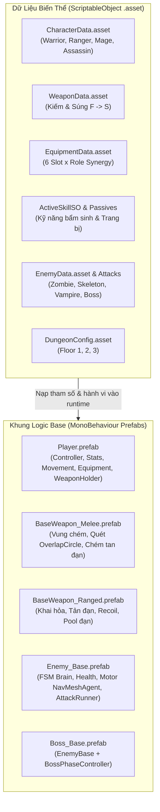

# Hệ Thống Dữ Liệu Data-Driven & Đặc Tả Mẫu Dữ Liệu (Data System)

> Đồng bộ 100% với `docs/ARCHITECTURE.md`, `docs/WEAPONS_AND_VFX_SYSTEM.md`, `docs/ENTITIES_PREFABS.md` và `docs/CODE_STRUCTURE.md`.  
> Nền tảng: Unity 6.3 · URP 2D · Addressables · ScriptableObject Data-Driven.

---

## 1. Triết Lý Thiết Kế: Base C# kết hợp Data-Driven ScriptableObject

Hệ thống phân tách triệt để giữa **Khung logic vận hành (Base C# MonoBehaviour)** và **Dữ liệu cấu hình / Biến thể (ScriptableObject .asset)**:



* **Không sinh mã C# thừa:** Không tạo class riêng cho từng thanh kiếm (ví dụ không có `IceSword.cs` hay `FireSword.cs`), không tạo class riêng cho từng quái (không có `Zombie.cs` hay `Skeleton.cs`).
* **Mọi khác biệt đều là Data:** Tốc độ, sát thương, bán kính, hình ảnh sprite, hoạt ảnh animator, hiệu ứng VFX, âm thanh, đạn bay, kỹ năng kích hoạt đều được đặc tả trong file `.asset`.

---

## 1.1. Chuẩn Hóa Enum & Công Thức Tính Chỉ Số (Core Contracts)

### 1. Quy định thứ tự Enum CharacterRole (Đã đồng bộ)
Tránh lỗi default(enum) = 0 trong C# biến mọi struct/field chưa gán thành Warrior:
`csharp
public enum CharacterRole
{
    Any = 0,        // Thích hợp mọi Role (mặc định cho trang bị phổ thông)
    Warrior = 1,    // Chiến binh / Kỵ sĩ: Cận chiến, giáp dày, càn lướt
    Ranger = 2,     // Xạ thủ: Tầm xa, tốc độ, chí mạng
    Mage = 3,       // Pháp sư: Phép thuật, mana dồi dào
    Assassin = 4    // Sát thủ: Bạo kích, tốc đánh cao, cơ động
}
`

### 2. Quy định thứ tự Rarity & Helper so sánh an toàn
Enum Rarity xếp từ mạnh nhất đến yếu nhất (S=0 đến F=4) để phục vụ thuật toán giáng cấp rơi đồ (or (int r = (int)rarity; r <= (int)Rarity.F; r++)). Khuyến khích sử dụng RarityExtensions thay vì toán tử < hoặc >:
`csharp
public enum Rarity { S = 0, A = 1, B = 2, C = 3, F = 4 }

// Sử dụng:
if (weapon.rarity.IsHigherThan(Rarity.B)) { /* S hoặc A */ }
if (item.rarity.IsAtLeast(Rarity.C))      { /* F không thỏa mãn */ }
`

### 3. Công thức tính chỉ số chiến đấu cuối cùng (WeaponBase.cs:10)
Khi nhân vật cầm vũ khí tham chiến:
* **Sát thương phát ra:** FinalDamage = weapon.damage * owner.AttackDamage * empowerMultiplier
* **Tốc độ vung kiếm / Khai hỏa:** FinalFireRate = weapon.fireRate * owner.AttackSpeed
* **Tỉ lệ chí mạng:** FinalCritChance = Mathf.Clamp01(weapon.critBonus + owner.CritChance) (Sát thương bạo kích nhân 2.0x)
* **Tổng hợp chỉ số nhân vật qua StatSheet:** StatValue = (Base + ΣFlat) * (1 + ΣPercent)

### 4. Quy ước nạp ItemCatalog cho WebGL
ItemCatalog.asset gom trực tiếp List<ItemData> items và List<CharacterData> characters cùng group Catalog_Items. Màn Lobby và Play nạp nguyên catalog 1 lần qua ItemCatalog.LoadAsync(scope) và truy xuất đồng bộ GetItem(id) / GetCharacter(id), loại bỏ hoàn toàn độ trễ async không cần thiết trên trình duyệt.

---

## 2. Đặc Tả Chi Tiết & Mẫu Dữ Liệu (Sample Data)

### 2.1. Nhóm 1: Class Nhân Vật (`CharacterData`)
* **Khung Base C#:** `PlayerController.cs`, `PlayerStats.cs`, `PlayerMovement.cs`, `PlayerSkillController.cs`, `WeaponHolder.cs` trên `Player.prefab`.
* **Thư mục lưu trữ:** `Assets/Project/Data/Characters/`

```yaml
# Mẫu 1: Hiệp Sĩ (Warrior) - Char_Warrior_Knight.asset
characterId: "knight"
nameKey: "char.knight.name"          # "Hiệp Sĩ"
descKey: "char.knight.desc"          # "Chiến binh càn lướt, giáp dày, chuyên cận chiến."
role: Warrior
unlockPrice: 0                       # Nhân vật mặc định mở khóa sẵn
portrait: "Art/Sprites/Characters/Knight/Hero_Knight_Blue_Portrait.png"
animator: "Knight_AnimatorController"
baseStats:
  maxHp: 100
  maxArmor: 5                        # Giáp kiểu Soul Knight: Trừ giáp trước, hết giáp trừ HP
  maxMana: 120
  attackDamage: 0                    # Chỉ số cộng thêm vào vũ khí
  attackSpeed: 1.0                   # Hệ số tốc đánh cơ bản
  moveSpeed: 4.5                     # Tốc độ chạy (m/s)
  critChance: 0.05                   # 5% tỉ lệ chí mạng cơ bản
armorRegenDelay: 4.0                 # 4 giây không bị đánh thì bắt đầu hồi giáp
armorRegenRate: 1.5                  # Hồi 1.5 giáp mỗi giây
manaRegen: 2.0                       # Tự hồi 2 mana mỗi giây
startingWeapon: "Weapon_Sword_Iron"  # Kiếm sắt khởi đầu
activeSkill: "Skill_ShieldCharge"    # Lướt húc đẩy lùi & hồi giáp
```

```yaml
# Mẫu 2: Xạ Thủ (Ranger) - Char_Ranger_Hunter.asset
characterId: "ranger"
nameKey: "char.ranger.name"          # "Xạ Thủ"
role: Ranger
unlockPrice: 500
baseStats:
  maxHp: 70
  maxArmor: 3
  maxMana: 150
  moveSpeed: 5.2                     # Cơ động cao
  critChance: 0.15                   # 15% chí mạng
armorRegenDelay: 3.5
armorRegenRate: 1.0
manaRegen: 2.0
startingWeapon: "Weapon_Gun_Pistol"  # Súng lục khởi đầu
activeSkill: "Skill_VolleyShot"      # Bắn tỏa chùm 7 tia đạn
```

```yaml
# Mẫu 3: Pháp Sư (Mage) - Char_Mage_Priest.asset
characterId: "mage"
nameKey: "char.mage.name"            # "Pháp Sư"
role: Mage
unlockPrice: 1000
baseStats:
  maxHp: 60
  maxArmor: 2
  maxMana: 220                       # Năng lượng dồi dào
  moveSpeed: 4.2
  critChance: 0.05
armorRegenDelay: 4.5
armorRegenRate: 1.0
manaRegen: 5.0                       # Tự hồi mana rất nhanh (5/s)
startingWeapon: "Weapon_Staff_Thunder"
activeSkill: "Skill_ArcaneNova"      # Vòng xoáy nổ phép diện rộng
```

```yaml
# Mẫu 4: Sát Thủ (Assassin) - Char_Assassin_Rogue.asset
characterId: "assassin"
nameKey: "char.assassin.name"        # "Sát Thủ"
role: Assassin
unlockPrice: 1500
baseStats:
  maxHp: 75
  maxArmor: 3
  maxMana: 140
  attackSpeed: 1.2                   # Tốc đánh nhanh hơn 20%
  moveSpeed: 5.5                     # Tốc chạy nhanh nhất
  critChance: 0.20                   # 20% chí mạng khởi điểm
armorRegenDelay: 3.0
armorRegenRate: 1.0
manaRegen: 3.0
startingWeapon: "Weapon_Sword_Thorn"
activeSkill: "Skill_ShadowBlink"     # Lướt tàng hình qua quái
```

---

### 2.2. Nhóm 2: Hệ Thống Vũ Khí Đánh Gần & Đánh Xa (`WeaponData`)
* **Khung Base C#:** `WeaponBase.cs` $\rightarrow$ phân nhánh `MeleeWeapon.cs` và `RangedWeapon.cs`.
* **Thư mục lưu trữ:** `Assets/Project/Data/Weapons/`
* **5 Bậc Rarity chuẩn hóa:** `F` (Xám) $\rightarrow$ `C` (Xanh lá) $\rightarrow$ `B` (Xanh dương) $\rightarrow$ `A` (Tím) $\rightarrow$ `S` (Cam).

#### A. Vũ khí Đánh Gần (Melee Swords) – Base `MeleeWeapon.cs`:
Tạo hitbox quét hình cung (`swingArc`), kiểm tra va chạm qua `Physics2D.OverlapCircleAll`, chém phá hủy đạn quái (`destroysProjectiles = true`) và kích hoạt vệt chém Slash VFX:

```yaml
# Mẫu Melee Bậc F: Kiếm Sắt Cổ Điển - Weapon_Sword_Iron.asset
id: "sword-iron"
rarity: F
weaponType: Melee
nameKey: "sword.iron.name"
damage: 12
fireRate: 2.2                        # 2.2 đòn chém / giây
attackRange: 1.3                     # Bán kính chém 1.3m
swingArc: 110                        # Vung góc 110 độ
swingDuration: 0.14
knockback: 6.0
critBonus: 0.05
manaCost: 0                          # Đòn chém thường không tốn mana
destroysProjectiles: true            # Chém tan đạn thường của quái
slashVfxPrefab: "VFX_Melee_SwordCombo"
hitImpactVfxPrefab: "VFX_Impacts_HitSpark"
passive: null
activeSkill: null
```

```yaml
# Mẫu Melee Bậc B: Băng Kiếm Hoàng Gia - Weapon_Sword_Ice.asset
id: "sword-ice"
rarity: B
weaponType: Melee
damage: 26
fireRate: 2.0
attackRange: 1.4
swingArc: 120
knockback: 7.0
critBonus: 0.10
manaCost: 0
slashVfxPrefab: "VFX_Melee_SpearThrust"
hitImpactVfxPrefab: "VFX_Ice_SnowballImpact"
passive: "Passive_ChillSlow30"       # Đòn chém làm chậm quái 30% trong 2s
activeSkill: "Skill_IceFrostNova"    # Băng Trận: Đóng băng quái xung quanh (Hồi 16s)
```

```yaml
# Mẫu Melee Bậc A: Kiếm Lửa Địa Ngục - Weapon_Sword_Fire.asset
id: "sword-fire"
rarity: A
weaponType: Melee
damage: 42
fireRate: 1.8
attackRange: 1.5
swingArc: 130
knockback: 8.0
critBonus: 0.12
manaCost: 1
slashVfxPrefab: "VFX_Melee_SwordCombo"
hitImpactVfxPrefab: "VFX_Fire_FireballImpact"
passive: "Passive_IgniteBurn"        # Đòn chém thiêu đốt quái 4 dmg/s trong 3s
activeSkill: "Skill_FireGroundFlames"# Hỏa Trận: Phun lửa sàn thiêu đốt diện rộng (Hồi 12s)
```

```yaml
# Mẫu Melee Bậc S: Kiếm Hư Không - Weapon_Sword_Void.asset
id: "sword-void"
rarity: S
weaponType: Melee
damage: 68
fireRate: 2.4
attackRange: 1.8
swingArc: 140
knockback: 10.0
critBonus: 0.20
manaCost: 2
slashVfxPrefab: "VFX_Arcane_BlinkDash"
hitImpactVfxPrefab: "VFX_Arcane_ArcaneBurst"
passive: "Passive_SwordBeam"         # Mỗi đòn chém phóng thêm luồng kiếm khí bay xa 5m
activeSkill: "Skill_VoidTear"        # Xé Rách Không Gian: Hút toàn bộ quái và phát nổ (Hồi 20s)
```

---

#### B. Vũ khí Đánh Xa (Ranged Weapons) – Base `RangedWeapon.cs`:
Định hướng theo Auto-Aim, giật nòng súng (kickback DOTween), lấy đạn từ `PoolManager`, hỗ trợ tản đạn (`spread`), bắn nhiều viên (`projectileCount`), xuyên mục tiêu (`pierce`), và nổ diện rộng (`explosionRadius`):

```yaml
# Mẫu Ranged Bậc F: Súng Lục Khởi Đầu - Weapon_Gun_Pistol.asset
id: "gun-pistol"
rarity: F
weaponType: Ranged
fireMode: Projectile
nameKey: "wp.pistol.name"
damage: 10
fireRate: 2.5                        # 2.5 viên / giây
attackRange: 8.0
spread: 3.0                          # Độ lệch đạn 3 độ
knockback: 3.0
critBonus: 0.05
manaCost: 0
projectileSpeed: 15.0
projectileCount: 1
pierce: 0
projectilePrefab: "Projectile_Plasma_Blue"
muzzleVfxPrefab: "VFX_Smoke_DustPuff"
hitImpactVfxPrefab: "VFX_Impacts_HitSpark"
```

```yaml
# Mẫu Ranged Bậc B: Súng Plasma Xanh - Weapon_Gun_PlasmaBlue.asset
id: "gun-plasma-blue"
rarity: B
weaponType: Ranged
damage: 28
fireRate: 3.0
attackRange: 10.0
spread: 2.0
knockback: 4.0
critBonus: 0.10
manaCost: 1
projectileSpeed: 20.0
projectileCount: 1
projectilePrefab: "Projectile_Plasma_Blue"
hitImpactVfxPrefab: "VFX_Arcane_ArcaneBurst"
passive: "Passive_FastBolt"          # Tốc độ đạn tăng thêm 40%
```

```yaml
# Mẫu Ranged Bậc A: Pháo Plasma Đỏ - Weapon_Gun_PlasmaRed.asset
id: "gun-plasma-red"
rarity: A
weaponType: Ranged
damage: 46
fireRate: 1.4
attackRange: 9.0
spread: 4.0
knockback: 8.0
critBonus: 0.15
manaCost: 3
projectileSpeed: 16.0
projectileCount: 1
explosionRadius: 1.8                 # Bán kính nổ 1.8m lan sang quái xung quanh
projectilePrefab: "Projectile_Plasma_Red"
hitImpactVfxPrefab: "VFX_Explosions_SmallExplosion"
passive: "Passive_BlastStun"         # Vụ nổ làm choáng quái 0.5s
```

```yaml
# Mẫu Ranged Bậc S: Trượng Thánh Quang - Weapon_Staff_Holy.asset
id: "staff-holy"
rarity: S
weaponType: Ranged
damage: 75
fireRate: 1.2
attackRange: 12.0
manaCost: 4
projectileSpeed: 18.0
projectileCount: 1
pierce: 3                            # Xuyên qua 3 kẻ địch liên tiếp
projectilePrefab: "Projectile_Rocket"
hitImpactVfxPrefab: "VFX_Holy_HolySmite"
passive: "Passive_HolyPurge"         # Tiêu diệt quái hồi 5 Mana và tạo sóng chấn động
activeSkill: "Skill_HolyBarrier"     # Thánh Khiên: Bất tử 2.5s và hồi 25 máu (Hồi 22s)
```

---

### 2.3. Nhóm 3: Trang Bị & Cơ Chế Role Synergy (`EquipmentData`)
* **Thư mục lưu trữ:** `Assets/Project/Data/Equipment/`
* **6 Ô Trang Bị:** `Helmet`, `Armor`, `Gloves`, `Boots`, `Necklace`, `Accessory`.
* **Cơ chế Tương thích Role (Role Synergy):**
  * `baseModifiers`: Mọi nhân vật mặc vào đều nhận đủ các chỉ số này.
  * `synergyPassive`: Chỉ kích hoạt khi `Player.Role == synergyRole` (hoặc `Role.Any`).

```yaml
# Mẫu 1 (Mũ): Mũ Sừng Chiến Binh - Equip_Helmet_Horn.asset
id: "eq-horn"
rarity: C
slot: Helmet
nameKey: "item.horn"
baseModifiers:
  - stat: MaxHp, flat: 20            # Ai mặc cũng +20 Máu
  - stat: MaxArmor, flat: 1          # Ai mặc cũng +1 Giáp
synergyRole: Warrior
synergyPassive: "Passive_WarriorBulwark" # Đúng WARRIOR: Tăng 10% giảm sát thương gánh chịu
```

```yaml
# Mẫu 2 (Giáp): Giáp Lửa Kỵ Sĩ - Equip_Armor_FlameKnight.asset
id: "eq-fire-armor"
rarity: B
slot: Armor
nameKey: "item.fire_armor"
baseModifiers:
  - stat: MaxHp, flat: 30
  - stat: MaxArmor, flat: 2
synergyRole: Warrior
synergyPassive: "Passive_ArmorBreakNova" # Đúng WARRIOR: Khi bị vỡ Giáp, phát nổ vòng lửa đẩy lùi quái
```

```yaml
# Mẫu 3 (Găng tay): Găng Tay Bóng Đêm - Equip_Gloves_Nightshade.asset
id: "eq-night-gloves"
rarity: B
slot: Gloves
nameKey: "item.night_gloves"
baseModifiers:
  - stat: CritChance, percent: 0.08  # +8% Chí mạng
  - stat: AttackSpeed, percent: 0.10 # +10% Tốc đánh
synergyRole: Assassin
synergyPassive: "Passive_CritManaSpeed"  # Đúng ASSASSIN: Đòn chí mạng hồi 2 Mana & tăng 20% tốc chạy trong 1.5s
```

```yaml
# Mẫu 4 (Giày): Giày Phong Vũ - Equip_Boots_Windstep.asset
id: "eq-wind-boots"
rarity: C
slot: Boots
nameKey: "item.wind_boots"
baseModifiers:
  - stat: MoveSpeed, percent: 0.18   # +18% Tốc chạy
synergyRole: Ranger
synergyPassive: "Passive_StillnessCharge" # Đúng RANGER: Đứng yên 1s giúp phát bắn kế tiếp +40% sát thương
```

```yaml
# Mẫu 5 (Phụ kiện): Sách Cổ Ngữ - Equip_Acc_RuneBook.asset
id: "eq-rune-book"
rarity: A
slot: Accessory
nameKey: "item.rune_book"
baseModifiers:
  - stat: MaxMana, flat: 50
  - stat: AttackDamage, percent: 0.12# +12% Sát thương phép
synergyRole: Mage
synergyPassive: "Passive_ThirdHitSpell"  # Đúng MAGE: Đòn đánh thứ 3 triệu hồi vòng xoáy phép tại mục tiêu
activeSkill: "Skill_RuneStorm"       # Bão Phép: Gọi 6 cầu sét tỏa ra (Hồi 18s)
```

---

### 2.4. Nhóm 4: Quái Vật, Boss & Đòn Đánh Module (`EnemyData`, `EnemyAttackSO`)
* **Khung Base C#:** `Enemy_Base.prefab` (chứa `Enemy`, `EnemyHealth`, `EnemyMotor`, `EnemyBrain` FSM, `EnemyAttackRunner`, `StatusEffectController`).
* **Thư mục lưu trữ:** `Assets/Project/Data/Enemies/` và `Assets/Project/Data/EnemyAttacks/`

#### A. Các Đòn Tấn Công Dạng Module (`EnemyAttackSO`):
Mỗi đòn đánh là 1 ScriptableObject độc lập, có tầm đánh (`range`), thời gian chuẩn bị đòn (`windupTime`), thời gian hồi (`cooldown`), hiệu ứng cảnh báo và sát thương:

```yaml
# Đòn 1: Cắn cào cận chiến - Attack_Melee_Bite.asset
attackType: MeleeAttackSO
range: 0.9                           # Tầm áp sát 0.9m
windupTime: 0.35                     # Giơ tay báo hiệu 0.35s
cooldown: 1.2                        # Hồi đòn 1.2s
damage: 1.0                          # Trừ 1 Giáp/Máu
knockback: 4.0
hitVfxPrefab: "VFX_Impacts_HitSpark"
```

```yaml
# Đòn 2: Đâm giáo cự ly vừa - Attack_Melee_Spear.asset
attackType: MeleeAttackSO
range: 1.5                           # Tầm đâm 1.5m
windupTime: 0.4
cooldown: 1.6
damage: 2.0
knockback: 6.0
hitVfxPrefab: "VFX_Impacts_HitSpark"
```

```yaml
# Đòn 3: Lao húc thần tốc - Attack_Charge_Dash.asset
attackType: ChargeAttackSO
range: 6.0                           # Khoảng cách kích hoạt 6m
telegraphTime: 0.6                   # Hiện vệt đỏ báo hướng lao trong 0.6s
chargeSpeed: 12.0                    # Tốc độ lao 12m/s
damage: 2.5
stunDuration: 1.0                    # Làm choáng Player 1 giây nếu húc trúng
```

```yaml
# Đòn 4: Bắn cầu huyết sắc - Attack_Shoot_Single.asset
attackType: ShootAttackSO
range: 8.0
windupTime: 0.3
cooldown: 2.0
projectileSpeed: 9.0
damage: 1.5
projectilePrefab: "Projectile_Plasma_Red"
```

```yaml
# Đòn 5: Bão cầu huyết tộc (Boss) - Attack_Shoot_Spread.asset
attackType: ShootAttackSO
range: 10.0
windupTime: 0.5
cooldown: 3.5
bulletCount: 5                       # Bắn chùm 5 viên đạn
spreadAngle: 45                      # Tỏa góc 45 độ
projectileSpeed: 10.0
damage: 2.0
projectilePrefab: "Projectile_Plasma_Red"
```

#### B. Dữ Liệu 4 Quái Thường & 1 Boss:

```yaml
# Quái 1: Zombie - Enemy_Zombie.asset
enemyId: "zombie"
maxHp: 35
moveSpeed: 1.8                       # Chậm chạp
contactDamage: 1.0
isFlying: false
spawnCost: 1                         # Tốn 1 điểm ngân sách độ khó
preferredDistance: 0.5
attacks:
  - "Attack_Melee_Bite"
```

```yaml
# Quái 2: Skeleton Giáo - Enemy_Skeleton_Spear.asset
enemyId: "skeleton-spear"
maxHp: 30
moveSpeed: 2.5
contactDamage: 1.0
isFlying: false
spawnCost: 1
preferredDistance: 1.2               # Giữ khoảng cách tầm giáo
attacks:
  - "Attack_Melee_Spear"
```

```yaml
# Quái 3: Skeleton Chiến Binh - Enemy_Skeleton_Warrior.asset
enemyId: "skeleton-warrior"
maxHp: 55
moveSpeed: 2.2
contactDamage: 1.5
isFlying: false
spawnCost: 2
preferredDistance: 0.8
attacks:
  - "Attack_Melee_Bite"
  - "Attack_Charge_Dash"             # Biết lao húc khi ở xa
```

```yaml
# Quái 4: Ma Cà Rồng - Enemy_Vampire.asset
enemyId: "vampire"
maxHp: 45
moveSpeed: 2.8
contactDamage: 1.0
isFlying: true                       # Quái bay: Bỏ qua tường nội bộ trong phòng
spawnCost: 2
preferredDistance: 5.0               # Thả diều bắn xa
attacks:
  - "Attack_Shoot_Single"
```

```yaml
# BOSS TẦNG 3: Chúa Tể Ma Cà Rồng - Enemy_Boss_VampireLord.asset
enemyId: "boss-vampire-lord"
maxHp: 650
moveSpeed: 3.2
contactDamage: 2.5
isFlying: true
spawnCost: 99                        # Boss đặt riêng ở phòng Boss
attacks:
  - "Attack_Shoot_Spread"            # Bão đạn 5 viên
  - "Attack_Charge_Dash"             # Lao húc
  - "Attack_Summon_Bats"             # Triệu hồi dơi
# BossPhaseController: Dưới 50% HP tốc độ chạy tăng +30%, cooldown đòn đánh giảm 40%
```

---

### 2.5. Nhóm 5: Cấu Hình 3 Tầng Hầm Ngục (`DungeonConfig`)
* **Thư mục lưu trữ:** `Assets/Project/Data/DungeonConfigs/`

```yaml
# Tầng 1: DungeonConfig_Floor1.asset
themeId: "dungeon"
floor: 1
mainPathLength: 6                    # 6 phòng đường chính
branchCount: 2                       # 2 nhánh phụ (1 Rương, 1 Shop)
gridSize: [7, 7]
cellSpacing: 40
spawnBudget: 6                       # Ngân sách wave đầu = 6 điểm quái
budgetGrowth: 2                      # Mỗi wave sau tăng thêm 2 điểm
wavesPerRoom: [2, 3]                 # Mỗi phòng có 2 đến 3 wave
enemyHealthMultiplier: 1.0
spawnWarningTime: 1.0                # Vòng đỏ báo hiệu 1s trước khi quái xuất hiện
chestOnClearChance: 0.25             # 25% cơ hội rơi thêm rương khi dọn sạch phòng
enemyTable:
  - enemy: "Enemy_Zombie", weight: 60, prewarm: 6
  - enemy: "Enemy_Skeleton_Spear", weight: 40, prewarm: 4
dropRatesByFloor:
  - F: 60%, C: 35%, B: 5%            # Tầng 1 chủ yếu rơi đồ F và C
```

```yaml
# Tầng 2: DungeonConfig_Floor2.asset
floor: 2
mainPathLength: 8
spawnBudget: 10
budgetGrowth: 3
enemyHealthMultiplier: 1.3
enemyTable:
  - enemy: "Enemy_Skeleton_Spear", weight: 30
  - enemy: "Enemy_Skeleton_Warrior", weight: 40
  - enemy: "Enemy_Vampire", weight: 30
dropRatesByFloor:
  - C: 50%, B: 35%, A: 15%           # Tầng 2 bắt đầu rơi đồ A
```

```yaml
# Tầng 3: DungeonConfig_Floor3.asset (Tầng Boss)
floor: 3
mainPathLength: 10
spawnBudget: 14
budgetGrowth: 4
enemyHealthMultiplier: 1.6
bossPrefab: "Enemy_Boss_VampireLord" # Boss ở phòng cuối
dropRatesByFloor:
  - B: 40%, A: 45%, S: 15%           # Tầng 3 rơi đồ A và đồ S Huyền thoại
```

---

### 2.6. Nhóm 6: Danh Mục Tổng Hợp (`ItemCatalog.asset`)
* **Vị trí:** `Assets/Project/Data/ItemCatalog.asset`
* **Address:** `data/catalog`
* **Nhiệm vụ:** Gom toàn bộ danh sách `characters`, `items` (vũ khí + trang bị) và tỷ lệ rơi đồ theo tầng. Khi game khởi động hoặc mở sảnh, `ItemCatalog` chỉ cần nạp 1 lần vào bộ nhớ để toàn bộ UI và hệ thống Drop đồ truy xuất tức thời.

---

## 3. Checklist Lắp Ráp Các Prefab Tương Ứng

Để các dữ liệu trên hoạt động trong màn chơi, các prefab sau sẽ được lắp ráp khớp đúng với dữ liệu:
1. `Assets/Project/Prefabs/Player/Player.prefab`:
   * Chứa `PlayerController`, `PlayerStats`, `PlayerMovement`, `PlayerSkillController`, `PlayerEquipment`, `PlayerInteractor`.
   * Chứa con `WeaponPivot` gắn `WeaponHolder.prefab` và con `Visual` gắn Sprite/Animator.
2. 4 Prefab Quái Gameplay (`Assets/Project/Prefabs/Enemies/`):
   * `Enemy_Zombie.prefab`, `Enemy_Skeleton_Spear.prefab`, `Enemy_Skeleton_Warrior.prefab`, `Enemy_Vampire.prefab`.
   * Gắn đủ: `Enemy`, `EnemyHealth`, `EnemyMotor`, `EnemyBrain`, `EnemyAttackRunner`, `CapsuleCollider2D` (Layer 9), `Rigidbody2D`.
3. Prefab Boss: `Boss_VampireLord.prefab` (gắn thêm `BossPhaseController`).
4. Combat FX: `DamagePopup.prefab`, `SpawnWarningMarker.prefab`.
5. Tương tác & Phòng: `RoomDoor.prefab`, `Chest.prefab`, `ShopStand.prefab`, `Portal.prefab` và 5 mẫu `RoomTemplate.prefab`.
6. Kết nối `PlayPrefabSet.asset` trong `Play.unity`.
