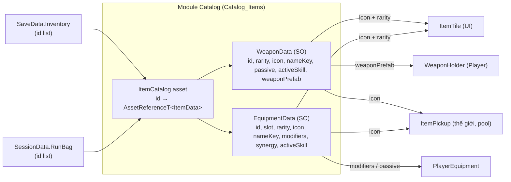
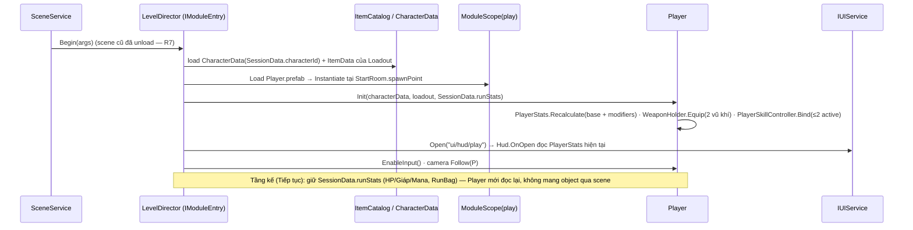
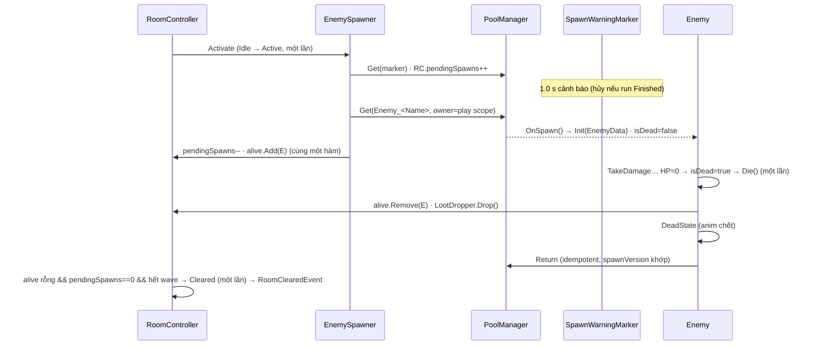
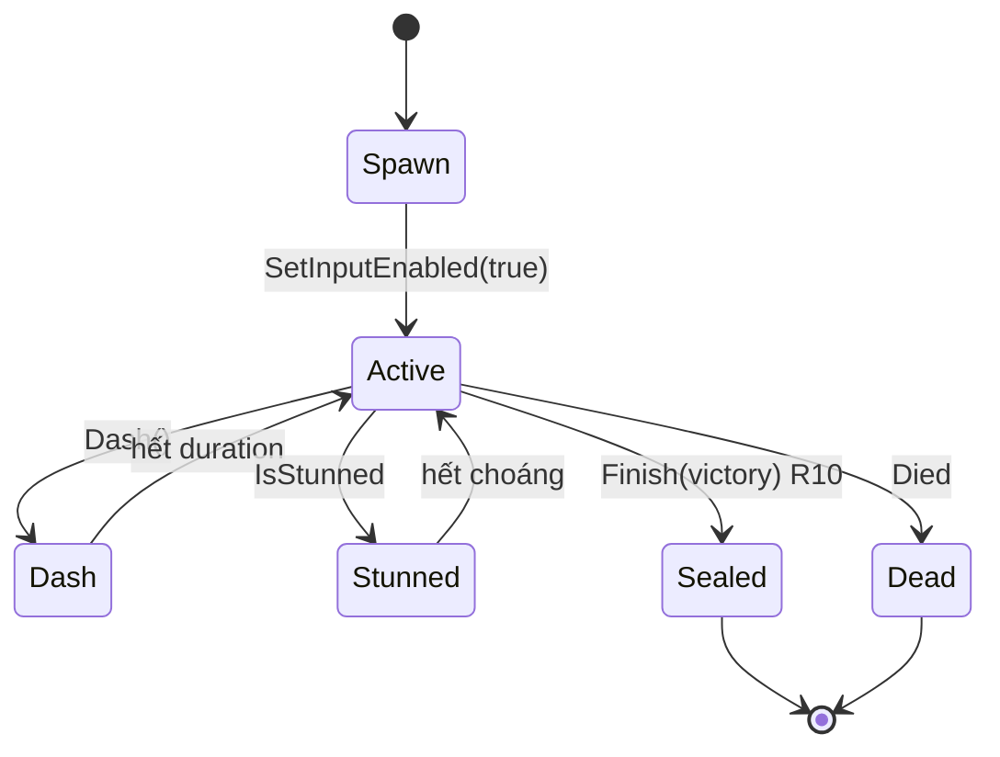

# Thực thể gameplay — Vật phẩm · Người chơi · Quái vật (dữ liệu, prefab, luồng sinh/hủy)

> Tài liệu bàn giao cho agent/session làm gameplay. Đọc trước khi dựng prefab vật phẩm, Player, quái hoặc boss.
> Cập nhật: 2026-11-04 · Unity 6.3 · URP 2D · Physics2D · Input System · DOTween.
> Liên quan: `docs/ARCHITECTURE.md` (tổng quan, dungeon, save, EventBus), `docs/WEAPONS_AND_VFX_SYSTEM.md` (vũ khí + VFX chi tiết), `docs/UI_SYSTEM.md` (ItemTile, HUD), `docs/MODULES_ADDRESSABLES_WEBGL.md` (module, Addressables, Pool §7.7, quy tắc R1–R14).
> Các mục có tiêu đề "(nguyên văn từ ARCHITECTURE §x)" được **chuyển nguyên văn** khỏi `ARCHITECTURE.md` (giữ số mục cũ để tra cứu các tham chiếu "§5.5", "§6"…).

---

## 0. TL;DR cho agent

- **Dữ liệu = ScriptableObject** (module Catalog: `CharacterData`, `WeaponData`, `EquipmentData`, `ActiveSkillSO`; module Enemies/Bosses: `EnemyData`, `EnemyAttackSO`). Prefab chỉ là "vỏ" nhận dữ liệu lúc spawn — **không** tạo prefab riêng cho từng món đồ. Asset dữ liệu thực tế sinh bằng `DataSeeder` — xem `docs/DATA.md`.
- **Id ngắn là khóa chung**: `sword-ice`, `rune-book`, `knight`, `skeleton-spear`… dùng trong save, `SessionData`, `ItemCatalog`, address (`data/weapon/sword-ice`), key i18n (`sword.ice`, `item.rune_book`).
- **Mọi thứ sinh nhiều lần đi qua `PoolManager`** (MODULES §7.7): quái, đạn, VFX, loot, pickup, số sát thương. Prefab được load **một lần** từ `ModuleScope`, pool theo `owner` scope.
- **Một điểm chết duy nhất** cho mọi `IDamageable` (`Die()` chạy đúng 1 lần — R12), **một chủ sở hữu** cho mọi sự kiện "kết thúc" (`RoomController`, `LevelDirector`).
- Thứ tự spawn Player và quái ở §2.3 / §3.3 là hợp đồng: gameplay chỉ bắt đầu trong `IModuleEntry.Begin` (R7).

---

## 1. Vật phẩm (Items)

### 1.1. Tổng quan dữ liệu → hiển thị



- `ItemData` (abstract SO, base của `WeaponData`/`EquipmentData`): `string id`, `Rarity rarity`, `Sprite icon` (ô 16×16 hoặc kiếm 32×32), `string nameKey`, `string descKey` (key trong `DG_Multilanguage`), `ActiveSkillSO activeSkill` (tùy chọn), `int shopPrice`.
- `ItemCatalog` (SO, `data/catalog`, group `Catalog_Items`): gom `List<ItemData> items` và `List<CharacterData> characters`. Tải trọn gói 1 lần qua `ItemCatalog.LoadAsync(scope)`, sau đó truy xuất đồng bộ `GetItem(id)` / `GetCharacter(id)` tức thì mà không phát sinh overhead async cho từng item trên WebGL (xem `MODULES_ADDRESSABLES_WEBGL.md` §13).
- Icon item gom vào **SpriteAtlas `Items`** (group `Catalog_Items`) — UI và pickup dùng chung atlas, không đánh address từng sprite.

### 1.2. Prefab vật phẩm

| Prefab | Module / group | Cấu trúc | Pool | Ghi chú |
|---|---|---|---|---|
| `ItemTile` / `ItemTileSmall` | Shared / `Shared_UI` | xem `UI_SYSTEM.md` §6.1 | pool UI theo màn | Chỉ hiển thị. |
| `ItemPickup.prefab` | Play / `Mod_Play` | `ItemPickup` (root: `CircleCollider2D` trigger r=0.5, layer `Pickup`, `IPoolable`) → `Icon` (SpriteRenderer, sorting `Items`) → `RarityGlow` (SpriteRenderer vòng màu theo rarity, nhấp nháy 2 frame) → `Shadow` | ✔ | 1 prefab cho mọi vũ khí/trang bị; `Init(ItemData)` gán icon + màu. Chạm → `RunBag.Add(id)` **một lần** (cờ `collected`, R11) → `ItemPickedUpEvent` → Toast tên món. |
| `Chest.prefab` | Play | `Chest` (`IInteractable`, cờ `opened`) → `Visual` (closed/open sprite) | ✘ (đặt sẵn trong room) | Mở → `LootSpawner.Spawn(table)`. |
| `ShopStand.prefab` | Play | `ShopStand` (`IInteractable`) → 3 `StandSlot` (icon + giá world-space) | ✘ | Interact → `IUIService.Open("ui/screen/shop", ShopContext.Run)`. |
| `Loot_Coin_Gold`, `Loot_Coin_Blue` (đã có), `Loot_ManaOrb`, `Loot_HealthPotion` | Play | `LootDrop` (trigger, `IPoolable`, DOTween nảy) → `Visual` (Animator) | ✔ | Hút về Player (magnet) — xem mục 8 nguyên văn bên dưới. |

### 1.3. Luồng vòng đời một món đồ

```mermaid
sequenceDiagram
    participant Enemy as Quái / Rương
    participant LS as LootSpawner
    participant Pool as PoolManager
    participant P as ItemPickup
    participant Bag as SessionData.RunBag
    participant End as Victory/Defeat
    participant Inv as SaveData.Inventory
    Enemy->>LS: Die() / Open() → lootTable
    LS->>Pool: Get(ItemPickup, owner=play scope)
    Pool-->>P: OnSpawn() → Init(ItemData)
    P->>Bag: chạm Player → Add(id) (collected=true trước)
    P->>Pool: Return (idempotent)
    End->>Inv: "Về sảnh": settled=true → RunBag → Inventory → Save
    Note over Inv: Lobby: Loadout chọn từ Inventory (giới hạn 2 kỹ năng kích hoạt — §5.5)
```

### 5. Hệ thống Vũ khí, Trang bị theo Role & VFX Chiến đấu *(nguyên văn từ ARCHITECTURE §5 (trừ 5.4 → UI_SYSTEM §6.1))*

Hệ thống tách bạch rõ **Vũ khí chiến đấu (`WeaponData`)** cầm trên tay và **Trang bị (`EquipmentData`)** mặc trên người:

#### 5.1. Vũ khí chiến đấu trong Dungeon (`WeaponData`)
- **Asset**:
  - **Cận chiến (Melee)**: Bộ 30 thanh kiếm nguyên tố/đặc biệt tại `Art/Sprites/Items/Weapon/Sword/File.png` (lưới `32 × 32`, 6 cột × 5 hàng).
  - **Tầm xa (Ranged)**: Hệ thống vũ khí tầm xa toàn diện gồm 48 vũ khí:
    - `Weapons 1-Sheet.png`: 25 loại súng lục, shotgun, súng trường, bắn tỉa, plasma (lưới `32 × 32`).
    - `Weapons 2-Sheet.png`: 11 loại shotgun nạp đạn bẻ nòng, sách phép thần chú (`32 × 32`).
    - `Weapons 3-Sheet.png`: 12 loại trượng phép lôi điện, thánh quang, năng lượng (`32 × 32`).
    - Prefab đạn: `Projectile_Plasma_Blue.prefab`, `Projectile_Plasma_Red.prefab`, `Projectile_Sparks_Blast.prefab`, `Projectile_Rocket.prefab` và kho đạn `Art/Sprites/VFX/FireBullets/`.
- **WeaponData (SO)**:
  - Loại vũ khí: `Melee` (Kiếm chém vòng cung / đâm) hoặc `Ranged` (Súng, Shotgun, Pháo Plasma, Trượng phép, Sách phép).
  - Thông số chiến đấu: `damage`, `fireRate`, `attackRange`, `spread` (độ tản đạn), `critBonus`, `knockback`, `manaCost`, `projectileSpeed` (cho tầm xa).
  - Hiển thị & VFX: `weaponSprite` (sprite tĩnh 32x32 trên tay/HUD), `slashVfxPrefab` (vệt chém Melee), `projectilePrefab` (đạn bay qua Pool), `muzzleVfxPrefab` (tia lửa nòng/tụ phép), `hitImpactVfxPrefab` (nổ va chạm), `rarity` (`S`/`A`/`B`/`C`/`F`).
  - **Kỹ năng đặc biệt**: `passive` (`WeaponPassiveSO`, tự kích hoạt khi đang cầm) và `activeSkill` (`ActiveSkillSO`, tùy chọn, người chơi bấm trong trận, tính vào giới hạn 2 kỹ năng kích hoạt của Loadout). Vũ khí không có Role Synergy.
- **WeaponBase** (abstract) →:
  - `MeleeWeapon`: chém cận chiến tạo hitbox quét `Physics2D.OverlapCircleAll` + spawn Slash VFX (`VFX_Melee_*`), có thể chém tan đạn thường của quái.
  - `RangedWeapon`: khai hỏa đạn `Projectile` qua `PoolManager`, hỗ trợ bắn đơn, bắn chùm (Shotgun), bắn tia tức thời (Raycast) và đạn nổ diện rộng (Rocket).
- **WeaponHolder**: giữ đúng 2 vũ khí (đặt ở màn Vũ khí ngoài sảnh), HUD chỉ hiện 1 ô của vũ khí đang cầm (icon `Basic Buttons 3 Fv_142`), bấm để đổi. Vũ khí nhặt trong dungeon vào `RunBag`, không đổi tại chỗ.
- **Auto-Aim**: tự động khóa mục tiêu vào quái còn sống gần nhất trong tầm nhìn (không bị tường chắn qua Raycast). Xoay 360° và tự động lật `flipY` khi ngắm sang trái.

#### 5.1.1. Hệ thống phân bậc vũ khí (Weapon Rarity & Tier System)
Toàn bộ vũ khí (Cận chiến & Tầm xa) được phân thành **5 bậc độ hiếm (Rarity)** theo thang: **F → C → B → A → S** (đồng bộ màu ô `ItemTile` từ `Basic Buttons 3 Fv`):

| Bậc (Rarity) | Màu sắc ô UI | Sát thương & Chỉ số | Kỹ năng Bị động (`passive`) | Kỹ năng Chủ động (`activeSkill`) | Hiệu ứng VFX đặc trưng | Ví dụ vũ khí tiêu biểu |
|---|---|---|---|---|---|---|
| **F (Phổ thông / Common)** | Xám (`Fv_141`) | Cơ bản ($10 \sim 15$) | Không có | Không có | Tia lửa va chạm nhỏ (`VFX_Impacts_HitSpark`) | Kiếm Sắt (`File_0`), Súng lục khởi đầu (`W1_R00`) |
| **C (Thường / Uncommon)** | Xanh lá (`Fv_124`) | Tăng $+25\%$ ($16 \sim 22$) | 1 Passive cơ bản (+Knockback, rơi thêm coin) | Không có | Vệt chém sắc nét, đạn bay chuẩn | Kiếm Gai Rừng (`File_2`), Súng SMG (`W1_R04`) |
| **B (Hiếm / Rare)** | Xanh dương (`Fv_109`) | Tăng $+50\%$ ($23 \sim 32$) | 1 Passive nguyên tố (Làm chậm 30%, Thiêu đốt, Độc) | Tùy chọn 1 Active (hồi $16\text{s}$) | Vệt chém nguyên tố, đạn Plasma sáng | Kiếm Băng (`File_9`), Súng Plasma Xanh (`W1_R10`), Shotgun bẻ nòng (`W2_R00`) |
| **A (Sử thi / Epic)** | Tím (`Fv_101`) | Tăng $+100\%$ ($35 \sim 50$) | 1 Passive mạnh (Sét lan 3 quái, nổ lan 2m) | 1 Active uy lực cao (AoE diện rộng) | Bão điện, nổ dung nham, vầng sáng thánh | Kiếm Sấm (`File_10`), Kiếm Lửa (`File_6`), Pháo Plasma Đỏ (`W1_R13`) |
| **S (Huyền thoại / Legendary)** | Cam (`Fv_75`) | Tăng $+150\%\sim+200\%$ ($55 \sim 80+$) | 1 Passive tối thượng (Hút máu, Phóng kiếm khí xa) | 1 Active thay đổi cục diện (Xé không gian, Mưa tên lửa) | Bùng nổ VFX đồ sộ, rực rỡ nhất | Kiếm Hư Không (`File_19`), Kiếm Hắc Ám (`File_15`), Tên Lửa Hạng Nặng (`W1_R20`), Trượng Bão Tố (`W3_R00`) |

- **Quy tắc phân bổ rơi đồ (Drop Rate by Floor)**:
  - Tầng 1: Bậc F ($60\%$), Bậc C ($35\%$), Bậc B ($5\%$).
  - Tầng 2: Bậc C ($50\%$), Bậc B ($35\%$), Bậc A ($15\%$).
  - Tầng 3 (Boss): Bậc B ($40\%$), Bậc A ($45\%$), Bậc S ($15\%$).

#### 5.2. Hệ thống Trang bị & Hiệu ứng Role Synergy (`EquipmentData`)
- **Asset**:
  - Lấy từ `Art/Sprites/Items/spritesheet_16x16.png` (lưới `16×16`, 350 icon gồm: Giáp ngực, Mũ/Mặt nạ, Găng tay, Giày, Nhẫn, Dây chuyền, Khiên, Sách phép...).
- **Các ô trang bị (`EquipmentSlotType`)**:
  - `Helmet` (Mũ / Mặt nạ), `Armor` (Giáp), `Gloves` (Găng tay), `Boots` (Giày), `Necklace` (Vòng / Dây chuyền), `Accessory` (Phụ kiện: Nhẫn / Khiên / Sách phép).
  - UI chia 3-3 hai bên nhân vật: Mũ · Giáp · Găng bên trái, Giày · Vòng · Phụ kiện bên phải.
- Ngoài chỉ số và hiệu ứng Role (bị động), trang bị có thể có `activeSkill` (`ActiveSkillSO`, tùy chọn), ví dụ *Khiên Thánh – Giơ Khiên*, *Sách Cổ Ngữ – Bão Phép*.
- **Cơ chế Tương thích Role (Role Synergy)**:
  - Mỗi `EquipmentData (SO)` bao gồm:
    1. **Chỉ số cộng thẳng (`List<StatModifier> baseModifiers`)**: Cộng vào `MaxHP`, `MaxArmor`, `MaxMana`, `AttackDamage`, `MoveSpeed`, `CritChance`... **Mọi nhân vật mặc vào đều nhận được đầy đủ chỉ số này**, bất kể Role nào.
    2. **Role yêu cầu (`CharacterRole synergyRole`)** + **Hiệu ứng đặc biệt (`EquipmentPassiveSO synergyPassive`)**:
       - **Nếu nhân vật ĐÚNG Role** (`Player.CharacterData.role == equipment.synergyRole`): Ngoài chỉ số cơ bản, trang bị **kích hoạt thêm hiệu ứng đặc biệt (`synergyPassive`)**.
       - **Nếu nhân vật KHÁC Role** (`Player.CharacterData.role != equipment.synergyRole`): Trang bị **chỉ cộng chỉ số cơ bản**, hiệu ứng đặc biệt bị ẩn/vô hiệu hóa (UI hiển thị dòng mô tả hiệu ứng màu xám để người chơi biết).

```csharp
public enum CharacterRole { Any = 0, Warrior = 1, Ranger = 2, Mage = 3, Assassin = 4 }
public enum EquipmentSlotType { Helmet, Armor, Gloves, Boots, Necklace, Accessory }
public enum Rarity { S = 0, A = 1, B = 2, C = 3, F = 4 }
public enum StatType { MaxHp, MaxArmor, MaxMana, AttackDamage, AttackSpeed, MoveSpeed, CritChance }

[Serializable]
public struct StatModifier
{
    public StatType Stat;
    public float FlatValue;
    public float PercentValue;
}

public abstract class ItemPassiveSO : ScriptableObject
{
    [TextArea] public string description;
    public string descKey;
    public abstract void OnEquip(IPlayerContext player);
    public abstract void OnUnequip(IPlayerContext player);
}

public abstract class EquipmentPassiveSO : ItemPassiveSO { }
`

##### Công thức gộp chỉ số Vũ khí ↔ Nhân vật:
- **Sát thương cuối:** FinalDamage = weapon.damage * owner.AttackDamage * empowerMultiplier
- **Tốc độ đánh cuối:** FinalFireRate = weapon.fireRate * owner.AttackSpeed
- **Tỉ lệ chí mạng cuối:** FinalCritChance = Mathf.Clamp01(weapon.critBonus + owner.CritChance) (hệ số bạo kích cố định CritMultiplier = 2.0x)
- **Chỉ số nhân vật qua StatSheet:** StatValue = (Base + ΣFlat) * (1 + ΣPercent)``

- **Ví dụ các `EquipmentPassiveSO` (Hiệu ứng khi đúng Role)**:
  - *Giáp Lửa Kỵ Sĩ (`Warrior`)*: Cộng `+2 Giáp, +10 Máu`. Nếu là **Warrior**: Khi bị vỡ giáp, phát nổ vòng lửa (`VFX/01.png` dòng 6) gây sát thương và đẩy lùi quái xung quanh.
  - *Sách Cổ Ngữ (`Mage`)*: Cộng `+30 Mana, +10% Sát thương`. Nếu là **Mage**: Mỗi đòn đánh thứ 3 triệu hồi vòng xoáy phép (`VFX/00.png` dòng 1) tại vị trí mục tiêu.
  - *Găng Tay Bóng Đêm (`Assassin`)*: Cộng `+8% Chí mạng, +10% Tốc đánh`. Nếu là **Assassin**: Đòn đánh chí mạng hồi ngay 2 Mana và tăng 20% tốc chạy trong 1.5s.
  - *Giày Phong Vũ (`Ranger`)*: Cộng `+15% Tốc chạy`. Nếu là **Ranger**: Đứng yên 1s giúp đòn bắn tiếp theo xuyên thấu và tăng 40% sát thương.

#### 5.3. Quy chuẩn cắt Sprite cho Vũ khí, Trang bị & VFX
| File Sprite Sheet | Kích thước ảnh | Ô lưới (Grid Slice) | Số lượng Sprite | Cấu hình Import |
|---|---|---|---|---|
| `Art/Sprites/Items/Weapon/Sword/File.png` | `192 × 160` | **`32 × 32`** (6 cột × 5 hàng) | **30** thanh kiếm | `PPU = 16`, `Point`, `Compression = None` |
| `Art/Sprites/Items/spritesheet_16x16.png` | `256 × 352` | **`16 × 16`** (16 cột × 22 hàng) | **350** item/trang bị | `PPU = 16`, `Point`, `Compression = None` |
| `Art/Sprites/VFX/00.png` | `1216 × 192` | **`64 × 64`** (19 cột × 3 hàng) | **50** frame VFX (3 bộ anim) | `PPU = 16`, `Point`, `Compression = None`, `Pivot = Center` |
| `Art/Sprites/VFX/01.png` | `704 × 576` | **`64 × 64`** (11 cột × 9 hàng) | **79** frame VFX (9 bộ anim) | `PPU = 16`, `Point`, `Compression = None`, `Pivot = Center` |

#### 5.5. Giới hạn kỹ năng kích hoạt (Loadout Active Limit)
- Một vật phẩm (vũ khí hoặc trang bị) có thể có **bị động** (tự kích hoạt) và/hoặc **chủ động** (bấm trong trận).
- **Khi bắt đầu run, loadout chỉ được có tối đa 2 vật phẩm có kỹ năng chủ động** (`LoadoutRules.MaxActiveItems = 2`), tính chung 2 vũ khí + 6 trang bị.
- Màn Trang bị/Vũ khí hiển thị `Kích hoạt n/2`; nếu mặc thêm món có kỹ năng chủ động làm vượt 2 thì nút bị khóa ("ĐỦ 2 KỸ NĂNG") cho đến khi tháo một món.
- HUD có đúng 2 nút Kích hoạt tương ứng (icon = ô vật phẩm, số đếm hồi chiêu); kỹ năng của nhân vật là nút riêng.


### 8. Hệ thống Tương tác (`IInteractable`) & Vật phẩm rơi (`LootDrop`) *(nguyên văn từ ARCHITECTURE §8)*

#### Tương tác (`IInteractable`)
```csharp
public interface IInteractable
{
    string GetInteractPrompt();
    bool CanInteract(GameObject interactor);
    void Interact(GameObject interactor);
}
```
- Dùng chung thống nhất cho mọi đối tượng tương tác trong game:
  - **Portal**: vào dungeon từ Lobby hoặc qua tầng mới.
  - **Nhân vật trong sảnh**: bấm để mở panel nhân vật (chọn / mở khóa / Trang bị / Vũ khí).
  - **NPC Thương nhân (Lobby)**: mở Shop sảnh, mua kiếm/trang bị bằng coin vĩnh viễn; đồ mua vào kho.
  - **Chest (Rương)**: mở ra Vũ khí (`WeaponPickup`), Trang bị (`EquipmentPickup`) hoặc Vàng/Bình máu.
  - **WeaponPickup / EquipmentPickup**: chạm vào là **tự vào `RunBag`**, không hiện bảng so sánh, không thay đồ trong trận.
  - **ShopStand**: quầy bán vũ khí/trang bị/bình máu bằng coin của run trong phòng `Shop` (đồ mua vào `RunBag`, bình máu dùng ngay).
- **Giao dịch idempotent** (§7.8 R11): mua hàng (Shop sảnh, ShopStand), mở rương, nhặt pickup đều làm trong **một hàm đồng bộ**: kiểm tra → trừ tiền/đánh dấu đã mở → thêm đồ, không có `await` ở giữa. Rương có cờ `opened`, pickup có cờ `collected` (đặt trước khi thêm vào `RunBag`) — chạm/bấm 2 lần trong cùng frame không nhận đồ 2 lần. Nút Mua tự khóa đến khi UI cập nhật xong.

#### Vật phẩm rơi (`LootDrop`)
- Khi quái bị tiêu diệt hoặc mở rương, `LootSpawner` lấy các hạt `GoldCoin`, `ManaOrb`, `HealthPotion` từ `PoolManager` và tung ra xung quanh bằng hiệu ứng nảy (`DOTween`).
- **Tự động hút (Magnet)**: các hạt `GoldCoin` và `ManaOrb` tự động bay hút về phía Player khi Player đi vào bán kính nhặt (`pickupRadius`), hoặc tự động hút toàn phòng ngay khi `RoomClearedEvent` được kích hoạt.
  - Loot còn đang nảy (tween DOTween chưa xong) lúc `RoomClearedEvent` bắn, hoặc rơi ra **sau** khi phòng đã `Cleared` (quái cuối chết làm rơi loot cùng frame), vẫn phải được hút: loot tự kiểm tra `room.IsCleared` khi tween nảy kết thúc, không chỉ dựa vào sự kiện.
  - Hạt loot có cờ `collected`: chạm Player 2 lần / vừa bị hút vừa chạm → chỉ cộng một lần. Khi trả về pool: `DOTween.Kill` mọi tween của hạt (nếu không, tween cũ tiếp tục chạy trên instance tái sử dụng).


---

## 2. Người chơi (Player)

### 2.1. Prefab

```
Player.prefab  (module Play, group Mod_Play, address "char/player-shell")
│  Rigidbody2D (Dynamic, gravity 0, Interpolate, freeze rotation), CapsuleCollider2D (layer Player)
│  PlayerInput · PlayerMovement · PlayerStats (IDamageable) · PlayerEquipment
│  PlayerSkillController · WeaponHolder · PlayerInteractor · PlayerAnimator
├─ Visual          SpriteRenderer + Animator (controller gốc; AnimatorOverrideController từ CharacterData) · SortingGroup "Characters"
├─ Shadow          SpriteRenderer (sorting "Shadows")
├─ WeaponPivot     xoay theo hướng ngắm (Auto-Aim) · flipY khi ngắm sang trái
│   └─ WeaponSocket   nơi WeaponHolder Instantiate prefab vũ khí đang cầm (WeaponData.weaponPrefab)
├─ Hurtbox         Collider2D trigger, layer PlayerHurtbox (đạn/bẫy quái chạm vào đây)
├─ InteractRange   CircleCollider2D trigger r=1.2 (PlayerInteractor)
└─ FxSockets       Feet (bụi chạy), Body (hit/heal)
```

- **Một prefab `Player` cho mọi nhân vật** (ARCHITECTURE cũ: "dùng chung 1 Prefab Player"). Khác biệt nhân vật = `CharacterData` (chỉ số, role, kỹ năng) + `AnimatorOverrideController` (hình).
- **Lobby không dùng `Player.prefab`.** Sảnh dùng `CharLobby_<id>.prefab` (module Characters, group `Characters`, address `char/<id>`): `Visual` (idle) + `Shadow` + `CharacterSpot` (collider bấm, mũi tên/giá khóa world-space). Nhẹ, không có physics/combat.

### 2.2. Lớp nhân vật & component

#### 4. Hệ thống Lớp nhân vật, Role, Chỉ số & Kỹ năng (Player & Classes) *(nguyên văn từ ARCHITECTURE §4)*

Dùng chung **1 Prefab `Player` gốc** cho cả `Lobby` và `Play`. Dữ liệu lớp nhân vật được cấu hình qua `CharacterData (ScriptableObject)`:

##### CharacterRole & CharacterData (SO)
- **CharacterRole (Enum)**:
  - `Warrior` (Chiến binh / Kỵ sĩ – thiên về kiếm cận chiến, giáp dày)
  - `Ranger` (Xạ thủ / Cung thủ – thiên về vũ khí tầm xa, tốc độ, chí mạng)
  - `Mage` (Pháp sư / Mục sư – thiên về phép thuật, năng lượng, nguyên tố)
  - `Assassin` (Sát thủ / Đạo tặc – thiên về tốc đánh, bạo kích, cơ động)
- **CharacterData (SO)**:
  - Định danh (`characterId`, tên, mô tả, giá mở khóa).
  - **Role (`CharacterRole role`)**: dùng để kiểm tra kích hoạt hiệu ứng đặc biệt của Trang bị (Role Synergy).
  - Visual: `Sprite` đại diện, `AnimatorOverrideController` (để thay hình dáng/animation cho các lớp nhân vật trên cùng một khung `Player.prefab`).
  - Chỉ số gốc (`BaseStats`): `maxHp`, `maxArmor` (giáp tự hồi), `maxMana` (năng lượng), `attackDamage`, `moveSpeed`, `critChance`.
  - Vũ khí khởi đầu (`startingWeapon`: `WeaponData`) và Kỹ năng chủ động (`activeSkill`: `ActiveSkillSO`).
- **ActiveSkillSO (Abstract ScriptableObject)**:
  - Định nghĩa thông số (`cooldown`, `duration`, icon) và logic kích hoạt `Activate(PlayerContext)`.

##### Các Component trên Player
- `PlayerInput`: đọc Input System (Move qua `VirtualJoystick` pixel trên mobile, Aim/Fire, Switch Weapon, Skill, Item Active 1/2, Interact).
- `PlayerMovement`: điều khiển `Rigidbody2D`, hỗ trợ tốc độ cơ bản (cộng từ `PlayerStats`) và dash/knockback.
- `PlayerStats` (implement `IDamageable`):
  - Tổng hợp **Chỉ số gốc (`CharacterData`) + Chỉ số cộng thêm từ Trang bị (`PlayerEquipment`)**.
  - Quản lý `CurrentHp`, `CurrentArmor`, `CurrentMana`.
  - **Cơ chế Giáp (Armor/Shield kiểu Soul Knight)**: Khi nhận sát thương, trừ vào `CurrentArmor` trước, phần sát thương dư mới trừ vào `CurrentHp`. Khi không nhận sát thương trong `armorRegenDelay` (ví dụ `4s`), tự động hồi lại `CurrentArmor` theo từng nhịp cho đến khi đầy.
  - Phát sự kiện `PlayerStatsChangedEvent` để HUD cập nhật thanh Máu, Giáp, Mana. HUD mở muộn (tải async) thì tự đọc `PlayerStats` hiện tại khi `OnOpen`, không chờ sự kiện kế tiếp.
  - `TakeDamage` bỏ qua khi `IsDead` hoặc đang bất tử (`LevelDirector` đã chốt run); `Die()` chỉ chạy một lần (xem `IDamageable` ở Mục 6).
- `PlayerEquipment`: quản lý các trang bị đang mặc và hiệu ứng Role Synergy (chi tiết ở Mục 5).
- `PlayerSkillController`: quản lý thời gian hồi chiêu (`cooldown`), hiệu lực kỹ năng và gọi `ActiveSkillSO` — gồm kỹ năng của nhân vật và **tối đa 2 kỹ năng kích hoạt của vật phẩm** trong loadout (xem 5.5).
- `WeaponHolder`: quản lý 2 slot vũ khí chiến đấu trong dungeon (chọn ở màn Vũ khí ngoài sảnh, bấm ô vũ khí trên HUD để đổi).
- `PlayerInteractor`: quét các vật thể `IInteractable` trong bán kính đứng gần để tương tác.
- `PlayerAnimator`: đồng bộ hướng nhìn (lật trái/phải) và trạng thái di chuyển/chết.


### 2.3. Luồng spawn Player trong Play



- Chết: `PlayerStats.Die()` (một lần) → tắt input → `LevelDirector.Finish(victory:false)` (chốt một lần — R10).
- Player **không** vào pool (1 cái mỗi run); hủy cùng scene Play.

---

## 3. Quái vật (Enemies & Boss)

### 3.1. Prefab

```
Enemy_Base.prefab  (module Enemies, group Enemies_<set>)
│  Rigidbody2D (Dynamic, gravity 0, Interpolate), CircleCollider2D body (layer Enemy)
│  EnemyHealth (IDamageable, IPoolable) · EnemyBrain (FSM) · EnemyMotor (NavMeshAgent / bay thẳng)
│  EnemyAttackRunner (chạy EnemyAttackSO) · LootDropper (lootTable của EnemyData)
├─ Visual          SpriteRenderer + Animator · SortingGroup "Characters"
├─ Shadow
├─ Hurtbox         trigger, layer EnemyHurtbox (đòn của Player)
├─ AttackOrigin    điểm bắn đạn / tâm đòn cận chiến
└─ StatusFx        socket cho làm chậm/độc/đóng băng (VFX loop)
Enemy_<Name>.prefab = Prefab Variant của Enemy_Base: Visual (animator riêng) + EnemyData gán sẵn
Boss_<Id>.prefab   = Variant + BossPhaseController + thanh máu qua BossHealthChangedEvent (group Boss_<Id>)
SpawnWarningMarker.prefab (pool) · DamagePopup.prefab (world-space TMP, pool)
```

- Prefab quái hiện có: `Prefabs/Enemies/Enemy_Skeleton_Spear`, `Enemy_Skeleton_Warrior`, `Enemy_Vampire`, `Enemy_Zombie` → giữ ở `Prefabs/Enemies/` (prefab không để theo module), chuyển thành Variant của `Enemy_Base` (MODULES §9.2).
- Layer va chạm (Physics2D matrix): `Player`↔`Enemy` (đẩy), `PlayerHurtbox`↔`EnemyProjectile`/`Trap`, `EnemyHurtbox`↔`PlayerAttack`/`PlayerProjectile`, `Pickup`↔`Player`. `Enemy`↔`Enemy` bật (tránh chồng), `EnemyProjectile`↔`Wall` bật.

### 3.2. Dữ liệu, FSM, sát thương, sinh quái, boss

#### 6. Hệ thống Quái vật, Sinh quái & Boss *(nguyên văn từ ARCHITECTURE §6)*

##### EnemyData & Đòn tấn công dạng Module (`EnemyAttackSO`)
- **EnemyData (SO)**:
  - Thông số: `maxHp`, `moveSpeed`, `contactDamage`, `isFlying`, `spawnCost` (điểm độ khó), bảng rơi đồ (`lootTable`).
  - Danh sách đòn tấn công: `List<EnemyAttackSO> attacks`.
- **EnemyAttackSO (Abstract ScriptableObject, implement `IEnemyAttack`)**:
  - Mỗi đòn đánh là một asset `ScriptableObject` độc lập có thể cấu hình tầm đánh (`range`), `cooldown`, `windupTime` (thời gian vung tay/báo hiệu) và kéo thả tái sử dụng cho nhiều loại quái trên Inspector:
    - `MeleeAttackSO`: áp sát cắn/chém cận chiến.
    - `ShootAttackSO`: bắn đạn đơn, bắn chùm (shotgun), bắn liên thanh hoặc tỏa tròn 360 độ.
    - `ChargeAttackSO`: hiện đường cảnh báo đỏ rồi lao nhanh (dash) về phía Player.
    - `SummonAttackSO`: triệu hồi quái con.
- **Enemy_Base prefab** → các loại quái (Zombie, Skeleton, Vampire...) là Prefab Variant hoặc nạp từ `EnemyData`.
- **EnemyBrain (FSM)**:
  - Quản lý các state là class riêng: `SpawnState`, `IdleState`, `ChaseState` (kết hợp `NavMeshAgent`), `AttackState` (thực thi `EnemyAttackSO` được chọn), `DeadState`.
  - `DeadState` là trạng thái cuối: không chuyển ra khỏi nó cho đến khi object được trả về pool. Đòn tấn công đang `windupTime` bị hủy khi vào `DeadState` (quái chết không được tung đòn sau khi chết).

##### `IDamageable` & chống chết nhiều lần

```csharp
public readonly struct DamageInfo
{
    public readonly float Amount, Knockback, CritBonus;
    public readonly Vector2 Direction;
    public DamageInfo(float amount, float knockback, Vector2 direction, float critBonus = 0f)
        => (Amount, Knockback, Direction, CritBonus) = (amount, knockback, direction, critBonus);
}

public interface IDamageable
{
    bool IsDead { get; }
    /// Trả false nếu đòn bị bỏ qua (đã chết, bất tử, cùng phe).
    bool TakeDamage(in DamageInfo info);
}
```

- Nhiều nguồn có thể gây sát thương cùng frame/bước vật lý: `OverlapCircleAll` trả về **nhiều collider của cùng một quái**, 2 viên đạn cùng trúng, bẫy + đạn. Quy tắc (§7.8 R12):
  1. `TakeDamage` kiểm tra `IsDead` đầu tiên; khi HP về 0 thì đặt `IsDead = true` **trước** khi gọi bất cứ thứ gì khác, rồi gọi `Die()` đúng một lần.
  2. `Die()` là nơi duy nhất: rơi loot, cộng `totalKills`, báo `RoomController`, chuyển `DeadState`, hẹn trả về pool.
  3. Mỗi đòn đánh vùng (melee, nổ, sét lan) gom mục tiêu vào `HashSet<IDamageable>` trước khi gây sát thương — một mục tiêu nhận tối đa một lần sát thương mỗi đòn.
  4. `IsDead` reset trong `IPoolable.OnSpawn()` khi lấy lại từ pool.

##### Hệ thống Sinh quái (`EnemySpawner`)
- **Cơ chế Wave kết hợp**:
  - **Fixed Waves**: phòng chỉ định rõ từng đợt gồm những loại quái nào và vị trí xuất hiện.
  - **Budget Waves**: phòng lấy ngân sách điểm `spawnBudget` từ `DungeonConfig`, tự động chọn ngẫu nhiên các quái trong pool của tầng sao cho tổng `spawnCost` khớp với ngân sách của từng đợt.
- **Hiệu ứng báo trước (`SpawnWarning`)**:
  - Trước khi mỗi con quái xuất hiện, `EnemySpawner` đặt một vòng cảnh báo (`SpawnWarningMarker`) tại điểm spawn trên mặt đất trong `1.0s` rồi mới lấy quái từ `PoolManager` ra, giúp người chơi chủ động né tránh.
  - Lúc đặt marker: `RoomController.pendingSpawns++`; lúc quái thật xuất hiện: `pendingSpawns--` và thêm vào `alive` (cùng một hàm, không có frame nào quái "biến mất" khỏi cả hai). Nếu phòng/run kết thúc trong lúc chờ (Player chết, `Finished`) thì hủy marker và không spawn.

##### Boss
- **Boss** = `Enemy` cộng thêm `BossPhaseController`:
  - Khi máu Boss giảm xuống dưới các ngưỡng (ví dụ `60%`, `30%`), Boss chuyển sang Phase mới, đổi tốc độ và chuyển sang danh sách `EnemyAttackSO` dữ dội hơn.
  - Bắn `BossHealthChangedEvent` để HUD hiển thị thanh máu Boss.
  - Một đòn có thể đẩy máu vượt qua nhiều ngưỡng cùng lúc (60% → 25%): chuyển thẳng sang phase ứng với máu hiện tại, mỗi phase vào tối đa một lần; không chuyển phase khi `IsDead`.
  - Boss chết → gọi `LevelDirector.Finish(victory: true)`; quái con còn sống bị dọn cùng lúc.


### 3.3. Luồng sinh → chết → trả pool



- **Prewarm**: `LevelDirector.Begin` tạo trước pool theo `DungeonConfig` (vd 8 Skeleton, 6 Zombie, 30 đạn, 20 coin) để không giật khi phòng đầu tiên mở.
- Boss: prefab `Boss_<Id>` tải nền (label `boss-<id>`, MODULES §7.6); phòng boss chờ có timeout. Boss không qua pool (1 lần/tầng).

---

## 3.5 Thiết kế prefab chi tiết & State Machine *(bổ sung 2026-11-05)*

> Thiết kế dựng prefab cho 4 nhóm **chưa tạo asset**: Nhân vật, Quái & Boss, Tương tác & Phòng, FX trong trận. **Player và Enemy tổ chức theo state machine** để dễ quản lý. Hợp đồng component bám sát code hiện có (`Scripts/Play`, `Scripts/Enemy`, `Scripts/Combat`); dựng prefab chỉ "gắn vỏ" cho các component này, không thêm logic mới.

### 3.5.1 Prefab Gameplay Nhân vật (`Player.prefab`)

**Một prefab duy nhất cho mọi nhân vật.** Khác biệt = `CharacterData` (chỉ số/role/skill) + `AnimatorOverrideController`. Gán vào `PlayPrefabSet.player`, `LevelDirector` Instantiate ở `StartRoom.playerSpawn`.

```
Player.prefab  (layer Player, address "char/player-shell")
│  Rigidbody2D (Dynamic, gravity 0, Interpolate, freeze rotation Z)
│  CapsuleCollider2D (va chạm thân, layer Player)
│  PlayerController  ──(RequireComponent)── PlayerStats · PlayerMovement · PlayerInputReader
│  StatusEffectController · PlayerSkillController · PlayerEquipment · PlayerInteractor
├─ Visual         SpriteRenderer + Animator + SpriteAnimDriver  (SetController từ CharacterData.animator)
├─ Shadow         SpriteRenderer (sorting "Shadows")
├─ WeaponPivot    WeaponHolder (xoay theo AimDirection, flipY khi ngắm trái)
│   └─ WeaponSocket   nơi dựng vũ khí đang cầm (WeaponData.weaponPrefab / weaponSprite)
├─ Hurtbox        Collider2D trigger, layer PlayerHurtbox (đạn/bẫy/đòn quái chạm vào đây)
├─ InteractRange  CircleCollider2D trigger (PlayerInteractor quét IInteractable)
└─ FxSockets      Feet (bụi chạy) · Body (hit/heal VFX)
```

**Hợp đồng component** (field `[SerializeField]` cần gán trên prefab):

| Component | Vai trò | Gán trên prefab |
|---|---|---|
| `PlayerController` | Điều phối; triển khai `IPlayerContext` + `ITargetable` | `weapons`, `skills`, `equipment`, `interactor`, `anim` (tự `GetComponent` nếu trống) |
| `PlayerStats` | `IDamageable`; HP/Giáp/Mana, `StatSheet`, hồi giáp/mana | — (đọc `CharacterData.baseStats`) |
| `PlayerMovement` | `Rigidbody2D`, tốc độ + `Dash` + knockback | — |
| `PlayerInputReader` | Đọc Input System / VirtualInput (Move, Attack, Swap, Skill, Interact) | — |
| `WeaponHolder` | 2 ô vũ khí, Auto-Aim xoay 360°, `UpdateAim/TryAttack` | `weaponPivot`, `weaponSocket` |
| `StatusEffectController` | Làm chậm/độc/choáng; `IsStunned` khóa di chuyển + đánh | socket `StatusFx` (tùy chọn) |

**State Machine (`IPlayerState` — đã triển khai 2026-11-05, `PlayerStateMachine.cs`).** Cùng khuôn `IEnemyState`. `PlayerController.Update()` = `UpdateTimedModifiers()` + `TickState()`; `ResolveState()` suy state từ cờ (`inputEnabled`, `combatEnabled`, `stats.IsDead`, `status.IsStunned`, `movement.IsDashing`) mỗi frame nên **không desync** với PlayerStats/Movement, và hành vi mỗi frame gom vào `DriveFrame(readInput, allowAttack)` (giữ nguyên hành vi bản cũ). State hiện tại đọc qua `PlayerController.StateId`:

```csharp
public interface IPlayerState { void Enter(PlayerController p); void Tick(PlayerController p); void Exit(PlayerController p); }
```

| State | Vào khi | Làm gì | Ra khi |
|---|---|---|---|
| **Spawn** | `Init` xong, trước khi bật input | đứng yên, (tùy chọn) hiệu ứng xuất hiện | → **Active** khi `SetInputEnabled(true)` |
| **Active** | chơi bình thường | đọc Move/Aim, `TryAttack`, `TryUse` skill, `TryInteract` | → Dash / Stunned / Sealed / Dead |
| **Dash** | gọi `movement.Dash(...)` | khóa hướng theo dash, bỏ qua input move, (tùy chọn) bất tử ngắn | → **Active** khi hết `duration` |
| **Stunned** | `status.IsStunned` | `move = 0`, không đánh/kỹ năng | → **Active** khi hết choáng |
| **Sealed** | run đã chốt **thắng** (`SetCombatEnabled(false)`) | cho đi lại tới Portal, **tắt** đánh/kỹ năng | → đổi scene |
| **Dead** | `stats.Died` | tắt input, `movement.Stop()`, anim chết | **cuối** (hủy cùng scene Play) |



> **Ưu tiên chọn state** (trong `ResolveState`): Dead > Spawn(`!inputEnabled`) > Sealed(`!combatEnabled`) > Stunned > Dash > Active. Dash/Stunned dùng chung `DriveFrame(true, true)` vì bất tử + khóa hướng (Dash) và chặn di chuyển + đánh (Stunned) đã do `PlayerMovement`/`PlayerStats`/`DriveFrame` tự lo. `PlayerController` vẫn giữ `IPlayerContext` + `ITargetable`; teardown khi chết do `OnDied` (tắt input + `movement.Stop`). Player **không** vào pool (1 cái/run). Ánh xạ 1-1 với cờ cũ → hành vi bất biến.

### 3.5.2 Prefab Gameplay Quái & Boss

**`Enemy_Base.prefab` → Variant mỗi loại quái** (Zombie, Skeleton Spear/Warrior, Vampire). `Enemy.Init(ctx, dataOverride)` nhận `EnemyData`; mọi quái thường **qua pool** (`IPoolable`).

```
Enemy_Base.prefab  (layer Enemy, group Enemies_<set>)
│  Rigidbody2D (Dynamic, gravity 0, Interpolate)
│  Enemy  ──(RequireComponent)── EnemyHealth · EnemyMotor · EnemyBrain · EnemyAttackRunner
│  StatusEffectController · CircleCollider2D (thân, layer Enemy) · PooledObject
├─ Visual        SpriteRenderer + Animator + SpriteAnimDriver
├─ Shadow
├─ Hurtbox       Collider2D trigger, layer EnemyHurtbox (đòn/đạn Player)
├─ AttackOrigin  điểm bắn đạn / tâm đòn cận chiến  → gán Enemy.attackOrigin
└─ StatusFx      socket VFX làm chậm/độc/đóng băng
Enemy_<Name> = Prefab Variant: Visual riêng + Enemy.data gán sẵn
Boss_<Id>    = Variant + BossPhaseController, isBoss = true, KHÔNG PooledObject (1 lần/tầng), group Boss_<Id>
```

**Hợp đồng component:**

| Component | Vai trò | Field chính |
|---|---|---|
| `Enemy` | Điều phối + vòng đời pool + sát thương chạm | `data`, `attackOrigin`, `anim`, `disableOnDeath[]`, `isBoss` |
| `EnemyHealth` | `IDamageable`; `ResetHealth/TakeDamage/Kill`, `Invulnerable`, sự kiện `Changed` | `hurtFlash` |
| `EnemyMotor` | Di chuyển/đuổi (`MoveTowards`, `Knockback`, `SpeedMultiplier`) | — |
| `EnemyAttackRunner` | Chọn & chạy `EnemyAttackSO` (`Pick/Run/IsAttacking`) | danh sách đòn từ `EnemyData.attacks` |
| `BossPhaseController` | (Boss) đổi phase theo ngưỡng máu, bắn `BossHealthChangedEvent` | `bossId`, `phases[]` (hpThreshold, speedMultiplier, attacks, transitionVfx) |

**State Machine Quái (`IEnemyState` — đã có trong code, `EnemyBrain.cs`):**

```
Spawn ──(spawnDuration)──▶ Idle ──(AlwaysAggro | dist ≤ aggroRange)──▶ Chase ⇄ Attack
   (bất tử)                 (đứng yên)                                   │
                                                                 Dead ◀─┘ (HP=0, cuối, tới khi về pool)
```

| State | Đọc từ `EnemyData` | Hành vi |
|---|---|---|
| **SpawnState** | `spawnDuration` | bất tử + đứng yên trong lúc hiện marker/anim xuất hiện |
| **IdleState** | `aggroRange` | đứng yên tới khi thấy Player (phòng Active → `AlwaysAggro` = luôn đuổi) |
| **ChaseState** | `preferredDistance` | `Attacks.Pick(target)` có đòn → đổi sang Attack; không thì `MoveTowards`; choáng → đứng yên |
| **AttackState** | (từ `EnemyAttackSO`) | chạy đòn đang `Pending`; `IsAttacking` xong → về Chase |
| **DeadState** | `deathDuration` | **trạng thái cuối**; windup bị hủy (`LifeToken`), `ReturnAfter(deathDuration)` |

- **Chết (R12):** `EnemyHealth.TakeDamage` → HP≤0 → đặt `isDead` **trước** → `Enemy.HandleDeath()` **một lần** (hủy windup, `Brain.EnterDead()`, tắt collider, bắn `EnemyDiedEvent`, hẹn trả pool). Loot do `LevelDirector.OnEnemyDied` tung từ `EnemyData.lootTable` (quái **không** tự dropper).
- **Boss** chồng FSM thường + `BossPhaseController`: `OnHealthChanged` nhảy thẳng tới phase ứng máu hiện tại (một đòn vượt nhiều ngưỡng → 1 phase, mỗi phase vào tối đa 1 lần), đổi `SpeedMultiplier` + `SetAttacks`, bất tử lúc chuyển; chết → `BossDefeatedEvent` → `LevelDirector.Finish(true)`.

### 3.5.3 Prefab Tương tác & Phòng

**Phòng = `RoomTemplate.prefab`** (gốc = tâm phòng). `DungeonBuilder` đặt theo layout, gắn `RoomController` lúc dựng.

```
Room_<type>.prefab  (RoomTemplate)
│  RoomTemplate   roomType, size (≤ 32×32)
│  (RoomController do builder gắn — trạng thái Idle → Active → Cleared)
├─ Grid
│   ├─ Ground     Tilemap
│   ├─ Wall       Tilemap + TilemapCollider2D  (layer Wall — Auto-Aim/đạn dùng; bị trừ khỏi NavMesh)
│   ├─ Decor      Tilemap
│   └─ Traps      Tilemap
├─ DoorSockets    doorNorth/East/South/West (Transform chính giữa mỗi cạnh: N/S → x=0, E/W → y=0)
│   └─ doors[4]   RoomDoor (tùy chọn; thiếu → builder dựng từ PlayPrefabSet.door)
├─ Points         playerSpawn · spawnPoints[] · chestPoint · shopPoint · bossPoint · portalPoint
└─ (tùy chọn)     cameraBounds (Collider2D) · roomTrigger — thiếu thì builder tự tạo theo size
```

- **`RoomTemplate.Validate()`** là cổng chất lượng (Room Builder): size ≤ `MaxRoomSize`, Wall có `TilemapCollider2D`, đủ 4 Door Socket **nằm chính giữa cạnh**, phòng Combat ≥ 1 SpawnPoint.
- **`RoomController` — FSM phòng `Idle → Active → Cleared` (một chiều):** phòng Start/Treasure/Shop coi như `Cleared` sẵn. Player vào phòng Combat/Boss → `Activate` (đóng cửa, chạy `EnemySpawner` hoặc `SpawnBoss`). Dọn khi **cả ba** rỗng: `alive` (HashSet) + `pendingSpawns` + `WavesRemaining` → `Clear` **một lần** → mở cửa + `RoomClearedEvent`.

**Prefab tương tác (`IInteractable`: `GetInteractPrompt / CanInteract / Interact`)** — `PlayerInteractor` quét trong `InteractRange`. Mọi giao dịch **idempotent, đồng bộ** (R11):

| Prefab | Component | Cờ chống lặp | Luồng |
|---|---|---|---|
| `Chest` | `Chest` (IInteractable) | `opened` (đặt **trước** khi tung đồ) | `visual` closed/open, `goldAmount`, `openSfx` → `Loot.DropItem/DropGold` |
| `ShopStand` | `ShopStand` (IInteractable) | `Sold` mỗi offer | `slotIcons[3]` = 2 món (`RollItem`) + 1 bình máu; `TryBuy` trừ coin + thêm `RunBag`/heal trong 1 hàm |
| `Portal` | `Portal` (IInteractable) | `used` | hiện sau khi hạ Boss; `enterOnTouch` qua trigger hoặc bấm → `onEnter()` (mở Kết quả) |
| `RoomDoor` | `RoomDoor` | — | `blocker` (collider Wall) bật khi phòng Active; `closedVisual/openVisual/animator("Closed")` |
| `ItemPickup`/`LootDrop` | (xem §1.2) | `collected` | chạm Player → `RunBag.Add` một lần |

**Bẫy (`TrapBase`, trong phòng/`Traps` tilemap) — FSM `Inactive → Warning → Active`:** `Collider2D` trigger + `targetMask` (trống → chỉ Player); 3 sprite theo phase; `DamageOverlapping` đánh mỗi mục tiêu **1 lần/chu kỳ** (`hitThisCycle`). `TrapBase.DisableAll()` khi run chốt (không có sát thương đến sau). Biến thể: `TimedTrap` (chu kỳ theo giờ), `TriggerTrap` (kích bằng bước lên), `HazardZone` (vùng hại liên tục).

### 3.5.4 Prefab FX trong trận

Mọi FX sinh nhiều lần **qua `PoolManager`** và **phải** `DOTween.Kill` + dừng/Clear `ParticleSystem` khi về pool (tránh tween/particle "sống" trên instance tái dùng). Điều phối qua API tĩnh **`CombatFx`** (do `LevelDirector.Begin` cấu hình prefab mặc định).

| Prefab / API | Component | Vai trò | Lưu ý pool |
|---|---|---|---|
| 101 VFX one-shot | `AutoDestroyEffect` (IPoolable) | nổ/chém/tia/hồi; `duration` tự trả pool | `OnSpawn`: Rebind Animator + replay Particle + `ReturnAfter`; `OnDespawn`: Kill tween + Stop/Clear particle |
| VFX loop (24) | (prefab thường) | aura/trạng thái gắn socket | gắn `StatusFx`, hủy theo chủ |
| `DamagePopup` | `DamagePopup` (IPoolable) | số sát thương TMP bay lên + mờ dần | màu normal/crit/hurt; `Show(amount, crit, playerHurt)` → `ReturnAfter(lifetime)` |
| `SpawnWarningMarker` | `SpawnWarningMarker` (IPoolable) | vòng cảnh báo sàn trước khi quái hiện | nhấp nháy DOTween Yoyo; pending++ lúc đặt |
| `CombatFx.Play/Hit` | (static) | spawn one-shot; prefab thiếu `AutoDestroyEffect` → trả sau `fallbackDuration` | — |
| `CombatFx.DamageNumber` | (static) | cầu nối ra `DamagePopup` | bỏ qua nếu `amount ≤ 0` |

> Liên kết nguồn VFX: vũ khí (`slashVfxPrefab`/`muzzleVfxPrefab`/`hitImpactVfxPrefab` ở `WeaponData`), đòn trúng (`EnemyHealth` gọi `DamageNumber` + `anim.Flash`), boss chuyển phase (`Phase.transitionVfx`). Ma trận vũ khí–VFX chi tiết: `WEAPONS_AND_VFX_SYSTEM.md`.

---

## 4. Checklist dựng prefab

1. Root đúng module/thư mục (MODULES §9.1), component theo cây §1.2/§2.1/§3.1 (chi tiết hợp đồng + FSM ở **§3.5**), layer + sorting đúng §3.1.
2. Dữ liệu từ SO, không hard-code chỉ số trong prefab. Tên hiển thị = key i18n.
3. Có `IPoolable` nếu sinh nhiều lần: `OnSpawn` reset (`isDead`, `collected`, `isLive`, timer, `spawnVersion++`), `OnDespawn` dọn (`DOTween.Kill`, `StopAllCoroutines`, velocity 0).
4. Mọi đường gây sát thương/chết/nhặt đồ có cờ chống lặp (R11–R13).
5. Đánh address + label (MODULES §6.2), chạy Analyze không trùng.
6. Test PlayMode: spawn 50 lần trả pool 50 lần không rò; giết bằng 2 nguồn cùng frame chỉ rơi loot 1 lần.
