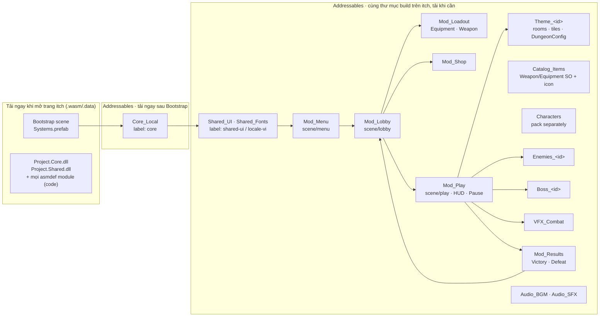
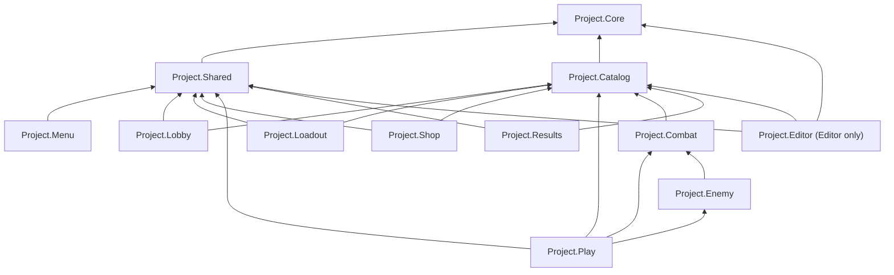

# Module hóa · Scene · Prefab · Addressables cho WebGL

> Tài liệu bàn giao cho **agent / session tiếp theo**. Đọc file này trước khi đụng vào scene, prefab hay Addressables.
> Cập nhật: 2026-11-04 · Unity 6.3 · Addressables 1.25.0 (đã có, kéo theo bởi Localization 1.5.13) · Đích build: **WebGL phát hành trên itch.io** (chơi trong trình duyệt, mobile + desktop).
> Người phụ trách: HaiTNDev (haitn@crow.vn). **Đây là game cá nhân**, không thuộc hệ thống CrowGaming — không dùng portal/deeplink/backend CrowGaming, không có CDN riêng. Liên quan: `docs/ARCHITECTURE.md` (kiến trúc gameplay), `docs/WEAPONS_AND_VFX_SYSTEM.md` (vũ khí/VFX), bản thiết kế UI ở `Design/canvas/project/*.dc.html`.

---

## 0. TL;DR cho agent

- Game được chia thành **module**. Mỗi module có: 1 thư mục script `Assets/Project/Scripts/<Module>/` (chứa **asmdef**), scene và/hoặc prefab riêng (nằm chung ở `Scenes/`, `Prefabs/` — §9.1), 1 **nhóm Addressables** riêng và 1 **label** để tải trước.
- **Chỉ `Bootstrap.unity` nằm trong Build Settings.** Mọi scene khác (Menu, Lobby, Play) và mọi prefab/SO/sprite/âm thanh đều tải qua **Addressables** bằng **address dạng chuỗi** (xem §6.2). Không dùng `Resources/` cho nội dung game.
- Code gameplay **không gọi `Addressables.*` trực tiếp**: dùng `IAssetService`, `ISceneService`, `IUIService` (§7). Các service này giữ handle theo **ModuleScope** và tự `Release` khi rời module.
- WebGL **không có thread** và **không hỗ trợ `WaitForCompletion()`** của Addressables → mọi thao tác tải là bất đồng bộ (`Awaitable` của Unity 6; không thêm UniTask trừ khi được yêu cầu).
- Vì mọi thứ async, **race condition** đến từ thao tác chồng nhau / xong sai thứ tự và nhiều sự kiện trong cùng frame. Trước khi code Core hay gameplay, đọc **§7.8 (R1–R14)**: một lần `Go` tại một thời điểm, cache handle (không cache `Awaitable`), owner = instance scope, kiểm tra hủy sau mỗi `await`, hành động không đảo ngược phải idempotent.
- Module **không tham chiếu assembly của nhau**. Giao tiếp qua `EventBus<T>`, `SessionData`, và **address** (chuỗi). Chỉ `Core` và `Shared` được mọi module tham chiếu.
- Mỗi bảng thiết kế UI ↔ 1 prefab ↔ 1 address (bảng §5). Khi làm một màn, mở đúng file `.dc.html` tương ứng để xem bố cục, sprite và chuỗi (key i18n đã trùng với bảng `DG_Multilanguage`).
- **Host = itch.io**: mọi bundle Addressables đóng gói **Local** (trong `StreamingAssets/aa` của bản build), upload cả thư mục build lên itch bằng **butler**. Vẫn tải theo module khi cần, chỉ là không có CDN/remote catalog riêng (§6, §10.1). Giới hạn của itch (≤ 1000 file, mỗi file ≤ 200 MB, tổng giải nén ≤ 500 MB) là ràng buộc cứng.
- **Save trên itch** phải ghi vào thư mục IndexedDB **cố định**, không dùng `Application.persistentDataPath` thô — itch đổi URL mỗi lần upload nên save sẽ mất (§10.2).
- Thứ tự làm: §11 (M0 → M9). Mỗi bước có **Definition of Done**; làm xong bước nào thì đánh dấu trong §11 và ghi chú ở §13.

---

## 1. Bối cảnh & mục tiêu

Game build **WebGL**, phát hành dạng **HTML5 trên itch.io**, chơi trên trình duyệt mobile và desktop. Vấn đề cần giải:

| Vấn đề trên WebGL | Hướng giải trong tài liệu này |
|---|---|
| Lần tải đầu nặng → người chơi bỏ trước khi vào game | Build gốc chỉ chứa `Bootstrap` + code; nội dung tải theo module khi cần (§4, §6). |
| Bộ nhớ heap WebGL giới hạn, không GC được asset đang giữ handle | Mỗi module giữ handle trong `ModuleScope`, rời scene là `Release` (§7.2). |
| Không có thread, `WaitForCompletion` không chạy | API tải 100% async, có màn loading + % tải (§7.4). |
| Mỗi bản cập nhật bắt người chơi tải lại toàn bộ | Bundle đặt tên kèm hash → trình duyệt giữ cache bundle không đổi; butler chỉ upload file thay đổi (§6.5). |
| Nhiều người/agent làm song song dễ đụng nhau | Mỗi module 1 thư mục + asmdef + group riêng; quy tắc phụ thuộc rõ (§8). |

---

## 2. Hiện trạng (2026-11-04)

| Hạng mục | Đã có | Chưa có / cần sửa |
|---|---|---|
| Scene | Cả 4 scene (`Bootstrap`, `Menu`, `Lobby`, `Play`) đã gom ở `Assets/Project/Scenes/` (2026-11-05). Build Settings chỉ trỏ `Scenes/Bootstrap.unity`. | — |
| Addressables | `Assets/AddressableAssetsData/` với `Default Local Group` và 4 nhóm `Localization-*` (do package Localization tạo) | Các nhóm module, profile WebGL, remote catalog. |
| Prefab UI | `Prefabs/UI/HUD.prefab`, `PauseMenu.prefab`, `ItemTile.prefab` | Các screen còn lại (§5). HUD/Pause cần đối chiếu lại với bản thiết kế mới nhất (HUD: 2 ô kích hoạt thay Lướt/Kỹ năng, không có tên vũ khí). |
| Prefab gameplay | Enemies (4), Loot (2), Projectiles (4), Player (`Knight/Hero_Knight_*`, `FantasyKnights/Knight_01..10`), VFX (101 prefab) | Player prefab chuẩn, Room templates, Traps, Boss. |
| Script | `Scripts/UI/ItemTile.cs`, `Scripts/Inventory/Rarity.cs`, `Scripts/Localization/*`, `Scripts/VFX/AutoDestroyEffect.cs`; Editor: `ItemTilePrefabBuilder`, `LocalizationCsvImporter`, `LocalizationFontBuilder`, `VFXProcessor` | Core services, asmdef (hiện tất cả đang ở `Assembly-CSharp`). |
| Data (SO) | Thư mục `Data/*` rỗng | `CharacterData`, `WeaponData`, `EquipmentData`, `EnemyData`, `DungeonConfig`… |
| Localization | Bảng `DG_Multilanguage` (en/vi, 241 key), font `PixelifySans-Regular SDF` / `Tiny5-Regular SDF`, `Localization/Resources/LocalizationFontConfig.asset` | Chuyển `LocalizationFontConfig` ra khỏi `Resources/` (§9.3). |

---

## 3. Nguyên tắc bắt buộc

1. **Build Settings chỉ có `Bootstrap`.** Bootstrap chứa duy nhất prefab `Systems` (DontDestroyOnLoad) + camera loading. Không đặt art nặng vào Bootstrap.
2. **Không tham chiếu cứng (serialized direct reference) từ Core/Bootstrap tới nội dung module.** Dùng `AssetReferenceT<T>` hoặc address chuỗi. Một tham chiếu cứng sẽ kéo asset vào bundle/scene sai và phá việc tách module.
3. **Không dùng `Resources/`** cho nội dung (asset trong Resources luôn nằm trong lần tải đầu). Ngoại lệ duy nhất: không có — config khởi động cũng tải qua Addressables label `core`.
4. **Tải một lần, Instantiate nhiều lần.** Prefab dùng nhiều (đạn, quái, VFX, loot, ItemTile) được `LoadAssetAsync<GameObject>` một lần rồi đưa vào `PoolManager`. Không gọi `Addressables.InstantiateAsync` cho từng viên đạn.
5. **Mỗi handle thuộc về một `ModuleScope`.** Rời module (unload scene / đóng screen nặng) → scope `Release` toàn bộ. Không giữ handle trong biến static.
6. **Không `WaitForCompletion()`**, không `Task.Run`, không `Thread`. Dùng `async Awaitable` / coroutine.
7. **Module không tham chiếu module khác.** Muốn mở màn của module khác: `IUIService.Open("ui/screen/weapon")` (chuỗi), muốn báo sự kiện: `EventBus<T>.Raise`.
8. **Asset dùng chung ≥ 2 module phải nằm ở group `Shared_*`** (chạy Analyze "Check Duplicate Bundle Dependencies" trước mỗi lần build, §6.6).
9. **Address là API**: đổi address = breaking change. Khai báo hằng trong `AddressKeys.cs` (Core), không gõ chuỗi rải rác.
10. Chuỗi hiển thị luôn qua key i18n (`LocalizedTMPText` / `LocalizationLookup`), không hard-code chữ trong prefab.

---

## 4. Bản đồ module



| Module | Thư mục script / ranh giới logic (từ `Assets/Project/`) | asmdef | Scene / prefab chính | Group Addressables | Label tải trước | Phụ thuộc asmdef |
|---|---|---|---|---|---|---|
| **Core** | `Core/` | `Project.Core` | `Bootstrap.unity` (Build Settings), `Systems.prefab`, `UIRoot.prefab`, `LoadingOverlay.prefab`, `ModuleRegistry.asset` | `Core_Local` (local) | `core` | Addressables, Localization, InputSystem, TMP |
| **Shared** | `Assets/Project/Shared/` | `Project.Shared` | `ItemTile.prefab`, `SettingsPanel.prefab`, `ConfirmDialog.prefab`, `Toast.prefab`, `VirtualJoystick.prefab`, sprite UI 9-slice, cờ, font | `Shared_UI`, `Shared_Fonts` | `shared-ui` (+ `locale-vi` cho Tiny5) | Core |
| **Menu** | `Scripts/Menu/` | `Project.Menu` | `Menu.unity`, `MenuScreen.prefab` | `Mod_Menu` | `menu` | Core, Shared |
| **Lobby** | `Scripts/Lobby/` | `Project.Lobby` | `Lobby.unity` (sảnh tilemap, NPC, Portal, điểm đứng nhân vật), `LobbyHud.prefab`, `CharacterPanel.prefab`, `CharacterSpot.prefab`, `MerchantNpc.prefab` | `Mod_Lobby` | `lobby` | Core, Shared, Catalog |
| **Loadout** | *(gộp vào `Scripts/Lobby/Loadout/`)* | `Project.Lobby` | `EquipmentScreen.prefab`, `WeaponScreen.prefab`, `StatRow.prefab`, `FilterTab.prefab` | `Mod_Loadout` | `loadout` (tải khi mở lần đầu, prefetch nền ở Lobby) | Core, Shared, Catalog |
| **Shop** | *(gộp vào `Scripts/Play/UI/ShopScreen.cs`)* | `Project.Play` | `ShopScreen.prefab` (context `Lobby` / `Run`), `ShopItemCard.prefab` | `Mod_Shop` | `shop` | Core, Shared, Catalog |
| **Catalog** | `Scripts/Catalog/` | `Project.Catalog` | SO: `WeaponData`, `EquipmentData`, `ActiveSkillSO`, `CharacterData`; `ItemCatalog.asset` (danh mục id → AssetReference); atlas icon item | `Catalog_Items` | `catalog` | Core |
| **Characters** | *(logic, không thư mục riêng)* | (dùng `Project.Catalog`) | 1 prefab / nhân vật: `Char_Knight.prefab`… (idle sảnh + gameplay, `AnimatorOverrideController`) | `Characters` (pack separately) | `character` hoặc `char/<id>` | — |
| **Play** | `Scripts/Play/` | `Project.Play` (+ `Project.Combat` ở `Scripts/Combat/`, `Project.Enemy` ở `Scripts/Enemy/`) | `Play.unity` (camera Cinemachine, Grid gốc, `LevelDirector`), `Player.prefab`, `Hud.prefab`, `PauseScreen.prefab`, `WeaponHolder.prefab` | `Mod_Play` | `play` | Core, Shared, Catalog |
| **Dungeon theme** | *(logic, data ở `Data/`, `Prefabs/Rooms/`, `Art/Tiles/`)* | (data, không code) | Room template prefab, RuleTile, tileset, `DungeonConfig_<floor>.asset`, bẫy | `Theme_<ThemeId>` (bản đầu: `Theme_Dungeon`, 3 tầng) | `theme-<id>` (`theme-dungeon`) | — |
| **Enemies** | `Scripts/Enemy/` (code); set quái = logic | `Project.Enemy` (code chung) | Prefab quái, `EnemyData`, `EnemyAttackSO` | `Enemies_<Set>` | `enemies-<set>` | Core, Shared |
| **Boss** | *(logic)* | (dùng `Project.Enemy`) | Prefab boss, phase SO, nhạc boss | `Boss_<BossId>` (pack separately) | `boss-<id>` | — |
| **VFX** | *(logic, prefab ở `Prefabs/VFX/`)* | (dùng `Project.Combat`) | 101 prefab VFX hiện có | `VFX_Combat` (pack together by label) | `vfx-melee`, `vfx-elemental` | — |
| **Results** | `Scripts/Results/` | `Project.Results` | `VictoryScreen.prefab`, `DefeatScreen.prefab` | `Mod_Results` | `results` (prefetch trong trận) | Core, Shared, Catalog |
| **Audio** | *(logic, asset ở `Audio/`)* | (dùng `Project.Core`) | BGM theo scene, SFX chung, `AudioMixer` | `Audio_BGM` (pack separately), `Audio_SFX` | `bgm-<scene>`, `sfx` | — |
| **Localization** | `Assets/Project/Localization/` | (dùng `Project.Core`) | Bảng `DG_Multilanguage`, Locale en/vi, `LocalizationFontConfig` | `Localization-*` (package tự quản) | do package quản | — |

> Ghi chú: Settings (âm lượng, Auto-Aim, Rung, Ngôn ngữ) là **`SettingsPanel` dùng chung** ở `Shared` — Menu (nút bánh răng) và Pause cùng mở nó, không làm 2 bản.

> **Quy ước bố cục vật lý (chốt 2026-11-05):** chỉ **script** chia theo module (asmdef ở `Core/`, `Shared/`, `Scripts/<Module>/`). Mọi **scene** nằm chung ở `Assets/Project/Scenes/`; mọi **prefab** nằm chung ở `Assets/Project/Prefabs/<module/loại>/`. Vì vậy cột "Thư mục" (với module không có code riêng) và "Scene / prefab chính" trong bảng trên chỉ mô tả **quyền sở hữu logic** (→ group Addressables), **không phải** đường dẫn file của scene/prefab. Xem cây thật ở §9.1.

---

## 5. Bảng thiết kế → prefab → address

| Bảng thiết kế (`Design/canvas/project/`) | Prefab | Address | Module / group | Mở bằng |
|---|---|---|---|---|
| `UI-Loading.dc.html` (tweak `state`: loading / error) | **2 lớp, cùng một giao diện**: (1) `Assets/WebGLTemplates/DungeonPixel/index.html` — HTML/CSS thuần, chạy khi trình duyệt tải `.wasm/.data` (bước "Loading game engine", % từ `createUnityInstance(..., onProgress)`); (2) `LoadingOverlay.prefab` trong Bootstrap — các bước "core data / interface / menu" với % và MB từ `IDownloadService`, mẹo chơi xoay vòng, trạng thái lỗi + nút **THỬ LẠI** | `ui/overlay/loading` (prefab nằm thẳng trong `Bootstrap.unity`, không qua Addressables vì phải hiện trước khi Addressables sẵn sàng) | Core / Built-in | Tự hiện khi mở game; `SceneService.Go` dùng lại khi chuyển module có tải |
| `UI-Menu.dc.html` | `Menu.unity` + `MenuScreen.prefab` | `scene/menu`, `ui/screen/menu` | Menu / `Mod_Menu` | `SceneService.Go(scene/menu)` sau Bootstrap |
| `UI-Lobby.dc.html` (sảnh) | `Lobby.unity`, `LobbyHud.prefab` | `scene/lobby`, `ui/hud/lobby` | Lobby / `Mod_Lobby` | Menu "TAP TO PLAY" |
| `UI-Lobby.dc.html` (panel nhân vật) | `CharacterPanel.prefab` | `ui/panel/character` | Lobby | Bấm nhân vật trong sảnh |
| `UI-Equipment.dc.html` | `EquipmentScreen.prefab` | `ui/screen/equipment` | Loadout / `Mod_Loadout` | Nút "TRANG BỊ" trên CharacterPanel |
| `UI-Weapon.dc.html` | `WeaponScreen.prefab` | `ui/screen/weapon` | Loadout / `Mod_Loadout` | Nút "VŨ KHÍ" trên CharacterPanel |
| `UI-Shop.dc.html` (tweak `context`) | `ShopScreen.prefab` | `ui/screen/shop` (tham số `ShopContext.Lobby/Run`) | Shop / `Mod_Shop` | NPC Thương nhân (sảnh) · `ShopStand` (trong run) |
| `UI-HUD.dc.html` | `Hud.prefab` (+ `VirtualJoystick` từ Shared) | `ui/hud/play` | Play / `Mod_Play` | Tự mở khi `scene/play` sẵn sàng |
| `UI-Pause.dc.html` | `PauseScreen.prefab` + `SettingsPanel.prefab` | `ui/screen/pause`, `ui/popup/settings` | Play / Shared | Nút Pause trên HUD |
| `UI-RunEnd.dc.html` | `DefeatScreen.prefab` | `ui/screen/defeat` | Results / `Mod_Results` | `RunFinishedEvent { Victory = false }` |
| `UI-Victory.dc.html` | `VictoryScreen.prefab` | `ui/screen/victory` | Results / `Mod_Results` | `RunFinishedEvent { Victory = true }` |
| (dùng ở mọi màn) | `ItemTile.prefab` (đã có) | `ui/shared/item-tile` | Shared / `Shared_UI` | Instantiate qua pool UI |

Chuỗi trên mỗi bảng đã dùng key của `DG_Multilanguage` (xem `Design/localization/strings_src.py`); khi dựng prefab, gắn `LocalizedTMPText` với đúng key đó.

---

## 6. Cấu hình Addressables

### 6.1. Groups

> **itch.io không có CDN riêng**: mọi group dùng **LocalBuildPath / LocalLoadPath** (bundle nằm trong `StreamingAssets/aa` của bản build, upload cùng game). Cột "Build/Load Path" bên dưới ghi `Local*` cho group tải ngay sau Bootstrap, `Local (on-demand)` cho group chỉ tải khi module cần — cả hai cùng đường dẫn, khác nhau ở **thời điểm tải** (label). Nếu sau này chuyển sang host có CDN, chỉ cần đổi các group `on-demand` sang Remote.

| Group | Nội dung | Bundle Mode | Build/Load Path | Ghi chú |
|---|---|---|---|---|
| `Built In Data` | Scene trong Build Settings (chỉ Bootstrap) | — | trong player | Tắt "Include Resources Folders" sau khi dọn `Resources/`. |
| `Core_Local` | `UIRoot`, `LoadingOverlay`, `ModuleRegistry`, `LocalizationFontConfig`, font EN | Pack Together | **Local\*** | Tải ngay sau Bootstrap; nhỏ (< 1 MB). |
| `Shared_UI` | Sprite UI (frame 9-slice, ô rarity, cờ…), atlas `UI_Common`, `ItemTile`, `SettingsPanel`, dialog, joystick | Pack Together | Local (on-demand) | Label `shared-ui`. |
| `Shared_Fonts` | `Tiny5-Regular SDF` (VI) | Pack Separately | Local (on-demand) | Label `locale-vi`; chỉ tải khi chọn tiếng Việt (§9.3). |
| `Localization-*` | Bảng chuỗi + locale | (package) | Local (on-demand) | Đừng đổi tên/xóa (package tự quản). |
| `Mod_Menu` … `Mod_Results` | Scene/prefab/sprite riêng của module | Pack Together | Local (on-demand) | Một group / module. |
| `Catalog_Items` | SO item + atlas icon item | Pack Together | Local (on-demand) | Lobby và Play đều cần. |
| `Characters` | Prefab + animation từng nhân vật | Pack Separately | Local (on-demand) | Nhân vật khóa vẫn cần ở sảnh (idle) → tải cùng `lobby`. |
| `Theme_<id>` | Room, tile, `DungeonConfig` | Pack Together By Label | Local (on-demand) | Mỗi theme 1 group. |
| `Enemies_<set>` | Quái + data | Pack Together | Local (on-demand) | |
| `Boss_<id>` | Boss + nhạc boss | Pack Separately | Local (on-demand) | Tải nền trong lúc chơi tầng. |
| `VFX_Combat` | 101 VFX | Pack Together By Label | Local (on-demand) | Label `vfx-melee`, `vfx-elemental`… |
| `Audio_BGM` | Nhạc nền | Pack Separately | Local (on-demand) | `AudioClip` Load Type = Streaming không áp dụng cho WebGL → để Compressed In Memory, Vorbis/AAC chất lượng 50–70%. |
| `Audio_SFX` | SFX chung | Pack Together | Local (on-demand) | |

Thiết lập chung cho mọi group: **Compression LZ4**, **Include in Build ✔**, **Use UnityWebRequest for Local Asset Bundles ✔**, **Bundle Naming = Append Hash** (để cache trình duyệt tự vô hiệu khi đổi nội dung), **Asset Bundle CRC = Disabled cho bundle đã cache** (WebGL tính CRC chậm), kích thước bundle mục tiêu **≤ 2–4 MB**, tổng số bundle giữ **dưới ~300 file** (giới hạn 1000 file của itch tính cả file build, `.json`, `.hash`).

### 6.2. Quy ước address & label

- Address: chữ thường, `/` phân cấp, `-` nối từ. Khai báo hằng trong `Core/AddressKeys.cs`.

| Tiền tố | Ví dụ |
|---|---|
| `scene/` | `scene/menu`, `scene/lobby`, `scene/play` |
| `ui/screen/` · `ui/panel/` · `ui/popup/` · `ui/hud/` · `ui/shared/` | `ui/screen/equipment`, `ui/panel/character`, `ui/popup/settings`, `ui/hud/play`, `ui/shared/item-tile` |
| `char/` | `char/knight`, `char/ranger` |
| `data/weapon/` · `data/equip/` · `data/char/` · `data/catalog` | `data/weapon/sword-ice`, `data/equip/rune-book`, `data/catalog` |
| `theme/<id>/` | `theme/crypt/config/floor-1`, `theme/crypt/room/combat-01` |
| `enemy/` · `boss/` | `enemy/skeleton-spear`, `boss/vampire-lord` |
| `vfx/` | `vfx/melee/slash-01`, `vfx/fire/ring` |
| `audio/bgm/` · `audio/sfx/` | `audio/bgm/lobby`, `audio/sfx/hit` |

- Item id trong save/SessionData dùng **id ngắn** (`sword-ice`, `rune-book`); `ItemCatalog` ánh xạ id → `AssetReferenceT<WeaponData/EquipmentData>`. Không lưu address hay GUID vào save.
- Label = tên nhóm tải trước: `core`, `shared-ui`, `locale-vi`, `menu`, `lobby`, `loadout`, `shop`, `catalog`, `character`, `play`, `results`, `theme-<id>`, `enemies-<set>`, `boss-<id>`, `vfx-melee`, `vfx-elemental`, `bgm-<scene>`, `sfx`.

### 6.3. Profiles

| Profile | Đường dẫn | Dùng khi |
|---|---|---|
| `Default` | Local mặc định: build `[UnityEngine.AddressableAssets.Addressables.BuildPath]/[BuildTarget]` → load `{UnityEngine.AddressableAssets.Addressables.RuntimePath}/[BuildTarget]` | Editor **và bản phát hành itch.io**. Unity chép bundle vào `StreamingAssets/aa` khi build Player. |

- `Build Remote Catalog`: **tắt** (không có remote). Catalog nằm cùng bản build; mỗi lần upload là một catalog mới.
- Không cần Hosting service. Nếu sau này chuyển sang host có CDN, thêm profile `WebGL_CDN` và đổi các group `on-demand` sang Remote — code không đổi vì mọi thứ gọi qua address.

### 6.4. Play Mode Script trong Editor

- Làm hằng ngày: **Use Asset Database (fastest)**.
- Trước khi merge hoặc khi sửa group/label: **Use Existing Build** sau `Build ▸ New Build ▸ Default Build Script` để bắt lỗi thiếu address/sai group sớm.

### 6.5. Phát hành & cập nhật (itch.io)

1. `Addressables ▸ Build ▸ New Build ▸ Default Build Script` (hoặc bật *Build Addressables on Player Build* trong Addressable Asset Settings).
2. `File ▸ Build Profiles ▸ Web` → build vào `Builds/WebGL/` (ngoài `Assets`, thêm vào `.gitignore`).
3. Upload bằng **butler** (CLI chính thức của itch, chỉ đẩy phần file thay đổi, giữ lịch sử bản):
   ```bash
   butler push Builds/WebGL <itch-user>/dungeon-gathering:html5 --userversion <x.y.z>
   ```
4. Mọi bản cập nhật (kể cả chỉ đổi data) đều build lại Player rồi `butler push`. Bundle đặt tên kèm hash nên trình duyệt người chơi chỉ tải lại bundle đã đổi.
5. Không dùng `addressables_content_state.bin` / *Update a Previous Build* (quy trình đó dành cho remote catalog).

### 6.6. Kiểm tra trùng lặp

Trước mỗi build: `Window ▸ Asset Management ▸ Addressables ▸ Analyze` → chạy **Check Duplicate Bundle Dependencies** và **Check Scene to Addressable Duplicate Dependencies**. Asset trùng → đưa vào `Shared_*` (hoặc group dữ liệu chung), không "Fix" tự động vào group mới khó kiểm soát.

---

## 7. Hợp đồng runtime (C#)

Toàn bộ nằm trong `Project.Core` (namespace `DungeonGathering.Core`). Đây là **hợp đồng** — agent triển khai giữ nguyên chữ ký, được thêm member mới.

### 7.1. Đăng ký service

```csharp
// Systems.prefab (Bootstrap) giữ các service và tự đăng ký vào Services khi Awake.
// Script của Systems có [DefaultExecutionOrder(-1000)] để Awake chạy trước mọi component khác (§7.8 R6).
public static class Services
{
    public static IAssetService Assets { get; internal set; }
    public static ISceneService Scenes { get; internal set; }
    public static IUIService UI { get; internal set; }
    public static IDownloadService Downloads { get; internal set; }
    /// true sau khi mọi service đã gán VÀ Addressables + Localization khởi tạo xong (bước 2 của §7.4).
    public static bool Ready { get; internal set; }
    /// Phát một lần khi Ready chuyển sang true; component đăng ký muộn hơn thì kiểm tra Ready trước.
    public static event System.Action BecameReady;
    /// Bị Cancel khi thoát game / thoát Play Mode; service Core dùng cho các vòng async dài (R14).
    public static System.Threading.CancellationToken AppToken { get; }
}
// Reset toàn bộ (kể cả Ready, BecameReady, AppToken mới) trong [RuntimeInitializeOnLoadMethod(SubsystemRegistration)].
```

### 7.2. Asset + ModuleScope

```csharp
public interface IAssetService
{
    /// Scope gốc sống suốt game (Core, Shared). Không release tự động.
    ModuleScope Global { get; }
    /// Tạo scope mới cho một module/scene/screen; Dispose() = Release mọi handle bên trong.
    ModuleScope CreateScope(string moduleId);
}

public sealed class ModuleScope : System.IDisposable
{
    public string ModuleId { get; }
    public int InstanceId { get; }                     // tăng dần mỗi lần CreateScope; dùng làm "owner" (PoolManager, UIService)
    public bool IsDisposed { get; }
    public System.Threading.CancellationToken Token { get; } // bị Cancel khi Dispose
    public Awaitable<T> Load<T>(string address) where T : UnityEngine.Object;            // cache HANDLE theo address trong scope
    public Awaitable<T> Load<T>(AssetReferenceT<T> reference) where T : UnityEngine.Object;
    public Awaitable<IList<T>> LoadByLabel<T>(string label) where T : UnityEngine.Object;
    public Awaitable<GameObject> Instantiate(string address, Transform parent = null);  // Load 1 lần + Object.Instantiate
    public void Dispose();                                                              // Addressables.Release từng handle
}
```

Quy tắc: scene module tạo scope khi load, `Dispose` khi unload (SceneService làm hộ). Screen nặng (Loadout, Shop) tạo scope con khi mở, dispose khi đóng nếu `ScreenConfig.releaseOnClose = true`.

Quy tắc async của `ModuleScope` (chi tiết lý do: §7.8 R3–R4):
- Cache là `Dictionary<string, AsyncOperationHandle>` gồm **cả handle đang tải** — lần gọi `Load` thứ hai cho cùng address trong lúc lần đầu chưa xong dùng lại handle đó, không gọi `LoadAssetAsync` lần nữa (1 address = 1 handle = 1 lần Release).
- **Không cache `Awaitable`/`Awaitable<T>`**: Awaitable của Unity 6 được pool và chỉ được await **một lần**. Mỗi lần gọi `Load` tạo Awaitable mới (vd `AwaitableCompletionSource<T>`) từ handle đã cache.
- Sau `Dispose()`: `IsDisposed = true`, `Token` bị cancel. Mọi `Load`/`Instantiate` gọi sau đó ném `ObjectDisposedException`. Handle nào hoàn thành **sau** Dispose → `Release` ngay và Awaitable ném `OperationCanceledException`; `Instantiate` không được tạo object vào scene đã unload / parent đã hủy.
- Code gọi phía module kiểm tra hủy sau mỗi `await` (`destroyCancellationToken` của MonoBehaviour hoặc `scope.Token`) trước khi đụng tới `this`/scene.

### 7.3. Scene

```csharp
public interface ISceneService
{
    string ActiveModule { get; }
    bool IsTransitioning { get; }
    /// Tải trước các label của module đích (có màn loading), load scene ADDITIVE,
    /// đặt làm active scene, rồi unload scene module cũ + Dispose scope cũ. Bootstrap không bao giờ bị unload.
    /// Chỉ một lần chuyển scene được chạy tại một thời điểm (xem bên dưới).
    Awaitable Go(string sceneAddress, object args = null);
}
```

- **Tuần tự hóa `Go`** (§7.8 R1): khi `IsTransitioning == true`, lời gọi `Go` mới **bị bỏ qua** (log cảnh báo `[Scene]`), không chạy song song. Nút gây chuyển scene (Portal, Về sảnh, Tiếp tục, Chơi lại, THỬ LẠI) tự khóa `interactable = false` ngay khi bấm. Không xếp hàng nhiều `Go`: người chơi bấm 2 nút khác nhau thì nút đầu thắng.
- **Thứ tự trong `Go`**: (1) đặt `IsTransitioning`, hiện overlay **chặn input**; (2) `UIService.CloseModule(oldScope)` (§7.5) + hủy Open đang chờ; (3) `Ensure` label; (4) tạo scope mới; (5) load scene mới Additive (scene mới chưa có `Player`/HUD hoạt động — xem dưới); (6) đặt active scene; (7) unload scene cũ → `PoolManager.ClearOwner(oldScope)` → `oldScope.Dispose()`; (8) báo scene mới bắt đầu; (9) ẩn overlay, bỏ `IsTransitioning`.
- Trong khoảng (5)–(7) hai scene cùng tồn tại: scene module **không tự bắt đầu gameplay trong `Awake`/`Start`** (không spawn Player, không bật camera/AudioListener, không Raise sự kiện). `SceneService` gọi `IModuleEntry.Begin(args)` (component gốc của scene) ở bước (8), sau khi scene cũ đã unload. Không dùng `FindObjectOfType`/singleton tìm theo scene trong `Awake` (có thể trúng object của scene cũ).
- Play → Play (Tiếp tục tầng kế, Chơi lại) đi đúng luồng trên: scope mới và scope cũ cùng `ModuleId = "play"` nhưng khác `InstanceId` — mọi dọn dẹp dựa trên **instance scope**, không theo chuỗi `moduleId` (§7.7).
- Load bằng `Addressables.LoadSceneAsync(address, LoadSceneMode.Additive)`; unload bằng `Addressables.UnloadSceneAsync(handle)`. **Không** dùng `SceneManager.LoadScene` cho scene addressable.
- Tham số giữa scene (nhân vật đã chọn, tầng…) đi qua `SessionData`, không qua static rải rác.

### 7.4. Download / loading

```csharp
public interface IDownloadService
{
    Awaitable<long> GetSize(IEnumerable<string> labels);                       // byte cần tải (0 = đã cache)
    Awaitable Ensure(IEnumerable<string> labels, System.IProgress<float> progress); // DownloadDependenciesAsync
    Awaitable Prefetch(IEnumerable<string> labels);                            // chạy nền, không chặn UI
}
```

- `DownloadService` giữ bảng `label → thao tác đang chạy`. `Ensure` gặp label đang được `Prefetch` thì **gộp vào thao tác đó** (theo dõi tiến độ của nó), không gọi `DownloadDependenciesAsync` lần hai; % trên overlay tính theo byte của toàn bộ label (`GetSize`) để không nhảy lùi.
- `Prefetch` lỗi phải được ghi lại (không nuốt im lặng): lần `Ensure` sau cho label đó chạy lại từ đầu và hiện trạng thái lỗi/THỬ LẠI nếu vẫn lỗi. Phòng boss chờ boss tải nền (M7) phải có timeout + thông báo lỗi, không chờ vô hạn.
- THỬ LẠI chỉ gọi lại `Ensure` khi không có lần `Ensure` nào đang chạy (nút khóa trong lúc thử).

`LoadingOverlay` (thiết kế: `UI-Loading.dc.html`) hiển thị % + MB từ `progress`, nhân vật Knight chạy dọc thanh tải, mẹo chơi đổi mỗi ~3–4 s. Chuỗi đã có trong bảng: `common.loading`, `loading.step_engine|step_core|step_ui|step_menu|done`, `loading.tip_label`, `loading.tip1..3`, `loading.first_time`, `loading.error`, `loading.retry`. Lỗi mạng → chuyển sang trạng thái lỗi của chính overlay (thông báo + nút THỬ LẠI gọi lại `Ensure`), không crash.

Thứ tự các bước khi mở game (khớp bước hiển thị trên màn Loading):

| Bước | Hiển thị | Ai lo | % trên thanh |
|---|---|---|---|
| 1 | `loading.step_engine` | WebGL template (HTML) — `onProgress` của Unity loader | 0 → 35 |
| 2 | `loading.step_core` | Bootstrap: `Addressables.InitializeAsync` + label `core` + `LocalizationSettings.InitializationOperation` | 35 → 60 |
| 3 | `loading.step_ui` | label `shared-ui` (+ `locale-vi` nếu chọn tiếng Việt) | 60 → 85 |
| 4 | `loading.step_menu` | label `menu`, `bgm-menu` → `SceneService.Go("scene/menu")` | 85 → 100 |
| 5 | `loading.done` | ẩn overlay | 100 |

Template HTML (bước 1) và `LoadingOverlay` (bước 2–5) phải trông như một màn liên tục: cùng nền `#1b1420`, logo, vị trí thanh tải; template chỉ hiện chữ tiếng Anh (chưa có Localization) hoặc đọc `dg-lang` từ `localStorage` nếu có.

### 7.5. UI

```csharp
public enum UILayer { Hud, Screen, Panel, Popup, Overlay, Toast }

public interface IUIService
{
    Awaitable<T> Open<T>(string address, object args = null) where T : UIScreen;
    void Close(UIScreen screen);
    bool Back();                     // nút Back / phím Esc: đóng screen trên cùng của layer Screen/Popup
    void CloseModule(ModuleScope owner); // đóng mọi screen + hủy mọi Open đang chờ thuộc scope này (SceneService gọi)
}

public abstract class UIScreen : MonoBehaviour
{
    [SerializeField] UILayer layer = UILayer.Screen;
    [SerializeField] bool releaseOnClose;     // true cho Loadout, Shop, Results
    public UILayer Layer => layer;
    public virtual Awaitable OnOpen(object args) => default;   // nhận args (vd ShopContext)
    public virtual void OnClose() { }
}
```

`UIRoot.prefab` (Core) = 1 Canvas `Screen Space – Overlay` với **`PixelSnapCanvasScaler`** (ref **1280×720**, Expand, tỉ lệ làm tròn để pixel nguyên), `SafeAreaFitter`, `Backdrop`, mỗi `UILayer` một RectTransform con. Mọi screen là prefab con của layer tương ứng. Chi tiết cây node, phương án co giãn, bảng neo từng màn và luồng prefab: **`docs/UI_SYSTEM.md`** §2–§5.

`IUIService` có thêm `void SetBackdrop(bool visible)`; `ModuleDefinition` có thêm `public bool showBackdrop` (menu = `true`, lobby/play = `false`); `SceneService.Go` bật Backdrop trong lúc tải và đặt theo cờ của module đích khi `Begin` (UI_SYSTEM §5.1).

Quy tắc async của `UIService` (§7.8 R5):
- **Một address chỉ có một lần Open đang chạy**: `Open` cùng address khi đang tải → trả về kết quả của lần đang chạy (qua Awaitable mới, không dùng lại Awaitable cũ); screen đã mở → đưa lên trên cùng, không tạo bản thứ hai.
- Mỗi lần Open ghi lại **owner** = scope của module đang active lúc gọi. Khi tải xong mà owner đã dispose hoặc lần Open đã bị `CloseModule` hủy → hủy instance vừa tạo, không gắn vào `UIRoot`.
- `Back()` trong lúc có Open đang chờ ở layer Screen/Popup → **hủy lần Open đó**, không đóng screen bên dưới.
- Trong lúc Open (tải + `OnOpen`), layer tương ứng chặn input (raycast blocker) để tránh bấm xuyên.
- Screen hiển thị trạng thái game (HUD, Loadout, Results) phải **đọc trạng thái hiện tại khi `OnOpen`** (từ `SessionData` / component nguồn), rồi mới nghe `EventBus`; không dựa vào sự kiện bắn trước lúc screen kịp subscribe (R7).

### 7.6. Đăng ký module

```csharp
[CreateAssetMenu(menuName = "Dungeon Gathering/Module Definition")]
public class ModuleDefinition : ScriptableObject
{
    public string moduleId;            // "lobby"
    public string sceneAddress;        // "scene/lobby" (rỗng nếu module chỉ có prefab)
    public string[] requiredLabels;    // tải xong mới vào: ["lobby","catalog","character","bgm-lobby"]
    public string[] prefetchLabels;    // tải nền sau khi vào: ["loadout","shop","play"]
    public string[] screenAddresses;   // tài liệu hóa các screen thuộc module
}
// ModuleRegistry.asset (Core_Local) giữ danh sách ModuleDefinition; SceneService.Go tra bảng này.
```

| moduleId | requiredLabels | prefetchLabels |
|---|---|---|
| `menu` | `shared-ui`, `menu`, `bgm-menu` | `lobby`, `catalog`, `character` |
| `lobby` | `lobby`, `catalog`, `character`, `bgm-lobby` | `loadout`, `shop`, `play`, `theme-dungeon` |
| `play` | `play`, `theme-dungeon`, `enemies-dungeon`, `vfx-melee`, `sfx`, `bgm-play` | `boss-vampire-lord`, `results`, `shop` |

### 7.7. Pool

`PoolManager` (Core) nhận **prefab đã load** từ `ModuleScope`, không tự load. Khi scope của module bị dispose, `PoolManager.ClearOwner(ModuleScope owner)` hủy object đã spawn từ prefab của **chính scope đó** trước khi Release.

- Owner là **instance scope** (`InstanceId`), không phải chuỗi `moduleId`: khi Play → Play, scope mới và cũ cùng tên `"play"`; xóa theo chuỗi sẽ hủy luôn đạn/quái của scope mới (§7.8 R2).
- `Get(prefab, owner, pos, rot)` đăng ký pool theo cặp (`owner.InstanceId`, `prefab.GetInstanceID()`).
- `Return(go)` **idempotent**: object đã ở trong pool hoặc pool đã bị `ClearOwner` → bỏ qua (cảnh báo trong Editor), không throw, không đưa vào pool lần hai. Bật `collectionCheck` của `ObjectPool` trong Editor/Development build để bắt lỗi sớm.
- Khi `Return`: gọi `IPoolable.OnDespawn()` trên object → `DOTween.Kill(transform/target)`, `StopAllCoroutines()`, `CancelInvoke()`, reset velocity, tắt trail. Khi `Get`: `IPoolable.OnSpawn()` reset trạng thái (cờ `isLive`, `isDead`, timer).
- Object có hẹn giờ tự trả (VFX one-shot, đạn hết lifetime) phải kiểm tra mình **vẫn là lần spawn đó** (đếm `spawnVersion` tăng mỗi `Get`) trước khi tự `Return`.

### 7.8. Quy tắc async & chống race condition

WebGL chạy một thread nên không có data race giữa thread; race ở đây là **thao tác async chồng nhau / hoàn thành sai thứ tự** và **nhiều sự kiện trong cùng frame hoặc cùng bước vật lý**. Mọi hệ thống Core/gameplay tuân theo bảng sau; khi code review, kiểm tra theo mã `R*`.

| Mã | Tình huống | Hậu quả nếu bỏ qua | Quy tắc bắt buộc | Nơi áp dụng |
|---|---|---|---|---|
| R1 | Gọi `Go` khi đang chuyển scene (bấm Portal 2 lần, Về sảnh + Tiếp tục, THỬ LẠI liên tục) | Hai scene load song song, unload/dispose nhầm, `ActiveModule` sai | `IsTransitioning` guard + khóa nút + overlay chặn input | §7.3 |
| R2 | Play → Play: scope mới và cũ cùng `moduleId` | `ClearOwner("play")` hủy object của scope mới | Owner = instance scope | §7.7 |
| R3 | Hai nơi `Load` cùng address khi lần đầu chưa xong | 2 handle, rò hoặc Release lệch; await một Awaitable hai lần | Cache handle cả khi đang tải; không cache Awaitable | §7.2 |
| R4 | Scope bị dispose khi Load/Instantiate còn chờ | Handle không bao giờ Release; Instantiate vào scene đã unload | `IsDisposed` + `Token`; handle xong muộn → Release ngay | §7.2 |
| R5 | Bấm mở screen 2 lần; `Back` khi screen đang tải; screen tải xong sau khi đổi module | 2 screen trùng; đóng nhầm screen dưới; screen module cũ đè module mới | Một Open/address, owner scope, `CloseModule`, `Back` hủy Open đang chờ | §7.5 |
| R6 | Awake/OnEnable của component chạy trước khi `Services` được gán | `NullReferenceException` ở Bootstrap (vd `LocalizedTMPText` trên LoadingOverlay) | `Services` gán trong `[RuntimeInitializeOnLoadMethod(BeforeSceneLoad)]` hoặc `Systems` có `[DefaultExecutionOrder(-1000)]`; component không dùng `Services` trong `Awake`, chỉ từ `OnEnable`/`Start` trở đi và phải chịu được `null` (chờ `Services.Ready`) | §7.1 |
| R7 | Sự kiện bắn trước khi subscriber (HUD tải async) kịp subscribe; hai scene cùng sống trong lúc chuyển | HUD hiện sai trạng thái đầu; sự kiện bị xử lý 2 lần | Screen kéo trạng thái khi mở; gameplay chỉ bắt đầu ở `IModuleEntry.Begin` (bước 8 của `Go`) | §7.3, §7.5, ARCHITECTURE §10 |
| R8 | Đổi ngôn ngữ liên tục khi font VI đang tải | Lần tải VI xong muộn đè lựa chọn EN; label đổi locale trước khi có font → ô vuông | "Yêu cầu sau cùng thắng" (`requestId`); font sẵn sàng **trước** khi đổi `SelectedLocale` | §9.3 |
| R9 | Nhiều lần save sát nhau; đóng tab giữa chừng; mở game ở 2 tab | `syncfs` chồng nhau; mất file trong khoảng Delete→Move; tab này đè save tab kia | Hàng đợi save (1 đang chạy + 1 chờ, giữ bản mới nhất); flush khi `pagehide`/`visibilitychange`; khóa tab (`BroadcastChannel`/`localStorage` lock) | §10.2 |
| R10 | Thắng và thua trong cùng frame (Boss chết nhưng đạn/bẫy/DoT còn giết Player) | Mở cả Victory lẫn Defeat, cộng/trừ phần thưởng hai lần | `LevelDirector` chốt kết quả run **một lần** (`RunState.Finished`); sau khi chốt, Player bất tử và tắt sát thương | ARCHITECTURE §2, §10 |
| R11 | Bấm "Về sảnh" / mua hàng 2 lần trước khi xong | Coin quy đổi 2 lần, mua 2 lần | Thao tác kinh tế idempotent (cờ `settled` trên `SessionData`, trừ tiền + thêm đồ trong cùng một hàm sync) | ARCHITECTURE §8–§9 |
| R12 | Một đòn đánh trúng nhiều collider của cùng mục tiêu; 2 viên đạn cùng giết một quái | `Die()` 2 lần → loot/kill đôi, phòng mở sớm, Return pool 2 lần | Cờ `isDead` trong `IDamageable`; gom mục tiêu duy nhất mỗi đòn; RoomController đếm bằng `HashSet` | ARCHITECTURE §6, WEAPONS §4–§6 |
| R13 | Đạn chạm 2 collider cùng bước vật lý / hết lifetime cùng frame va chạm | `Return` 2 lần, một instance bị cấp cho 2 nơi | Cờ `isLive` trên đạn, `Return` idempotent | §7.7, WEAPONS §6 |
| R14 | Awaitable/coroutine từ lần Play trước chạy tiếp sau khi thoát Play Mode (Fast Enter Play Mode) | Đụng object đã hủy / `Services` của lần chạy mới | Mọi `async Awaitable` của MonoBehaviour dùng `destroyCancellationToken`; service Core giữ `CancellationTokenSource` toàn cục bị cancel khi `Application.quitting` / `EditorApplication.playModeStateChanged` | §7, §12 |

Mẫu code bắt buộc cho continuation sau `await` trong MonoBehaviour:

```csharp
async Awaitable OpenShopAsync()
{
    var token = destroyCancellationToken;
    var screen = await Services.UI.Open<ShopScreen>(AddressKeys.UiScreenShop, ShopContext.Run);
    if (token.IsCancellationRequested || screen == null) return; // object đã hủy / Open bị hủy (R4, R5)
    screen.Bind(this);
}
```

Checklist cho M1 (test EditMode/PlayMode bắt buộc):
- [ ] Gọi `Go` 2 lần liên tiếp cùng frame → chỉ một scene được load, không lỗi.
- [ ] `Load` cùng address 2 lần song song → `handleCount == 1`; Dispose → 0.
- [ ] Dispose scope trong lúc `Load` chưa xong → sau khi handle xong, `handleCount == 0`, Awaitable ném `OperationCanceledException`.
- [ ] Play → Play: object pool của scope mới không bị hủy khi scope cũ dispose.
- [ ] `Open` cùng address 2 lần → 1 instance; `Go` trong lúc `Open` đang chờ → screen không xuất hiện ở module mới.
- [ ] `Return` cùng object 2 lần → pool không chứa trùng.

---

## 8. Assembly & phụ thuộc



- Mũi tên = "tham chiếu tới". Không có chiều ngược lại, không có cạnh ngang giữa Menu/Lobby/Loadout/Shop/Play/Results.
- `Project.Core` tham chiếu: `Unity.Addressables`, `Unity.ResourceManager`, `Unity.Localization`, `Unity.InputSystem`, `Unity.TextMeshPro`, `Unity.Cinemachine` (nếu Core giữ camera service), DOTween (qua `DOTween.Modules` asmdef hoặc `Plugins` mặc định ở `Assembly-CSharp-firstpass` → **cần tạo asmdef cho DOTween Modules** hoặc bật "Use precompiled references").
- Script hiện có chuyển vào: `Localization/*` → `Project.Core` (hoặc `Project.Shared`), `ItemTile` + `Rarity` → `Project.Shared`, `AutoDestroyEffect` → `Project.Combat`. Editor script → `Project.Editor`.

---

## 9. Cấu trúc thư mục mục tiêu & di chuyển

### 9.1. Cây thư mục

> Quy ước: **scene** gom chung ở `Scenes/`, **prefab** gom chung ở `Prefabs/<module/loại>/`, chỉ **script** chia theo module (asmdef). Tên module (= thư mục con của `Scripts/` + asmdef) và group Addressables (§8) vẫn là ranh giới logic. Thư mục `Modules/` cũ **đã bỏ** (2026-11-05).

```
Assets/Project/
  Scenes/                   MỌI scene ở đây (Build Settings chỉ chứa Bootstrap)
    Bootstrap.unity · Menu.unity · Lobby.unity · Play.unity
  Prefabs/                  MỌI prefab ở đây, chia thư mục con theo module/loại
    UI/          Systems? không — Systems/UIRoot ở Core/Prefabs; UI gồm MenuScreen, LobbyHud,
                 CharacterPanel, PlayHud, PauseScreen, EquipmentScreen, WeaponScreen, ShopScreen,
                 SettingsPopup, VictoryScreen, DefeatScreen, ItemTile, VirtualJoystick…
    Player/ · Enemies/ · Projectiles/ · Loot/ · Rooms/ (+ Props) · Traps/ · Weapons/ · VFX/ (101 prefab)
  Core/                     Project.Core.asmdef
    Prefabs/  Systems, UIRoot, LoadingOverlay   (prefab khung Bootstrap)
    Scripts/  Services/, EventBus/, Save/, Session/, Pool/, UI/, Localization/, AddressKeys.cs
    Data/     ModuleRegistry.asset, Modules/*.asset
  Shared/                   Project.Shared.asmdef
    Scripts/  ItemTile, VirtualJoystick, VirtualButton
    Sprites/ · Atlases/UI_Common.spriteatlasv2
  Localization/             (package localization: bảng, locale en/vi, font config)
  Data/                     SO dữ liệu game (CharacterData, item, DungeonConfig… khi tạo)
  Scripts/                  CHỈ script (asmdef) theo module — không chứa scene/prefab/art
    Catalog/   Project.Catalog.asmdef
    Combat/    Project.Combat.asmdef  — Skills/, Passives/, projectile, vũ khí…
    Enemy/     Project.Enemy.asmdef   — Attacks/ (namespace DungeonGathering.Enemies)
    Menu/      Project.Menu.asmdef
    Lobby/     Project.Lobby.asmdef   — Loadout/ (EquipmentScreen, WeaponScreen)
    Play/      Project.Play.asmdef    — Player/, Dungeon/ (Traps/), Interaction/, UI/ (+ ShopScreen)
    Results/   Project.Results.asmdef
  Art/        (sprite gốc của asset pack — GIỮ NGUYÊN chỗ cũ; chỉ đánh address cho asset dùng trực tiếp)
              Sprites/Environment/lobby_hall.png (trước ở Modules/Lobby/Art)
  Editor/     Project.Editor.asmdef (Editor only)
```

### 9.2. Trạng thái di chuyển asset

> Cập nhật 2026-11-05: đã chốt quy ước **script theo module, scene + prefab gom chung** (§8 ghi chú, §9.1). Phần lớn việc dời đã xong; bảng dưới chỉ còn lưu trạng thái. Di chuyển trong Unity (`AssetDatabase.MoveAsset`) hoặc `mv` kèm cả file `.meta` để giữ GUID; sau `mv` ngoài Unity thì Refresh lại.

| Hạng mục | Trạng thái |
|---|---|
| **Scene** (`Bootstrap`, `Menu`, `Lobby`, `Play`) | ☑ Đã gom về `Assets/Project/Scenes/`. Build Settings chỉ trỏ `Scenes/Bootstrap.unity`. |
| **Script** theo module | ☑ Đã chuyển vào `Core/`, `Shared/`, `Scripts/<M>/` (GUID giữ; 2026-11-05 bỏ tầng `Modules/<M>/Scripts/`). Localization → `Core/Scripts/Localization/`. |
| **Prefab** | ☑ Giữ chung ở `Assets/Project/Prefabs/<module/loại>/` (UI, Player, Enemies, Projectiles, Loot, Rooms, Traps, Weapons, VFX). **Không** dời vào `Scripts/`. |
| `ItemTile` build path | `ItemTilePrefabBuilder` trỏ `Prefabs/UI/ItemTile.prefab` (prefab ở `Prefabs/UI/`, không ở `Shared/`). |
| Bản cũ không dùng | ☑ Đã dọn: `Prefabs/UI/HUD.prefab`, `Prefabs/UI/PauseMenu.prefab`, `Scripts/Play/UI/HudScreen.cs`, `Scripts/Play/UI/VirtualJoystick.cs`, `Project.Tests.csproj`. |
| `Assets/Scenes/SampleScene.unity` | Không còn trong Build Settings (chỉ có Bootstrap). |

### 9.3. Font & Localization trên WebGL

- `LocalizationFontConfig` đang nằm ở `Localization/Resources/` và được nạp bằng `Resources.Load` → **kéo cả 2 font vào lần tải đầu**. Sửa:
  1. Chuyển asset vào `Core/Data/`, đánh address `core/localization/font-config`, group `Core_Local`.
  2. Đổi `fontAsset` thành `AssetReferenceT<TMP_FontAsset>`; Core tải font EN lúc khởi động, font VI (`Shared_Fonts`, label `locale-vi`) chỉ tải khi `GameLanguage.Current == "vi"` (và trước khi `SelectedLocale` đổi).
  3. `LocalizedTMPText` đọc config qua `Services.Assets.Global`, không qua `Resources`.
  4. **Đổi ngôn ngữ thành async có thứ tự** (§7.8 R8): `GameLanguage.Apply(code)` tăng `requestId`, `await` tải font của locale đích (nếu cần), rồi **chỉ** đổi `SelectedLocale` khi `requestId` vẫn là lần mới nhất; lần cũ xong muộn thì bỏ qua (font giữ trong `Global` scope, không release). Nút cờ khóa trong lúc tải. `SelectedLocale` chỉ đổi khi font đích đã sẵn sàng, nên `LocalizedTMPText.ApplyFont` không bao giờ thấy font `null` của locale đang chọn.
  5. `GameLanguage.Apply` gọi trước khi `InitializationOperation` xong: không chồng nhiều handler `Completed` — chỉ lưu `pendingCode` (lần gọi sau ghi đè) và áp một lần khi init xong.
- Lỗi đã biết trong code hiện tại (`Scripts/Localization/LocalizedTMPText.cs`), sửa khi làm M3:
  - `SetRaw()` lúc component đang tắt → `OnEnable` subscribe lại `StringChanged` và chuỗi localized tải async xong **ghi đè** text raw. `OnEnable` phải bỏ qua subscribe khi `rawMode`.
  - `Refresh()` trước khi Localization init xong thêm một handler `init.Completed` mỗi lần gọi (bật/tắt nhiều lần → cộng dồn). Dùng một cờ `waitingInit`.
  - `OnLocaleChanged` + `StringChanged` cùng cập nhật text → mỗi lần đổi ngôn ngữ gán text 2 lần; chỉ cần đổi font ở `OnLocaleChanged`, text để `StringChanged` lo.
- Bảng chuỗi `Localization-*`: giữ group do package tạo (Local). Gọi `LocalizationSettings.InitializationOperation` trong Bootstrap trước khi mở Menu.

---

## 10. Thiết lập WebGL

| Mục | Giá trị | Lý do |
|---|---|---|
| Player ▸ Publishing ▸ Compression | **Gzip** + **Decompression Fallback ✔** | itch.io không cho cấu hình header `Content-Encoding`; fallback để loader tự giải nén nên chạy chắc chắn. Có thể thử Brotli + fallback (nhỏ hơn nhưng giải nén JS chậm hơn) — đo rồi chọn. |
| Player ▸ Data Caching | ✔ | Cache `.data` bằng IndexedDB. |
| Scripting Backend / IL2CPP Code Generation | IL2CPP · **Optimize Size** | Giảm `.wasm`. |
| Managed Stripping Level | **Medium** (lên High sau khi có `link.xml`) | Addressables/Localization dùng reflection. Thêm `Assets/Project/Core/link.xml` giữ `UnityEngine.ResourceManagement`, `UnityEngine.AddressableAssets`, `UnityEngine.Localization`. |
| Strip Engine Code | ✔ | |
| Exceptions | Explicitly Thrown Exceptions Only | Nhỏ + vẫn có log lỗi. |
| Memory | Initial 256 MB, Maximum 1024–2048 MB, Growth Geometric | Mobile browser hay giới hạn; theo dõi bằng Profiler. |
| Texture | ASTC cho mobile hoặc giữ uncompressed cho sprite pixel nhỏ; **Filter Point** cho mọi sprite pixel | Pixel art không nhòe. |
| Audio | Không tự phát trước tương tác đầu tiên | Trình duyệt chặn autoplay; Menu "TAP TO PLAY" là cú chạm mở khóa audio. |
| Input | Input System, `VirtualJoystick` (Shared) cho touch | Theo HUD thiết kế. |
| WebGL Template | Template tối giản tự làm (`Assets/WebGLTemplates/DungeonPixel/`): nền `#1b1420`, thanh tải pixel, canvas co theo khung 16:9 | Khớp style game; template mặc định có logo Unity + footer thừa khi nhúng itch. |
| Resolution | Default Canvas **1280×720**, Run In Background ✘ | Trùng khung thiết kế UI và viewport itch. |
| Device Pixel Ratio | Template truyền `devicePixelRatio: Math.min(window.devicePixelRatio \|\| 1, 2)` + `matchWebGLToCanvasSize: true` vào `createUnityInstance` | Điện thoại DPR 3 không vẽ gấp 9 lần pixel — đòn bẩy hiệu năng lớn nhất (UI_SYSTEM §3.4). |

### 10.1. Đăng lên itch.io

| Mục trên trang itch (Edit game) | Giá trị |
|---|---|
| Kind of project | **HTML** |
| Upload | Kênh butler `html5` (hoặc zip có `index.html` ở gốc), tick **This file will be played in the browser** |
| Viewport dimensions | **1280 × 720** |
| Mobile friendly | ✔, Orientation **Landscape** |
| Automatically start on page load | ✘ — để người chơi bấm *Run game* (mở khóa audio, tránh tải khi chỉ xem trang) |
| Fullscreen button | ✔ |
| Enable scrollbars | ✘ |
| SharedArrayBuffer support | ✘ (không dùng thread) |

Giới hạn HTML5 của itch (theo hướng dẫn của itch, kiểm tra lại khi upload): **≤ 1000 file**, **mỗi file ≤ 200 MB**, **tổng giải nén ≤ 500 MB**, đường dẫn file không quá dài. Vì vậy giữ số bundle thấp (Pack Together / By Label, §6.1).

Trang game nên có mục **Credits**: tên các asset pack pixel trong `Assets/Project/Art` (đều free cho thương mại — §14 D4) và font Pixelify Sans, Tiny5 (SIL OFL 1.1).

### 10.2. Lưu game trên itch (quan trọng)

- Unity WebGL lưu `Application.persistentDataPath` (và PlayerPrefs) trong IndexedDB theo **đường dẫn URL** của trang. itch phục vụ mỗi bản upload ở một URL khác (`…/html/<upload-id>/index.html`) → **mỗi lần `butler push` là save cũ biến mất** nếu dùng đường dẫn mặc định.
- Cách làm: `SaveSystem` ghi vào thư mục **cố định** trong IDBFS, ví dụ `/idbfs/dungeon-gathering/save.json` (+ `.tmp` rồi đổi tên như §9 của ARCHITECTURE), sau đó gọi `FS.syncfs(false, …)` qua một file `.jslib` (`Assets/Project/Core/Plugins/WebGL/SaveSync.jslib`) để đẩy xuống IndexedDB ngay.
- Lựa chọn ngôn ngữ (`GameLanguage`, hiện dùng PlayerPrefs `dg-lang`) và Settings chuyển vào `SaveData` cùng file trên — không dựa vào PlayerPrefs trên WebGL.
- **Tuần tự hóa save** (§7.8 R9): `FS.syncfs` là async; không gọi chồng. `SaveSystem` giữ tối đa **1 lần save đang chạy + 1 lần chờ** (lần chờ luôn là bản `SaveData` mới nhất; các yêu cầu giữa chừng gộp lại). `.jslib` báo hoàn tất về C# qua callback (`SendMessage` / `dynCall`) rồi mới chạy lần chờ.
- **Thay file an toàn**: ghi `save.json.tmp` → giữ bản cũ thành `save.json.bak` → đổi `.tmp` thành `save.json` → xóa `.bak`. Khi load: thiếu `save.json` mà có `.bak` (hoặc `.tmp` hợp lệ) thì khôi phục từ đó. Không có lúc nào không còn bản save hợp lệ nào trên đĩa.
- **Flush khi rời trang**: `OnApplicationPause`/`OnApplicationQuit` không chạy chắc chắn khi đóng tab trên trình duyệt. `.jslib` đăng ký `visibilitychange` (khi `hidden`) và `pagehide` để gọi save + `syncfs` ngay. Chấp nhận rằng `syncfs` có thể không xong nếu tab bị đóng cứng → save quan trọng (kết thúc run, mua hàng) phải được ghi **ngay lúc xảy ra**, không đợi lúc rời trang.
- **Load sau khi IDBFS sẵn sàng**: chỉ đọc save sau khi `syncfs(true)` (populate từ IndexedDB) hoàn tất cho thư mục cố định; `Services.Ready` không bật trước bước này.
- **Nhiều tab**: mở game ở 2 tab thì cả hai ghi chung một chỗ, tab nào ghi sau đè tab kia. Tab đầu giữ "khóa" (`localStorage` key `dg-owner` có heartbeat, hoặc `BroadcastChannel`); tab sau hiện thông báo "Game đang mở ở tab khác" và không ghi save.
- Kiểm chứng ở M9: lưu → upload bản mới → mở lại trang → save còn; spam đổi Settings 20 lần/giây không lỗi console; mở 2 tab → tab 2 không ghi đè.

---

## 11. Lộ trình triển khai (mỗi bước ≈ 1 session)

> Cột **Trạng thái**: `☐` chưa làm · `◐` đang làm · `☑` xong. Agent cập nhật cột này + ghi ngày & ghi chú ngắn ở §13 khi xong.

| # | Việc | Definition of Done | Trạng thái |
|---|---|---|---|
| M0 | Khung thư mục + asmdef (§8, §9) + di chuyển asset hiện có (§9.2) | Project compile 0 lỗi; `Assembly-CSharp` không còn script game; prefab/scene cũ còn nguyên tham chiếu (GUID giữ). | ☑ |
| M1 | Core services: `Services`, `AssetService`/`ModuleScope`, `SceneService`, `DownloadService`, `UIService`/`UIRoot`, `LoadingOverlay`, `AddressKeys`, `ModuleDefinition`/`ModuleRegistry`, `EventBus`, `SessionData`, `PoolManager` | Test EditMode cho `ModuleScope` (load/release đếm handle = 0 sau Dispose); qua hết checklist race §7.8; PlayMode: Bootstrap → `Go("scene/menu")` chạy với Play Mode Script "Use Existing Build". | ☑ |
| M2 | Addressables: tạo groups/labels/profiles (§6) + **Editor tool `Tools ▸ Dungeon Gathering ▸ Addressables ▸ Apply Module Rules`** gán group/address/label theo thư mục | Chạy tool 2 lần không đổi gì (idempotent); 15 group + 194 entry + `ModuleRegistry.asset`. | ☑ |
| M3 | Bootstrap + `LoadingOverlay` (`UI-Loading`, 4 bước §7.4, trạng thái lỗi/THỬ LẠI) + Menu (`UI-Menu`) + `SettingsPanel` dùng chung + sửa 3 lỗi `LocalizedTMPText` & `GameLanguage` (§9.3) | Mở game → Menu; đổi EN/VI ở Settings đổi chữ + font; `LocalizationFontConfig` ở `Core/Data/`. | ☑ |
| M4 | Lobby: `Lobby.unity` (sảnh tilemap như bản thiết kế), `CharacterSpot` (+ `SelectedMarker`/`LockedMarker`), `CharacterPanel`, `MerchantNpc`, Portal | Bấm nhân vật → panel; Portal → `Go("scene/play")` có màn loading %; quay lại sảnh không rò handle. | ☑ |
| M5 | Loadout (`UI-Equipment`, `UI-Weapon`) + Shop (`UI-Shop`, 2 context) dùng `ItemTile` | Giới hạn 2 kỹ năng kích hoạt hoạt động; mở/đóng không tăng bộ nhớ; Shop mở được từ sảnh và từ `ShopStand`. | ☑ |
| M6 | Play shell: `Play.unity`, `Player` (tự cân scale theo nhân vật), `PlayHud` (joystick, 1 ô vũ khí, Character Skill, 2 ô kích hoạt, nút Interact, Minimap động), `PauseScreen`, `SafeAreaFitter` trên `UIRoot` | Vào Play từ Lobby với nhân vật + loadout từ `SessionData`; Pause ↔ Settings dùng chung. | ☑ |
| M7 | Theme/Enemies/Boss/VFX packs + tải nền boss | 5 biến thể phòng vẽ sẵn tile 20×14, 3 tile hành lang/cửa, 3 bẫy, `Enemy_Skull`, 3 Boss (`Boss_EliteWarrior`, `Boss_EliteVampire`, `Boss_VampireLord` 3 phase). | ☑ |
| M8 | Results (`UI-Victory`, `UI-RunEnd`) + luồng Về sảnh / Tiếp tục / Chơi lại | `RunFinishedEvent` mở đúng màn; Về sảnh dispose scope Play. | ☑ |
| M9 | Phát hành itch.io: thiết lập §10, WebGL template `DungeonPixel` (`Assets/WebGLTemplates/DungeonPixel/index.html`), `Assets/Project/Core/link.xml`, `SaveSync.jslib` + save đường dẫn cố định (§10.2) | Template pixel 16:9 + DPR cap 2 + `link.xml` + `SaveSync.jslib` sẵn sàng. | ☑ |

---

## 12. Lưu ý / bẫy thường gặp

- `Addressables.LoadSceneAsync(..., Single)` sẽ unload cả Bootstrap → **luôn Additive**.
- Scene addressable **không** được nằm trong Build Settings (trùng nội dung, phình bản build).
- Prefab trong scene module tham chiếu cứng tới prefab khác cùng group là bình thường; tham chiếu cứng **khác group** sẽ tạo phụ thuộc bundle → kiểm tra Analyze.
- `AssetReference` trong prefab cần `RuntimeKeyIsValid()` trước khi load.
- `SpriteAtlas`: dùng **V2**, bật *Include in Build*, mỗi atlas thuộc đúng 1 group; sprite đã vào atlas không đánh address riêng.
- Release đúng số lần đã Load; `Addressables.Release(go)` chỉ dùng cho object tạo bằng `InstantiateAsync` — ta dùng `Object.Instantiate` nên chỉ `Destroy`.
- Fast Enter Play Mode: `EventBusRegistry` đã reset; nhớ reset thêm `Services` trong `SubsystemRegistration`. Awaitable/coroutine của lần Play trước **không tự dừng** khi thoát Play Mode → dùng `destroyCancellationToken` / `Services.AppToken` (§7.8 R14).
- Sau mỗi `await` trong MonoBehaviour, kiểm tra `destroyCancellationToken` trước khi đụng `this`, `transform` hay scene (§7.8).
- Nút gây tác dụng không đảo ngược (chuyển scene, mua, quy đổi coin) tự khóa ngay khi bấm; logic phía sau vẫn phải idempotent (§7.8 R1, R11).
- `TMP_InputField` không bật bàn phím ảo trên WebGL mobile — tránh ô nhập chữ, hoặc dùng plugin bàn phím HTML.
- Game chạy trong **iframe của itch**: phím tắt trình duyệt (Esc thoát fullscreen, phím mũi tên cuộn trang) có thể bị trang cha nhận; giữ focus canvas khi bấm vào game và không dùng Esc làm phím duy nhất để Pause.
- Đừng log dữ liệu người chơi; log tiếng Việt, tiền tố `[Module]`.

---

## 13. Nhật ký bàn giao

| Ngày | Ai | Việc | Ghi chú |
|---|---|---|---|
| 2026-11-04 | Claude (session thiết kế UI) | Viết tài liệu này; thiết kế module/scene/prefab/Addressables từ bản thiết kế UI hiện tại | Chưa tạo asmdef, chưa đổi Build Settings, chưa tạo group mới. Các script Localization + `ItemTile` đã có (xem §2). |
| 2026-11-04 | Claude (session thiết kế UI) | Chốt D1–D3 theo mặc định (§14): miễn phí, chỉ web; theme Dungeon 3 tầng + boss Vampire Lord; `Awaitable` | O1 đã đóng: user xác nhận mọi asset free cho thương mại (D4). |
| 2026-11-04 | Claude (session thiết kế UI) | Đổi đích phát hành sang **itch.io** (game cá nhân, không thuộc CrowGaming) | Mọi group Local + tải theo label; bỏ remote catalog/CDN; thêm §10.1 (trang itch), §10.2 (save đường dẫn cố định). |
| 2026-11-04 | Claude (session review race condition) | Rà soát race condition trong 3 tài liệu + code Localization; thêm §7.8 (bảng R1–R14 + checklist test); bổ sung hợp đồng `ModuleScope` (`InstanceId`, `IsDisposed`, `Token`), `ISceneService.IsTransitioning` + thứ tự `Go`, `IUIService.CloseModule`, `Services.Ready`/`AppToken`, `PoolManager.ClearOwner(ModuleScope)`; quy tắc đổi ngôn ngữ (§9.3) và hàng đợi save (§10.2) | Chỉ sửa tài liệu, chưa sửa code. 3 lỗi đã biết trong `LocalizedTMPText.cs` ghi ở §9.3, sửa ở M3. Liên quan: ARCHITECTURE §2/§6/§9/§10, WEAPONS §6. |
| 2026-11-04 | Claude (session code kiến trúc) | M0 (phần script) + M1 (code) + code gameplay: 9 asmdef, Core services theo §7 (R1–R14), Catalog/Combat/Enemy/Play/Menu/Lobby/Results; tạo 9 layer + ma trận va chạm 2D | Chi tiết `docs/CODE_STRUCTURE.md`. Chưa di chuyển prefab/scene, chưa tạo group/address (M2), chưa có test M1. Lệch tài liệu: `ItemCatalog` tham chiếu trực tiếp item (cùng group `Catalog_Items`) thay vì `AssetReferenceT`; `Rarity`/`CharacterRole` nằm ở Core (Catalog chỉ phụ thuộc Core). |
| 2026-11-04 | Claude (session thiết kế UI) | Chốt co giãn UI: ref 1280×720 + `PixelSnapCanvasScaler` (Expand, snap pixel nguyên) + SafeArea + cap DPR 2; tách `ARCHITECTURE.md` thành `UI_SYSTEM.md` + `ENTITIES_PREFABS.md` (nội dung chuyển nguyên văn, ARCHITECTURE giữ mục trỏ cùng số) | ItemTile phải đổi sang ×4 (104×108) + ×2 (52×54) ở M5 — UI_SYSTEM §6.1. |
| 2026-11-05 | Claude (session data-driven) | `DataSeeder` (Seed/Overwrite/Validate) sinh 81 asset SO trong `Data/`; cơ chế `CharacterData.released` ("Chưa ra mắt") ở Spot/Panel/Economy/LobbyEntry; `LobbyRosterBuilder` dựng 12 chỗ đứng sảnh; 35 key chữ mới; Player Knight/Paladin có animation tách từ FantasyKnights. Chạy thử: Lobby → Portal → Play tầng 1 với Knight (LevelDirector `Playing`, 6 phòng). | **Chưa** đăng ký address cho data (chạy qua fallback `PlayPrefabSet`); `ModuleRegistry` hoãn tới M2 (label chưa có sẽ làm `Go` kẹt THỬ LẠI). Còn thiếu boss prefab, tile phòng/hành lang — xem `docs/DATA.md` §5. |
| 2026-11-05 | Claude (session dọn cấu trúc) | Gom 4 scene (`Bootstrap`, `Menu`, `Lobby`, `Play`) về `Assets/Project/Scenes/` chung (dời kèm `.meta`, giữ GUID; Build Settings cập nhật path Bootstrap). Chốt quy ước: script theo module, scene + prefab gom chung. Cập nhật §2, §8 (ghi chú), §9.1, §9.2 + `CODE_STRUCTURE.md §1`. | Prefab vốn đã ở `Assets/Project/Prefabs/<loại>/` nên không đổi. Không phát sinh lỗi missing-scene/ref (console chỉ còn lỗi cũ: thiếu `DungeonConfig`, WebGL texture settings). |
| 2026-11-04 | Claude (session kiểm tra luồng UI) | Rà soát & dựng lại UI theo thiết kế: `Editor/UIDesignBuilder.cs` dựng lại toàn bộ prefab trong `Prefabs/UI` (Menu, LobbyHud, CharacterPanel, PlayHud, Pause+Settings, Equipment, Weapon, Shop, SettingsPopup, Victory, Defeat) + LoadingOverlay/BackdropArt trong `UIRoot.prefab`; thêm script `SettingsPanel`, `SettingsPopup`, `LoadoutScreenBase`/`EquipmentScreen`/`WeaponScreen`, `ShopScreen`. Dọn scene: Menu/Lobby/Play bỏ Canvas/EventSystem/camera trùng; Bootstrap dùng instance `Systems.prefab` (lồng `UIRoot.prefab`); Lobby có art sảnh + vị trí nhân vật theo thiết kế. Đã chạy thử Play mode: Bootstrap → Loading → Menu → Lobby → panel nhân vật → Trang bị/Vũ khí → Shop; HUD + Pause/Settings (đổi VI/EN) | Ảnh kiểm chứng: `Design/previews/*.png` (render prefab) + `Design/previews/play/` (Play mode). **Còn thiếu dữ liệu**: chưa có `CharacterData`/item/`DungeonConfig` → panel hiện chữ mẫu, `StartRun` trả false, `LevelDirector` không mở HUD. Lệch tài liệu: Loadout nằm trong `Project.Lobby`, `ShopScreen` trong `Project.Play`; `CharacterPanel` dùng layer **Screen** (để Back từ Trang bị quay về panel). Prefab/script cũ không dùng: `HUD.prefab`, `HudScreen.cs`, `PauseMenu.prefab`. `UIRoot.prefab` chưa có node SafeArea. |
| 2026-11-05 | Claude | Bỏ thư mục `Assets/Project/Modules/`: script mỗi module dời sang `Assets/Project/Scripts/<Module>/` (asmdef đi kèm, bỏ tầng `Scripts/` con; `Enemies` → `Scripts/Enemy`), xóa các thư mục rỗng cũ trong `Scripts/`, `lobby_hall.png` → `Art/Sprites/Environment/` | Dời kèm `.meta` → GUID giữ nguyên, tên asmdef/namespace không đổi. Unity compile sạch sau Refresh. Cập nhật §0, §8, §9.1, §9.2, `CODE_STRUCTURE.md`, `ARCHITECTURE.md` §11, `ENTITIES_PREFABS.md`, `UI_SYSTEM.md`. |
| 2026-11-05 | Antigravity | Hoàn thiện toàn bộ các hạng mục M2–M9 (trừ Audio): `EntityPrefabBuilder` tạo Tile hành lang/phòng, 5 biến thể `Room_*` vẽ sẵn tile 20×14, 3 bẫy, `Enemy_Skull`, 3 Boss (`Boss_EliteWarrior`, `Boss_EliteVampire`, `Boss_VampireLord` 3 phase); `DataSeeder` bổ sung đủ 11 passive vũ khí, 10 passive trang bị, 4 súng tầm xa, 6 nhân vật ra mắt (đủ 4 Role); `PlayHud` thêm Character Skill, Interact, Minimap động; `UIRoot` thêm `SafeAreaFitter`; sửa 3 lỗi `LocalizedTMPText` & `GameLanguage` (M3); tạo `AddressablesModuleRulesBuilder` (15 group, 194 entry, `ModuleRegistry`), WebGL template `DungeonPixel` + `link.xml` (M9); dọn file legacy. | `Data ▸ Validate` đạt **30 item · 12 nhân vật (6 đã ra mắt) · 8 quái · 0 lỗi · 0 cảnh báo**. |

---

## 14. Quyết định đã chốt & việc còn mở

**Đã chốt (2026-11-04, user chọn "theo mặc định"):**

| # | Chủ đề | Quyết định | Ảnh hưởng tới triển khai |
|---|---|---|---|
| D1 | Phát hành itch.io | **Miễn phí**, **chỉ chơi trên trình duyệt** (không có bản tải desktop). Tên tài khoản itch chưa có → giữ placeholder `<itch-user>` trong lệnh butler. | Chỉ một build target: Web. Không cần build Windows/Mac. Trang itch: Pricing = *No payments*. |
| D2 | Nội dung bản đầu | **1 theme "Dungeon" (hầm ngục), 3 tầng**; quái là bộ đang có (Skeleton Spear, Skeleton Warrior, Zombie, Vampire); **boss Vampire Lord** ở tầng 3. | Group/label: `Theme_Dungeon` / `theme-dungeon` (address `theme/dungeon/...`, `DungeonConfig_Floor1..3`); `Enemies_Dungeon` / `enemies-dungeon`; `Boss_VampireLord` / `boss-vampire-lord` (address `boss/vampire-lord`). Theme mới sau này = thêm group mới, không sửa code. |
| D3 | Async | Dùng **`Awaitable` của Unity 6**, không thêm UniTask. | Mọi API trong §7 trả `Awaitable`/`Awaitable<T>`. |

`ModuleDefinition` của `play` cho bản đầu: `requiredLabels = ["play", "theme-dungeon", "enemies-dungeon", "vfx-melee", "sfx", "bgm-play"]`, `prefetchLabels = ["boss-vampire-lord", "results", "shop"]`.

| D4 | License asset | User xác nhận (2026-11-04): **mọi asset trong `Assets/Project/Art` đều free cho dự án thương mại.** Font Pixelify Sans, Tiny5: SIL OFL 1.1. | Không còn chặn M9. Mục Credits trên trang itch: nên liệt kê tên các asset pack + 2 font (lịch sự, không bắt buộc với asset); nếu sau này thêm asset mới, kiểm tra license trước khi đưa vào `Art/`. |

**Còn mở:** không còn câu hỏi chặn triển khai.
