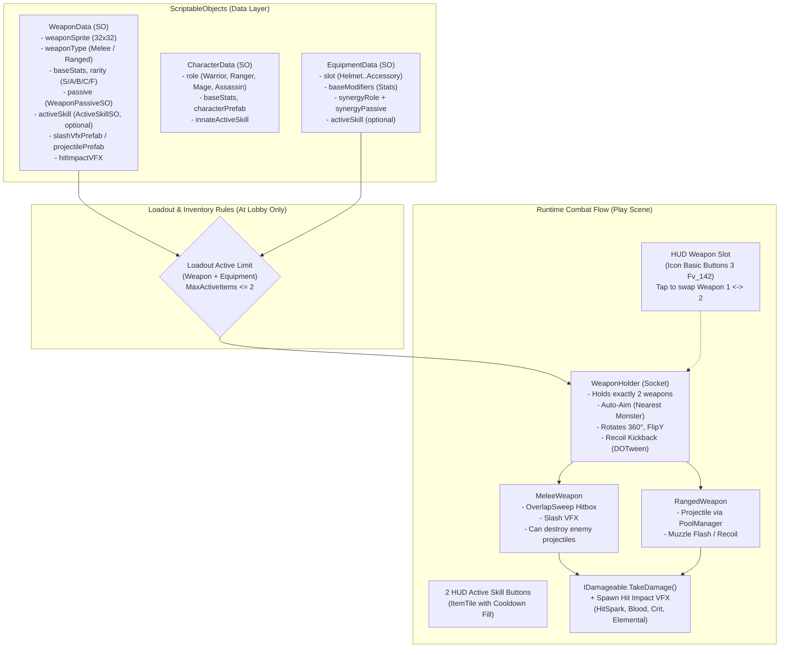
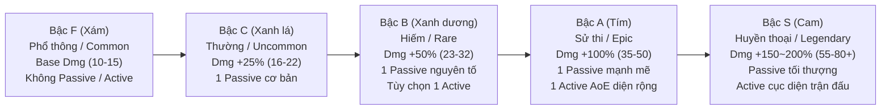

# Hệ Thống Quản Lý Vũ Khí, Hoạt Ảnh (Animation) & Hiệu Ứng (VFX)

> Đồng bộ 100% với tài liệu kiến trúc chính `docs/ARCHITECTURE.md`, quy chuẩn UI Flow, Loadout Rules và kho 101 VFX của dự án **Dungeon Gathering**.

---

## 1. Tổng Quan Kiến Trúc & Phân Định Trách Nhiệm

Hệ thống tuân thủ nghiêm ngặt nguyên tắc **Dữ liệu điều khiển (Data-Driven Architecture)** và phân định rõ ràng giữa Vũ khí và Trang bị:

1. **Vũ khí (`WeaponData` - ScriptableObject)**:
   - Là công cụ chiến đấu cầm trực tiếp trên tay (`MeleeWeapon` hoặc `RangedWeapon`).
   - Giai đoạn đầu tập trung vào **30 thanh kiếm** (`Art/Sprites/Items/Weapon/Sword/File.png`) kết hợp hiệu ứng chém (`VFX/00.png`, `01.png` và bộ `VFX_Melee_*`); giai đoạn mở rộng tích hợp các vũ khí tầm xa từ `Weapons 1..3-Sheet` và `Projectiles`.
   - **Quy tắc kỹ năng vũ khí:**
     - `passive` (`WeaponPassiveSO`): Kỹ năng bị động tự kích hoạt khi đang cầm vũ khí (ví dụ: đòn chém làm chậm 30%, đòn chém hồi mana, chém xuyên giáp).
     - `activeSkill` (`ActiveSkillSO`, tùy chọn): Kỹ năng chủ động bấm trong trận (ví dụ: *Kiếm Băng – Băng Trận, hồi 16s*). Nằm trong quy tắc giới hạn tối đa 2 kỹ năng kích hoạt của Loadout (`LoadoutRules.MaxActiveItems = 2`).
     - **Vũ khí KHÔNG có Role Synergy** (Role Synergy chỉ áp dụng cho hệ thống Trang bị `EquipmentData`).
2. **Trang bị (`EquipmentData` - ScriptableObject)**:
   - Gồm 6 ô mặc trên người: `Helmet`, `Armor`, `Gloves`, `Boots`, `Necklace`, `Accessory` (lấy từ `spritesheet_16x16.png`).
   - Mọi nhân vật mặc vào đều nhận đủ các chỉ số cơ bản (`baseModifiers`).
   - **Kích hoạt Role Synergy:** Nếu nhân vật ĐÚNG Role (`Warrior`, `Ranger`, `Mage`, `Assassin`), kích hoạt thêm `EquipmentPassiveSO` đặc thù; nếu KHÁC Role chỉ nhận chỉ số cơ bản.
3. **Hiệu ứng & Hoạt ảnh (VFX & Animations)**:
   - 101 Prefabs VFX chuẩn trong `Assets/Project/Prefabs/VFX/`.
   - Vòng đời: One-shot VFX tự thu hồi qua `PoolManager` theo thời lượng; Looping VFX gắn theo socket nhân vật/mục tiêu.
   - Hẹn giờ tự thu hồi phải kiểm tra `spawnVersion` (object có thể đã bị trả và lấy lại cho lần dùng khác trước khi hẹn giờ cũ chạy). Looping VFX gắn trên quái phải được gỡ/trả về pool khi quái `Die()` — không để VFX là con của object sắp vào pool. Khi trả về pool: `DOTween.Kill`, dừng `ParticleSystem` + `Clear()`.



---

## 2. Đồng Bộ Với Luồng Giao Diện (UI Flow Integration)

Theo tài liệu kiến trúc mục 1.1 và 5.4:

### 2.1. Quy tắc Thay Đổi Trang Bị & Vũ Khí
* **Chỉ đổi đồ ở Sảnh (Lobby):**
  - Người chơi tiếp cận các nhân vật đứng tự do trong sảnh, bấm vào nhân vật để mở **Panel nhân vật**.
  - Bấm nút **Vũ khí** $\rightarrow$ Mở màn hình Vũ khí (3 cột: Trái = chi tiết vũ khí đang chọn + nút Trang bị/Tháo; Giữa = nhân vật + 2 ô vũ khí chính/phụ; Phải = kho kiếm/vũ khí có bộ lọc Rarity).
  - Bấm nút **Trang bị** $\rightarrow$ Mở màn hình Trang bị (Trái = chi tiết món; Giữa = nhân vật + 6 ô trang bị 3-3; Phải = túi đồ trang bị).
* **Trong Dungeon:**
  - Vật phẩm rơi (vũ khí/trang bị/vàng/mana) tự bay vào túi run (`RunBag`), **hoàn toàn không có popup nhặt đồ làm gián đoạn nhịp chơi**, không thay đổi trang bị khi đang trong trận đấu.
  - Khi hoàn thành run (hạ Boss) hoặc Thua: đồ trong `RunBag` được quy đổi và chuyển vào kho vĩnh viễn ở sảnh.

### 2.2. Hiển Thị Trên HUD
* **1 Ô Vũ Khí Cầm Tay:** Nằm ở cụm điều khiển bên phải HUD (icon `Basic Buttons 3 Fv_142`), chỉ hiển thị ô của vũ khí đang cầm trên tay, bấm vào để đổi qua lại giữa Vũ khí 1 và Vũ khí 2, không hiện tên chữ.
* **2 Nút Kích Hoạt (Active Skill Buttons):** Dùng chính component `ItemTile.prefab`:
  - Hiển thị icon của 2 vật phẩm có kỹ năng chủ động đã trang bị trong Loadout.
  - Hiệu ứng hồi chiêu: Lớp phủ xám `CooldownOverlay` (Radial 360 Fill) kèm số đếm giây hồi chiêu `CooldownText`.
  - Trong trận: `showRarityLetter = false` (chỉ hiển thị viền ô màu Rarity, không hiện chữ cái Rarity).
* **Nút Kỹ Năng Nhân Vật:** Nút bấm riêng biệt dùng kỹ năng bẩm sinh của lớp nhân vật (`CharacterData.activeSkill`).

---

## 3. Hệ Thống Phân Bậc Vũ Khí (Weapon Rarity & Tier System)

Toàn bộ vũ khí (Cận chiến Melee Swords và Tầm xa Ranged Guns / Staves) trong dự án được chuẩn hóa theo **5 bậc độ hiếm (Rarity)**: **F → C → B → A → S**. Màu sắc ô hiển thị trên UI đồng bộ 100% với `ItemTile` (`Basic Buttons 3 Fv`):



### Bảng Chi Tiết Đặc Tính 5 Bậc Vũ Khí
| Bậc (Rarity) | Màu sắc ô UI | Sát thương | Kỹ năng Bị động (`passive`) | Kỹ năng Chủ động (`activeSkill`) | Hiệu ứng VFX đặc trưng | Ví dụ tiêu biểu trong Game |
| :--- | :--- | :--- | :--- | :--- | :--- | :--- |
| **F (Common)** | Xám (`#6b7280`) | $10 \sim 15$ | *Không có* | *Không có* | Tia lửa va chạm nhỏ (`VFX_Impacts_HitSpark`) | Kiếm Sắt (`File_0`), Súng lục khởi đầu (`W1_R00_0`) |
| **C (Uncommon)** | Xanh lá (`#22c55e`) | $16 \sim 22$ | 1 Passive cơ bản (+Knockback, rơi thêm coin) | *Không có* | Vệt chém sắc bén, đạn bay ổn định | Kiếm Gai Rừng (`File_2`), Súng SMG (`W1_R04_0`) |
| **B (Rare)** | Xanh dương (`#3b82f6`)| $23 \sim 32$ | 1 Passive nguyên tố (Làm chậm 30%, Thiêu đốt, Độc) | Tùy chọn 1 Active (Hồi chiêu $16\text{s}$) | Vệt chém nguyên tố, đạn Plasma sáng xanh | Kiếm Băng (`File_9`), Súng Plasma Xanh (`W1_R10_0`), Shotgun bẻ nòng (`W2_R00_0`) |
| **A (Epic)** | Tím (`#a855f7`) | $35 \sim 50$ | 1 Passive mạnh (Sét giật lan 3 quái, nổ lan 2m) | 1 Active uy lực cao (AoE quét phòng) | Bão điện, nổ dung nham, vầng sáng thánh | Kiếm Sấm (`File_10`), Kiếm Lửa (`File_6`), Pháo Plasma Đỏ (`W1_R13_0`), Shotgun hạng nặng (`W2_R01_0`) |
| **S (Legendary)**| Cam (`#f97316`) | $55 \sim 80+$| 1 Passive tối thượng (Hút máu, Phóng kiếm khí xa) | 1 Active thay đổi cục diện (Xé không gian, Mưa tên lửa)| Bùng nổ VFX đồ sộ, ánh sáng rực rỡ nhất | Kiếm Hư Không (`File_19`), Kiếm Hắc Ám (`File_15`), Tên Lửa Hủy Diệt (`W1_R20_0`), Trượng Bão Tố (`W3_R00_0`) |

---

## 4. Quản Lý Hoạt Ảnh Vũ Khí (Weapon Animations)

### 3.1. Cơ Chế Kiếm Cận Chiến (Melee Swords - `File.png`)
* **Dữ liệu nguồn:** 30 thanh kiếm kích thước `32 × 32` px tại `Art/Sprites/Items/Weapon/Sword/File.png`.
* **Cơ chế chém:**
  1. `WeaponHolder` bắt góc ngắm tự động (Auto-Aim) vào kẻ địch gần nhất trong tầm nhìn (không bị tường cản qua Raycast).
  2. Khi tấn công, `WeaponHolder` vung xoay góc cung $90^\circ \sim 120^\circ$ trong thời gian $0.15\text{s}$ bằng `DOTween` (Ease.OutQuad).
  3. Đồng thời kích hoạt Prefab vệt chém (Slash VFX) tương ứng:
     - Kiếm thường / kiếm sắt: `VFX_Melee_SwordCombo`
     - Liễu kiếm / đâm kiếm: `VFX_Melee_SpearThrust`
     - Đại kiếm / rìu: `VFX_Melee_AxeSmear`
  4. Đòn chém tạo hitbox quét `Physics2D.OverlapCircleAll`, gây sát thương lên quái và **có khả năng chém tiêu biến đạn thường của quái vật**.
  5. **Mỗi mục tiêu trúng tối đa một lần mỗi đòn**: `OverlapCircleAll` trả về mọi collider, một quái có thể có nhiều collider (thân + hurtbox). Gom kết quả vào `HashSet<IDamageable>` (bỏ mục tiêu `IsDead`) rồi mới gây sát thương. Đạn quái bị chém gọi `Projectile.Despawn()` (idempotent) — có thể trùng frame với lúc đạn đó trúng Player.
  6. Không vung đòn mới khi đòn trước chưa xong (cooldown `fireRate` + cờ `isSwinging`); tween vung bị `Kill` khi đổi vũ khí, khi Player chết hoặc khi `WeaponHolder` bị tắt.

### 3.2. Cơ Chế Vũ Khí Tầm Xa (Ranged Weapons - `Weapons 1..3-Sheet`)
* **Dữ liệu nguồn:** 48 loại súng và trượng phép (lưới `32 × 32`).
* **Frame `_0`:** Sprite tĩnh hiển thị trên tay và trên icon HUD (`ItemTile`).
* **Frames `_1..N`:** Animation khai hỏa (Recoil & Muzzle Flash):
  - Kích hoạt qua `Animator` trên `WeaponHolder`.
  - Sinh đạn từ điểm nòng súng (`muzzleOffset`):
    - Đạn Plasma Xanh: `Projectile_Plasma_Blue.prefab`
    - Đạn Plasma Đỏ: `Projectile_Plasma_Red.prefab`
    - Đạn Chùm / Mũi tên: `Projectile_Sparks_Blast.prefab`
    - Tên lửa / Rocket: `Projectile_Rocket.prefab`
  - Đạn bay theo vận tốc thẳng `Rigidbody2D.linearVelocity` và tự động trả về `PoolManager` khi va chạm hoặc hết tầm bay — **đúng một lần** dù va chạm và hết giờ trùng frame (cờ `isLive`, xem §6 `Projectile.cs`).
  - Đổi vũ khí (`SwapWeapon`) trong lúc animation khai hỏa đang chạy: hủy lượt bắn đang chờ, không bắn đạn của vũ khí cũ sau khi đã đổi.

---

## 5. Ma Trận Hợp Nhất Vũ Khí & VFX (Weapon-VFX Fusion Matrix)

Bảng phân loại chi tiết cách ghép nối giữa các loại vũ khí và bộ 101 VFX có sẵn trong dự án:

| Tên Vũ Khí / Nhóm | Sprite Nguồn | Loại Vũ Khí | Vệt Chém / Nòng Súng (Swing/Muzzle) | Prefab Đạn (Projectile) | Hiệu Ứng Va Chạm (Hit Impact) | Kỹ Năng Bị Động (`WeaponPassiveSO`) | Kỹ Năng Chủ Động (`ActiveSkillSO`) |
| :--- | :--- | :--- | :--- | :--- | :--- | :--- | :--- |
| **Kiếm Thép Hiệp Sĩ** | `File_0` | Melee | `VFX_Melee_SwordCombo` | *(Không - Hitbox quét)* | `VFX_Impacts_HitSpark` + `BloodSplat` | Tăng 20% lực đẩy lùi (Knockback). | *(Không)* |
| **Kiếm Rỉ Sét Cổ** | `File_1` | Melee | `VFX_Melee_SwordCombo` | *(Không)* | `VFX_Impacts_HitSpark` | Gây xuất huyết nhẹ: 2 sát thương/s trong 3s. | *(Không)* |
| **Kiếm Lửa Địa Ngục** | `File_6` | Melee | `VFX_Melee_SwordCombo` | *(Không)* | `VFX_Fire_FireballImpact` | Đòn chém thiêu đốt quái `VFX_Status_BurningAura`. | **Hỏa Trận:** Phun lửa sàn `VFX_Fire_GroundFlames` (hồi 12s). |
| **Băng Kiếm Hoàng Gia** | `File_9` | Melee | `VFX_Melee_SpearThrust` | *(Không)* | `VFX_Ice_SnowballImpact` | Làm chậm tốc độ chạy quái 30% trong 2s. | **Băng Trận:** Đóng băng quái xung quanh `VFX_Ice_FrostNova` (hồi 16s). |
| **Lôi Kiếm / Kiếm Sấm** | `File_10`| Melee | `VFX_Melee_SwordCombo` | *(Không)* | `VFX_Lightning_StaticBurst` | 20% tỷ lệ phóng điện giật quái kế cận. | **Lôi Giáng:** Gọi sét `VFX_Lightning_LightningStrike` (hồi 14s). |
| **Trọng Rìu Chiến** | `File_12`| Melee | `VFX_Melee_AxeSmear` | *(Không)* | `VFX_Impacts_RockShatter` | Chém xuyên 25% giáp của kẻ địch. | **Bổ Trảm:** Nện đất `VFX_Impacts_GroundSlam` gây choáng 1.5s (hồi 15s). |
| **Kiếm Hắc Ám** | `File_15`| Melee | `VFX_Melee_ShadowClaw` | *(Không)* | `VFX_Shadow_ShadowBolt` | Hút 4% sát thương thành sinh lực `VFX_Shadow_SoulDrain`. | **Bóng Đêm:** Lướt tàng hình `VFX_Arcane_BlinkDash` (hồi 10s). |
| **Súng Plasma Xanh** | `W1_R10_0`| Ranged | Animation nòng `W1_R10` | `Projectile_Plasma_Blue.prefab` | `VFX_Arcane_ArcaneBurst` | Tốc độ bay của đạn tăng 40%. | *(Không)* |
| **Pháo Plasma Đỏ** | `W1_R13_0`| Ranged | Animation nòng `W1_R13` | `Projectile_Plasma_Red.prefab` | `VFX_Explosions_SmallExplosion`| Đạn nổ lan diện rộng bán kính 1.8m. | *(Không)* |
| **Súng Đạn Chùm** | `W2_R00_0`| Ranged | Animation nạp đạn bẻ nòng | `Projectile_Sparks_Blast.prefab` | `VFX_Impacts_CritHit` | Bắn chùm 5 tia đạn, đẩy lùi mạnh cự ly gần. | *(Không)* |
| **Trượng Bão Tố** | `W3_R00_0`| Ranged | Nạp điện đầu gậy `W3_R00` | Sét tức thời (Raycast) | `VFX_Lightning_ChainLightning` | Sét tự động giật lan sang 2 mục tiêu. | **Bão Điện:** Triệu hồi đám mây giông `VFX_Lightning_ThunderCloud` (hồi 18s). |
| **Trượng Thần Thánh** | `W3_R04_0`| Ranged | Tỏa sáng đầu gậy `W3_R04` | Cột ánh sáng thánh | `VFX_Holy_HolySmite` | Tiêu diệt quái hồi 3 Mana. | **Thánh Quang:** Tạo khiên `VFX_Holy_ShieldBubble` và hồi máu `VFX_Holy_HolyHeal` (hồi 20s). |

---

## 6. Quy Chuẩn Cấu Trúc C# (Implementation Contracts)

### 5.1. `WeaponData.cs`
```csharp
using UnityEngine;
using DungeonGathering.Inventory;

namespace DungeonGathering.Combat
{
    public enum WeaponType { Melee, Ranged }

    [CreateAssetMenu(fileName = "NewWeapon", menuName = "Dungeon Gathering/Weapon Data")]
    public class WeaponData : ScriptableObject
    {
        [Header("Thong Tin Co Ban")]
        public string weaponId;
        public string weaponName;
        [TextArea] public string description;
        public WeaponType weaponType = WeaponType.Melee;
        public Rarity rarity = Rarity.C;

        [Header("Hien Thi")]
        public Sprite weaponSprite;                 // Sprite 32x32 hien thi tren tay & ItemTile
        public Vector2 holdOffset = Vector2.zero;
        public Vector2 muzzleOffset = Vector2.right * 0.5f;

        [Header("Chi So Chien Dau")]
        public float damage = 10f;
        public float fireRate = 1.5f;              // So don danh / giay
        public float attackRange = 1.2f;           // Ban kinh chem hoac tam ban
        public float knockback = 5f;
        public float critBonus = 0.05f;            // Ti le chi mang
        public int manaCost = 0;                   // Mana tieu hao moi lan dung

        [Header("Hieu Ung & Dan")]
        public GameObject slashVfxPrefab;          // Vfx chem cho Melee (tu Assets/Project/Prefabs/VFX/Melee/)
        public GameObject projectilePrefab;        // Prefab dan cho Ranged (tu Assets/Project/Prefabs/Projectiles/)
        public GameObject hitImpactVfxPrefab;      // Vfx no khi danh trung quai (HitSpark, Blood, Elemental)

        [Header("Ky Nang Dac Biet")]
        public WeaponPassiveSO passive;            // Bi dong luon kich hoat khi cam vu khi
        public ActiveSkillSO activeSkill;          // Chu dong (tuy chon, tinh vao gioi han 2 Active Skills)
    }
}
```

### 5.2. `WeaponHolder.cs` (Gắn trên Player Prefab)
* Quản lý chính xác 2 slot vũ khí: `WeaponData weapon1`, `WeaponData weapon2`.
* `activeSlotIndex` (0 hoặc 1). Bấm nút ô vũ khí trên HUD sẽ gọi `SwapWeapon()`.
* Bắt mục tiêu tự động (Auto-Aim):
  - Dùng `Physics2D.OverlapCircleAll(transform.position, aimRange, enemyLayer)`.
  - Chọn quái gần nhất có đường nhìn thông suốt (`Physics2D.Raycast` không chạm Layer `Wall`).
  - Xoay nòng vũ khí trỏ về phía quái; nếu không có quái thì trỏ theo hướng di chuyển của Joystick.
  - Tự động lật `SpriteRenderer.flipY = true` khi góc quay hướng về bên trái ($|\text{angle}| > 90^\circ$).

### 5.3. `RangedWeapon.cs` (Logic khai hỏa vũ khí tầm xa)
```csharp
using UnityEngine;

namespace DungeonGathering.Combat
{
    public class RangedWeapon : WeaponBase
    {
        [SerializeField] private Transform muzzlePoint;

        public override void Attack(Vector2 direction)
        {
            if (!CanAttack()) return;

            // 1. Tinh toan goc ban kem do lech (Spread)
            float angle = Mathf.Atan2(direction.y, direction.x) * Mathf.Rad2Deg;
            if (data.spread > 0f)
            {
                angle += Random.Range(-data.spread, data.spread);
            }
            Quaternion rotation = Quaternion.Euler(0f, 0f, angle);

            // 2. Lay dan tu Pool qua PoolManager
            Vector3 spawnPos = muzzlePoint != null ? muzzlePoint.position : transform.position;
            GameObject projGo = PoolManager.Instance.Get(data.projectilePrefab, spawnPos, rotation);
            var projectile = projGo.GetComponent<Projectile>();
            if (projectile != null)
            {
                projectile.Initialize(data.damage, data.projectileSpeed, data.knockback, data.critBonus, data.hitImpactVfxPrefab);
            }

            // 3. Hieu ung dau nong (Muzzle Flash / Smoke)
            if (data.muzzleVfxPrefab != null)
            {
                PoolManager.Instance.Get(data.muzzleVfxPrefab, spawnPos, rotation);
            }

            // 4. Giat lui nong sung (DOTween Recoil)
            ApplyRecoil();
            ResetAttackCooldown();
        }
    }
}
```

### 5.4. `Projectile.cs` (Logic đường đạn bay & va chạm)
```csharp
using UnityEngine;

namespace DungeonGathering.Combat
{
    public class Projectile : MonoBehaviour
    {
        [SerializeField] private Rigidbody2D rb;
        [SerializeField] private float lifetime = 3f;
        private float damage;
        private float knockback;
        private float critBonus;
        private GameObject impactVfx;
        [SerializeField] private LayerMask targetMask;   // layer nhận sát thương (Enemy cho đạn Player, Player cho đạn quái)
        [SerializeField] private LayerMask wallMask;     // layer Wall
        private float damage;
        private float knockback;
        private float critBonus;
        private GameObject impactVfx;
        private float timer;
        private bool isLive;                             // false = đã trúng/hết giờ, đang chờ hoặc đã về pool

        public void Initialize(float dmg, float speed, float kb, float crit, GameObject hitVfx)
        {
            damage = dmg;
            knockback = kb;
            critBonus = crit;
            impactVfx = hitVfx;
            timer = lifetime;
            isLive = true;
            rb.linearVelocity = transform.right * speed;
        }

        private void Update()
        {
            if (!isLive) return;
            timer -= Time.deltaTime;
            if (timer <= 0f) Despawn();
        }

        private void OnTriggerEnter2D(Collider2D col)
        {
            // Cùng một bước vật lý có thể gọi hàm này nhiều lần (trúng 2 quái, quái + tường).
            // Chỉ lần đầu được tính; các lần sau bỏ qua (§7.8 R13 của tài liệu module).
            if (!isLive) return;

            int bit = 1 << col.gameObject.layer;
            if ((targetMask.value & bit) != 0 && col.TryGetComponent<IDamageable>(out var target))
            {
                if (target.IsDead) return;                 // xác quái đang chết: bay xuyên qua
                target.TakeDamage(new DamageInfo(damage, knockback, transform.right, critBonus));
                SpawnImpact();
                Despawn();
            }
            else if ((wallMask.value & bit) != 0)
            {
                SpawnImpact();
                Despawn();
            }
        }

        private void SpawnImpact()
        {
            if (impactVfx != null)
            {
                PoolManager.Instance.Get(impactVfx, transform.position, Quaternion.identity);
            }
        }

        /// Gọi được từ nhiều nơi (va chạm, hết giờ, bị kiếm chém tan, phòng/run kết thúc) — chỉ lần đầu có tác dụng.
        public void Despawn()
        {
            if (!isLive) return;
            isLive = false;
            rb.linearVelocity = Vector2.zero;
            PoolManager.Instance.Return(gameObject);       // Return cũng idempotent (§7.7)
        }
    }
}
```

> Ghi chú: bản cũ dùng `col.CompareTag("Enemy") || col.TryGetComponent(out var target)` — **không compile** (biến `out` chưa được gán khi vế trái đúng) và không có cờ `isLive` nên một viên đạn có thể `Return` 2 lần trong cùng bước vật lý, làm một instance nằm 2 lần trong pool. Ví dụ trên rút gọn, bỏ tham số `owner` của `PoolManager.Get` (§7.7 tài liệu module).

### 5.5. `LoadoutRules.cs` (Kiểm soát giới hạn trang bị)
```csharp
namespace DungeonGathering.Inventory
{
    public static class LoadoutRules
    {
        public const int MaxActiveItems = 2; // Toi da 2 vat pham co ky nang chu dong trong Loadout
        public const int WeaponSlotCount = 2; // 2 o vu khi
        public const int EquipmentSlotCount = 6; // 6 o trang bi (Helmet, Armor, Gloves, Boots, Necklace, Accessory)

        public static bool CanEquipActiveItem(int currentActiveCount)
        {
            return currentActiveCount < MaxActiveItems;
        }
    }
}
```

---

## 7. Lộ Trình Triển Khai Thực Tế

1. **Giai đoạn 1 (C# Foundation):**
   - Tạo các enum và data classes: `CharacterRole.cs`, `EquipmentSlotType.cs`, `WeaponData.cs`, `EquipmentData.cs`, `StatModifier.cs`, `WeaponPassiveSO.cs`, `EquipmentPassiveSO.cs`.
   - Tạo bộ quy tắc kiểm soát `LoadoutRules.cs`.
2. **Giai đoạn 2 (Combat Runtime Components):**
   - Tạo `WeaponHolder.cs`, `WeaponBase.cs`, `MeleeWeapon.cs`, `RangedWeapon.cs`.
   - Tích hợp gọi `PoolManager` để spawn đạn và 101 VFX có sẵn.
3. **Giai đoạn 3 (Prefab & ScriptableObjects):**
   - Tạo `Loot_Weapon_Pickup.prefab` và `Loot_Equipment_Pickup.prefab` (dùng chung cho mọi vật phẩm rơi trong run).
   - Khởi tạo bộ dữ liệu ScriptableObject mẫu cho Kiếm (`File.png`), Súng Plasma (`Weapons-Sheet`) và Trang bị theo từng Role trong `Assets/Project/Data/`.
4. **Giai đoạn 4 (Kết nối UI & HUD):**
   - Kết nối nút đổi vũ khí `Basic Buttons 3 Fv_142` trên HUD.
   - Kết nối 2 nút Kích hoạt kỹ năng dùng `ItemTile.prefab` có hiệu ứng hồi chiêu radial 360 fill.
